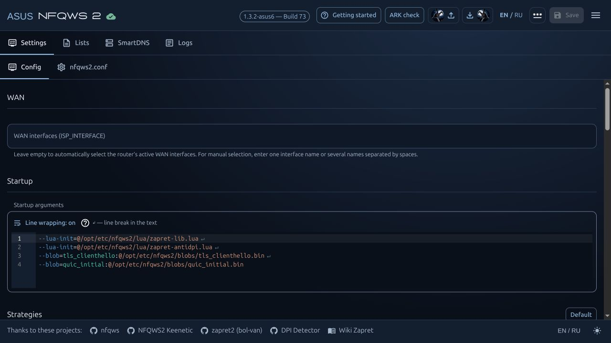

# NFQWS2 ASUS Community

**Set up access to YouTube, Instagram and Discord without a VPN — directly on your router.**

NFQWS2 helps bypass your provider's DPI restrictions. Choose a ready-made strategy,
select devices on your home network and manage processing through a browser.
Your TV, phone or PC does not need a separate NFQWS2 client.

Results depend on your provider's restrictions and a suitable strategy;
test video playback, seeking and voice calls separately.

**This is an application for an installed firmware:** an ASUS package for Asuswrt-Merlin/Entware
or a native OpenWrt package. Installing the application itself does not require flashing your router.

**Free · RU / EN · ASUS/Entware · OpenWrt**

## What you get

| Benefit | How it helps at home |
| --- | --- |
| **Access to services without a VPN** | Find a DPI bypass for YouTube, Instagram, Discord and other services while keeping a direct connection without a VPN tunnel |
| **Browser-based management** | Start, stop, devices, strategies and logs in one panel; everyday setup does not require editing configuration files over SSH |
| **Router-level setup** | Process traffic from your whole home network or only selected devices |
| **Ready-made catalog profiles** | Start with a provider profile or import your own JSON with its lists and required files |
| **DNS for specific sites** | SmartDNS assigns separate DoT/DoH servers or fixed IP addresses to sites |
| **Preview and undo** | See “before / after” before importing; undo the last import, while a trial DNS connection rolls back without confirmation |
| **Diagnostics and updates in the panel** | Check packet delivery, collect error details and install updates with signature and SHA256 verification |

Compared with installing the engine manually, this package already integrates
**NFQWS2, WebUI, Lua, service management and configuration tools**. Traffic processing
methods come from upstream [NFQWS2 / zapret2](https://github.com/bol-van/zapret2);
this package adds router integration and convenient management.

**SmartDNS and DPI Detector are installed separately using panel buttons**, when needed.
A ready-made profile is a starting point: results depend on your provider and chosen services.

## Quick start

### ASUSWRT-Merlin / Entware

Working SSH and Entware in `/opt` are required. Connect to **the router** over SSH and run:

```sh
( nfqws_url=https://raw.githubusercontent.com/madworldpay/nfqws2-asus-community/main/install.sh; nfqws_file=$(mktemp) && trap 'rm -f "$nfqws_file"' 0 && { curl -fL --connect-timeout 10 --max-time 60 "$nfqws_url" -o "$nfqws_file" || wget --https-only -T 20 -t 2 -O "$nfqws_file" "$nfqws_url"; } && sh "$nfqws_file" )
```

**Manual installation:** download the IPK for your architecture and transfer it using WinSCP/SCP
or the USB drive's Samba share. [Manual installation with File Explorer examples](MANUAL-INSTALL.en.md).

### OpenWrt

Entware is not required. Connect to **the OpenWrt router** over SSH as `root` and run:

```sh
( nfqws_url=https://raw.githubusercontent.com/madworldpay/nfqws2-asus-community/main/install.sh; nfqws_file=$(mktemp) && trap 'rm -f "$nfqws_file"' 0 && { curl -fL --connect-timeout 10 --max-time 60 "$nfqws_url" -o "$nfqws_file" || uclient-fetch -T 20 -O "$nfqws_file" "$nfqws_url"; } && sh "$nfqws_file" )
```

**Choose a file manually:** [native OpenWrt packages and installation](OPENWRT.en.md#choose-a-package-manually).

Both installers select and verify the package for their platform, preserving settings
during updates. The installer prints the panel address when finished.

**One-time transition for older builds.** To install the current release and
receive subsequent updates through the panel, rerun the command for your
platform above once. Settings, lists, login credentials and the chosen service
state are preserved. After the transition, use the panel's usual update buttons.

### After installation

1. Open `http://ROUTER_IP:90`. On ASUS, follow the panel's ARK check. If ARK is absent, no preparation is needed.
2. Select devices. Import a cloud profile or your own JSON, review the preview and save the selected contents.
3. If needed, connect DNS through the SmartDNS wizard and confirm the result.
4. Start NFQWS2. Test the required websites, video and voice from a selected device.

After a first install, processing stays off until you configure it.
Updates preserve settings and the previous service state.

<a id="inside-the-panel"></a>

## What the panel looks like

Settings, strategies and service controls in one panel.

[](images/screenshots/panel-overview-en.jpg)

[](SCREENSHOTS.en.md#panel-screenshots)

## Which sites and devices to process

The panel has **two independent choices**: which sites to process and which devices they come from.

| “Mode” | Meaning |
| --- | --- |
| **List** | Process domains in your `user.list` |
| **Auto** | Your list plus domains added automatically to `auto.list` when connection problems are detected; exclusions are respected |
| **All** | Process all traffic matching the settings, except domains in `exclude.list` |

**Auto adds domains to the list; it does not automatically find a working strategy.**
The selected strategy's ports, protocols and filters apply in every mode.

| “Process traffic” | Devices covered |
| --- | --- |
| **All devices** | All clients whose traffic passes through the configured router |
| **Only listed devices** | For example, only the TV and phone whose local IP addresses you added |
| **All except listed devices** | All other clients; added IP addresses are excluded from processing |

**Example:** `List` + **Only listed devices** + the TV's IP address —
the TV gets DPI processing for listed domains; other devices use the network without NFQWS2 processing.

You can enter individual IP addresses or a subnet. Separate addresses with spaces;
reserve IP addresses in DHCP for selected devices. IPv6 is enabled and selected separately.
This selection applies to NFQWS2; SmartDNS is configured separately.

## What about VPN?

**This package does not include a VPN client, VPN server or subscription.**
NFQWS2 applies DPI bypass methods to traffic; it does not create a VPN tunnel
or change your public IP address by itself. It is not an anonymization tool.

Configure a VPN separately through your firmware or another application.
VPN capabilities depend on your firmware and chosen client.

## Limitations and known issues

- **There is no single strategy for every provider and service.** You may need another profile, domain list or DNS; opening a website does not confirm that video playback, seeking or voice works.
- **On some ASUS models, the ARK module interferes with traffic processing.** NFQWS2 may be running while no packets reach the queue. The panel provides a check and preparation with a backup; you may need to disable related ASUS functions and reboot manually.
- **OpenWrt traffic acceleration can bypass NFQUEUE.** Follow the panel's guidance on hardware/software flow offloading.
- **A verified model and a matching architecture are different things.** ASUS/Entware has been tested on GT-BE19000AI and RT-AC87U with the stated firmware; native OpenWrt on RT-AC87U with OpenWrt 24.10. Other combinations depend on package architecture, kernel capabilities and hardware verification status.
- **IPv4/IPv6, HTTPS, QUIC, video and voice need separate checks.** An increasing queue counter confirms packet delivery; test the actual service and speed from your device.

<a id="panel-capabilities"></a>

## More capabilities

<details>
<summary><strong>All panel sections and technical capabilities</strong></summary>

| Feature | What you can do |
| --- | --- |
| Strategies and devices | Select WAN, process all or selected devices, configure IPv6 separately |
| Strategy editor | Highlighting, quote checks, visual line wrapping and restoring default strategies |
| Local JSON and cloud presets | Provider profiles and global strategies; all JSON contents are initially selected, and unwanted parts can be deselected |
| Import preview and undo | Compare “before / after”, transfer required files and undo the last import |
| SmartDNS | Up to **32 DNS servers**, **256 domain → DNS bindings** and **64 fixed answers**; DoT/DoH and custom servers |
| Diagnostics and DPI Detector | Checkup, packet delivery checks, logs and separate network tests from the router |
| Profile sharing | Export individual blocks, lists, blobs and DNS; review and edit the copy to be sent |
| Updates | Install from the panel with signature and SHA256 verification while preserving settings |

The package includes NFQWS2, WebUI, embedded Lua and service utilities.
**SmartDNS and DPI Detector are installed separately using panel buttons**, when needed.
**Getting started** guides you through setup, and **?** explains fields and actions.

</details>

## Updates and profile catalog

The strategy catalog is hosted on ASUS. User-submitted profiles and diagnostics
are received on ASUS and delivered to the project's Gmail inbox; releases
are downloaded from GitHub. These functions do not require a VPS.

Use the current package to import and submit profiles. Strategies already
applied keep working; you can also open your own JSON through
**From computer (JSON)**.

## Share working strategies

If you get good results for YouTube, Instagram, Discord or another service,
**share your profile through “Export / share”**. These reports help improve strategies
and expand the cloud catalog for different providers and regions.

Select the strategy, required lists/blobs and DNS, enter your provider and test result,
then open the preview. **Download JSON** saves a copy for you;
**Send** submits it to the project. Participation is voluntary; submitting a profile
does not publish it in the catalog automatically.

## Verification and support

- Before changing DNS, the wizard checks the profile, offers a trial connection and restores the previous DNS without confirmation.
- Import preview shows what will change. Before sending, you can review the exact contents and edit copies; this leaves your active settings unchanged.
- Each release includes SHA256 checksums and a corresponding source archive.
- Test services from a phone or PC: an increasing queue counter confirms packet delivery, while video playback, seeking and voice require testing the application itself.

If something fails, collect diagnostics through **Export / share**
and describe the steps that led to the error.
Use [Issues](https://github.com/madworldpay/nfqws2-asus-community/issues)
for a reproducible bug report. You can send settings and diagnostics to the developer
after reviewing them in the panel preview.

An independent community port. Packages are free, and participation is voluntary.
Thanks to [NFQWS2 Keenetic](https://github.com/nfqws/nfqws2-keenetic),
[WebUI Keenetic](https://github.com/nfqws/nfqws-keenetic-web),
[zapret2](https://github.com/bol-van/zapret2),
[SmartDNS](https://github.com/pymumu/smartdns) and
[DPI Detector](https://github.com/Runnin4ik/dpi-detector).

Our ASUS adaptation is distributed under [MIT](LICENSE). Third-party components
retain their licenses and attribution.
[Component attribution and licenses](UPSTREAM.en.md) · [Full notices](THIRD-PARTY-NOTICES.txt).

The **Technical channel** at the bottom of the panel provides temporary router
access for diagnostics or configuration after prior arrangements with the
Administrator. Paste the link they provide and connect. A panel password is
required. You can disconnect at any time; access ends at expiry or reboot.
This does not submit a request for permanent or 24/7 support.


## Documentation

Start with your task; each guide contains its main steps on the page itself.

| Task | Guide |
| --- | --- |
| Install or remove | [Quick start](QUICKSTART.en.md) · [Installation and removal](INSTALL.en.md) |
| Choose a file for manual installation | [Packages](DOWNLOADS.en.md) · [IPK installation](MANUAL-INSTALL.en.md) |
| Configure the application | [Panel and devices](USAGE.en.md) · [Import and profile sharing](IMPORT.en.md) |
| Choose a ready-made strategy or DNS | [Profile catalog](PRESETS.en.md) · [SmartDNS](SMARTDNS.en.md) |
| Update the application | [Updates](PACKAGE-UPDATES.en.md) |
| Troubleshoot a problem | [Diagnostics](DIAGNOSTICS.en.md) · [DPI Detector](DPI-DETECTOR.en.md) |
| Check compatibility | [ASUS / Entware](COMPATIBILITY.en.md) · [OpenWrt](OPENWRT.en.md) |
| Share a result | [Contributing](CONTRIBUTING.en.md) |

[Русский](README.md)
