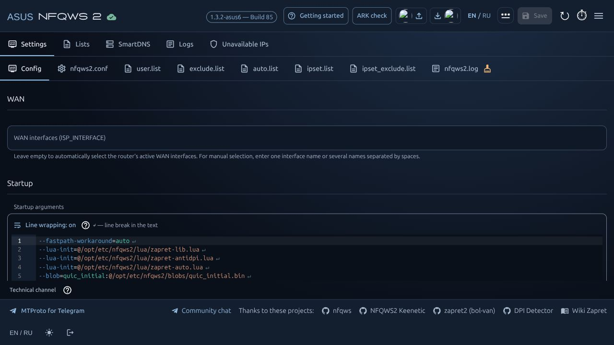

# NFQWS2 ASUS Community

**Set up access to YouTube, Instagram and Discord without a VPN — directly on your router.**

Start with **Import profile**: choose a ready-made cloud strategy, your own JSON
or NFQWS2 text from Keenetic. Review its blocks, lists and blobs in the preview,
save the changes and select home-network devices. NFQWS2 processes traffic on
the router; your TV, phone or PC does not need a separate client.

Results depend on your provider's restrictions and a suitable strategy;
test video playback, seeking and voice calls separately.

**This is an application for an installed firmware:** an ASUS package for Asuswrt-Merlin/Entware
or a native OpenWrt package. Installing the application itself does not require flashing your router.

**Free · RU / EN · ASUS/Entware · OpenWrt**

💬 **[Telegram community chat](https://t.me/nfqws2AsusCommunityChat)** — setup help and strategy discussions.

**Build 91:** [download the release](https://github.com/madworldpay/nfqws2-asus-community/releases/tag/build91) · [change history](CHANGELOG.md). Download original TXT reports from DPI Detector, remove it through a confirmation menu, and keep the SmartDNS editor in sync after imports. Profile import with preview and zapret2 1.0.7 are retained. [Real Detector runs before and after tuning](docs/DETECTOR-COMPARISON.en.md).


## What you get

| Benefit | How it helps at home |
| --- | --- |
| **Import a complete profile** | A provider profile or general strategy from the signed catalog, your JSON and its declared lists/blobs; review contents and dependencies before applying |
| **Keenetic converter** | Paste NFQWS2 text from Keenetic: paths are adapted and missing files are shown before saving |
| **Preview and undo** | See “before / after” before importing; undo the last import, while a trial DNS connection rolls back without confirmation |
| **Access to services without a VPN** | Find a DPI bypass for YouTube, Instagram, Discord and other services while keeping a direct connection without a VPN tunnel |
| **Browser-based management** | Start, stop, devices, strategies and logs in one panel; everyday setup does not require editing configuration files over SSH |
| **Router-level setup** | Process traffic from your whole home network or only selected devices |
| **DNS for specific sites** | SmartDNS assigns separate DoT/DoH servers or fixed IP addresses to sites |
| **Diagnostics and updates in the panel** | Packet and error checks, signed updates; on ASUS, services stop before the backup and installation, then return to their previous state |
| **DPI Detector in the panel** | The original interactive menu, phone controls, help and TXT reports; availability depends on the architecture |
| **Less waiting for unavailable addresses on ASUS** | A confirmed unavailable IP is temporarily excluded, helping applications move to working alternatives when the site provides them |

Compared with installing the engine manually, this package already integrates
**NFQWS2, WebUI, Lua, service management and configuration tools**. Traffic processing
methods come from upstream [NFQWS2 / zapret2](https://github.com/bol-van/zapret2);
this package adds router integration and convenient management.

**SmartDNS and DPI Detector are installed separately using panel buttons**, when needed.
A ready-made profile is a starting point: results depend on your provider and chosen services.

## Quick start

### ASUSWRT-Merlin / Entware

**If Entware is already working in `/opt`, continue with the installation command.**
On a fresh ASUSWRT-Merlin installation, prepare Entware first:

1. Connect a USB drive with a Linux filesystem — normally ext4; ext2/ext3 also work. Save any files you need before formatting the drive.
2. Enable SSH for the local network under **Administration → System**, then connect to the router using your ASUS administrator account.
3. Run `amtm` over SSH, choose `ep` and wait for Entware installation to finish.
4. Press `e`, then Enter, to leave `amtm` and return to the same SSH shell. Check Entware with `/opt/bin/opkg print-architecture`.

### Install with one command

The command is shared by ASUS/Entware and OpenWrt. Paste it into the router’s SSH shell:

```sh
(
  umask 077
  nfqws_dir=/tmp/nfqws2-install.$$
  mkdir "$nfqws_dir" || exit 1
  trap 'rm -rf "$nfqws_dir"' 0
  nfqws_url=https://raw.githubusercontent.com/madworldpay/nfqws2-asus-community/main/install.sh
  { curl -fL --connect-timeout 10 --max-time 60 "$nfqws_url" -o "$nfqws_dir/install.sh" || uclient-fetch -T 20 -O "$nfqws_dir/install.sh" "$nfqws_url"; } &&
  sh "$nfqws_dir/install.sh"
)
```

**Manual ASUS installation:** download the IPK for your architecture and transfer it using WinSCP/SCP
or the USB drive's Samba share. [Manual installation with File Explorer examples](MANUAL-INSTALL.en.md).

### OpenWrt

**OpenWrt uses the same command above.** Connect over SSH as `root`; Entware is not required.

**Choose a file manually:** [native OpenWrt packages and installation](OPENWRT.en.md#choose-a-package-manually).

The installer detects the platform, selects and verifies its package, preserving settings
during updates. The installer prints the panel address when finished.

**One-time transition for older builds.** To install the current release and
receive subsequent updates through the panel, rerun the command for your
platform above once. Settings, lists, login credentials and the chosen service
state are preserved. After the transition, use the panel's usual update buttons.

### After installation

**ASUS panel login:** use your router administrator username and password.
If the panel cannot read the ASUS system credentials, it automatically enables the
fallback login: **username `root`, password `asus`**.
A separate panel password set earlier is preserved during updates; use that password.
Use **Change password** to set your own panel password.

1. Open `http://ROUTER_IP:90` and **Getting started**. On ASUS, follow the panel's ARK check. If ARK is absent, no preparation is needed.
2. Select devices. Import a cloud profile or your own JSON, review the preview and save the selected contents. For NFQWS2 text from Keenetic, use **Import profile → Paste Keenetic strategy**.
3. If needed, connect DNS through the SmartDNS wizard and confirm the result.
4. Start NFQWS2. Test the required websites, video and voice from a selected device.

In Build 88, the **DPI Detector** button at the top opens installation, the original menu and built-in help. Start with tests 1–3 and press **S** to save the result. [Read and compare reports](DPI-DETECTOR.en.md). The [NFQWS2 Keenetic chat](https://t.me/nfqws) can help with selecting Keenetic strategies.

After a first install, processing stays off until you configure it.
Updates preserve settings and the previous service state.

<a id="inside-the-panel"></a>

[A comparison example and how to test your profile](docs/DETECTOR-COMPARISON.en.md): one personal DOM.RU connection, limitations and interpreting Detector results. It is not a profile recommendation for other providers or regions.

### Import: a profile and all required files

**Import profile → From cloud** loads the selected entry from the signed catalog. Review the strategy blocks, lists, blobs and before/after preview. Unneeded parts can be deselected; resolve missing dependencies before applying. Your own JSON uses the same preview, while **Paste Keenetic strategy** converts NFQWS2 text and checks file references. DNS is selected separately and is not enabled automatically.

In Build 88, compatible **general strategies from the signed cloud catalog** offer **Add bypass for torrent tracker websites**, unchecked by default. It adds a separate rule for the HTTPS websites **nnmclub.to, rutracker.org, rutor.info and tapochek.net** on TCP 443 only; the sites and rule are shown in the preview. It does not promise peer/DHT or all BitTorrent traffic. Unsupported settings or incompatible files cause the addition to be rejected. With the checkbox off, the original profile is imported.

A separate **DOM.RU · Tula region profile v4 candidate** includes 14 lists/blobs and a packaged TLS helper requiring **Build 88 or later**. The previous public profile’s DNS is preserved. This candidate is awaiting final traffic checks and is not published; results on one connection do not guarantee success for every DOM.RU subscriber.

## What the panel looks like

Settings, strategies and service controls in one panel. Main actions are at the top; language, theme and links are in the collapsible lower panel. It starts collapsed on phones. In Build 88, short windows, landscape screens and mobile desktop mode retain scrolling through settings and access to the lower panel; browser zoom is allowed.

The [annotated gallery](SCREENSHOTS.en.md) also covers unavailable IPs, scheduled restart and recovery, blobs, Keenetic import, SmartDNS, export and MTProto installation. Screenshots from the previous release may differ from Build 88.

[](images/screenshots/panel-overview-en.jpg)

[](SCREENSHOTS.en.md#panel-screenshots)

## Which sites and devices to process

The panel has **two independent choices**: which sites to process and which devices they come from.

| “Mode” | Meaning |
| --- | --- |
| **List** | Process domains in your `user.list` |
| **Auto** | Your list plus domains added automatically to `auto.list` when connection problems are detected; exclusions are respected |
| **All** | Process all traffic matching the settings, except domains in `exclude.list` |

**Auto adds domains to the list; it does not automatically find a working strategy.**
Mode supplies domain lists to the main TCP and QUIC blocks. Separate UDP blocks, the custom strategy and IP-list processing use their own filters and are not automatically restricted by this choice. The selected ports and protocols still apply.

| “Process traffic” | Devices covered |
| --- | --- |
| **All devices** | All clients whose traffic passes through the configured router |
| **Only listed devices** | For example, only the TV and phone whose local IP addresses you added |
| **All except listed devices** | All other clients; added IP addresses are excluded from processing |

**Example:** `List` + **Only listed devices** + the TV's IP address —
the TV gets DPI processing for listed domains; other devices use the network without NFQWS2 processing.

You can enter individual IP addresses or a subnet. Separate addresses with spaces;
reserve IP addresses in DHCP for selected devices. IPv6 is enabled and selected separately.
This selection applies to NFQWS2; SmartDNS is configured separately.

## What about VPN?

**This package does not include a VPN client, VPN server or subscription.**
NFQWS2 applies DPI bypass methods to traffic; it does not create a VPN tunnel
or change your public IP address by itself. It is not an anonymization tool.

Configure a VPN separately through your firmware or another application.
VPN capabilities depend on your firmware and chosen client.

## Limitations and known issues

- **There is no single strategy for every provider and service.** You may need another profile, domain list or DNS; opening a website does not confirm that video playback, seeking or voice works.
- **On some ASUS models, the ARK module interferes with traffic processing.** NFQWS2 may be running while no packets reach the queue. The panel provides a check and preparation with a backup; you may need to disable related ASUS functions and reboot manually.
- **OpenWrt traffic acceleration can bypass NFQUEUE.** Follow the panel's guidance on hardware/software flow offloading.
- **A verified model and a matching architecture are different things.** ASUS/Entware has been tested on GT-BE19000AI and RT-AC87U with the stated firmware; a community user also confirmed NFQWS operation on RT-AC68U / Merlin 386.14.2. Native OpenWrt has been tested on RT-AC87U with OpenWrt 24.10. Other combinations depend on package architecture, kernel capabilities and hardware verification status.
- **IPv4/IPv6, HTTPS, QUIC, video and voice need separate checks.** An increasing queue counter confirms packet delivery; test the actual service and speed from your device.

<a id="panel-capabilities"></a>

## More capabilities

<details>
<summary><strong>All panel sections and technical capabilities</strong></summary>

| Feature | What you can do |
| --- | --- |
| Strategies and devices | Select WAN, process all or selected devices, configure IPv6 separately |
| Strategy editor | Highlighting, quote checks, visual line wrapping and restoring default strategies |
| Local JSON and cloud presets | Provider profiles and global strategies; all JSON contents are initially selected, and unwanted parts can be deselected |
| Strategy from Keenetic | Paste NFQWS2 text, adapt paths and check missing files before saving — [guide](IMPORT.en.md#a-strategy-from-keenetic) |
| Packet templates (blobs) | Choose another template without replacing the strategy or upload a `.bin` from your device — [guide](USAGE.en.md#packet-templates-blobs) |
| Import preview and undo | Compare “before / after”, transfer required files and undo the last import |
| SmartDNS | Up to **32 DNS servers**, **256 domain → DNS bindings** and **64 fixed answers**; DoT/DoH and custom servers |
| Diagnostics and DPI Detector | Checkup, packet delivery checks and logs; the Build 88 candidate adds the original Detector menu in the panel, TXT reports, help and separate removal |
| Profile sharing | Export individual blocks, lists, blobs and DNS; review and edit the copy to be sent |
| Updates | Signature and SHA256 checks, retained settings; package backups and automatic rollback after a caught failure on ASUS |
| Unavailable IPs (ASUS) | Address list with expiry, recheck and removal; ordinary UDP DNS filtering and fast failure on port 443 |
| Restart and recovery | A ↻ button, a 4/12/24-hour or custom timer, and optional recovery after a crash |
| ARK check (ASUS) | Module checks, preparation with a backup and restoration of changed settings — [guide](DIAGNOSTICS.en.md) |
| MTProto for Telegram | Docker, Entware or Linux installation; generated link, secret, script and Portainer stack — [guide](#telegram-proxy) |
| Technical channel | Temporary Administrator access by invitation, expiry and disconnect — [guide](DIAGNOSTICS.en.md#technical-channel) |

The package includes NFQWS2, WebUI, embedded Lua and service utilities.
**SmartDNS and DPI Detector are installed separately using panel buttons**, when needed.
**Getting started** guides you through setup, and **?** explains fields and actions.

</details>

### Service restart

Use **↻** to restart NFQWS2 or **⏱** to choose 4, 12, 24 hours or a custom interval from 1 to 168 hours. This can help devices with limited RAM. The timer restarts only a running service. **Recover the service** permits up to three recovery attempts after a crash, with 1, 5 and 15-minute delays; a manual start is then required. Both features default to off, and a manually stopped service stays stopped. OpenWrt requires a running system cron service.

### Unavailable IPs on ASUS

The **Unavailable IPs** tab helps reduce stalls when a service provides several addresses and some are unreachable. After independent confirmation, an address is excluded for **24 hours**, or **7 days** after a repeat incident. A single timeout or QUIC failure is insufficient. The feature defaults to on; **Remember unavailable addresses** lets you turn it off.

When an ordinary UDP DNS answer contains working alternatives, the unavailable address is removed. New TCP/UDP connections to its port **443** fail promptly. The list shows remaining time and check results, with actions to recheck, remove an entry or clear the list. Automatic checks restore an address after three successful checks, checking each IP no more often than every 15 minutes in rotation. A manual recheck queues a check. The list is stored in `/opt/etc/nfqws2/ip-health/bans.json`; use the panel to view or clear it.

Excluded devices are unaffected. Restrictions stop taking effect when the worker stops. **TCP DNS, DoH and DoT are not filtered; simultaneous multiple WAN connections are unsupported.** This feature is not yet available on native OpenWrt. A suitable NFQWS2 strategy is still needed.

### Telegram proxy

The **MTProto for Telegram** button at the bottom of the panel prepares installation with Docker, on ASUS with Entware, or on Linux with systemd. Suggested ASUS or AI Board addresses remain editable. A `dd` secret, connection link and command are generated automatically, with copy buttons and a script download. Docker offers a Portainer stack (`compose.yaml`) or a terminal command, both using a pinned [LordArrin image based on Flowseal](https://github.com/LordArrin/tg-ws-proxy-docker) for x86-64 / ARM64. Access away from home requires an externally reachable address and port. The installer reports success after checking a real Telegram response and preserves an existing proxy and NFQWS settings.

Run the command on the selected device. For Portainer choose **Docker → Portainer**, then **Stacks → Add stack → Web editor → Deploy the stack**; choose **Docker → Terminal** for the script. Without Docker, use a free TCP port from 1024–65535 and run as root: ASUS requires Entware, while Linux requires systemd, Python 3.8+ and python3-venv. The installer does not open the firewall; configure port access separately. A link using the router’s local IP works within its network; CGNAT prevents direct incoming access through the provider’s address without an additional solution.

Save the link and configuration before closing the dialog: the panel does not retain the generated key. **Another secret** changes only the proposed installation text. Use the displayed diagnostic command for an installed proxy, and test messages and media in Telegram after installation.

## Updates and profile catalog

**The Build 85 updater on ASUS/Entware** stops services before creating a backup and installing the package. After verification, it restores their previous state; a stopped NFQWS2 stays stopped. On failure, it verifies the old installation before restoring services, or rolls back if package replacement has begun. Power loss and a direct opkg command require separate checks — [update and recovery details](PACKAGE-UPDATES.en.md).

The strategy catalog is hosted on ASUS. User-submitted profiles and diagnostics
are received on ASUS and delivered to the project's Gmail inbox; releases
are downloaded from GitHub. These functions do not require a VPS.

Use the current package to import and submit profiles. Strategies already
applied keep working; you can also open your own JSON through
**From computer (JSON)**.

## Share working strategies

If you get good results for YouTube, Instagram, Discord or another service,
**share your profile through “Export / share”**. These reports help improve strategies
and expand the cloud catalog for different providers and regions.

Select the strategy, required lists/blobs and DNS, enter your provider and test result,
then open the preview. **Download JSON** saves a copy for you;
**Send to developer** submits it to the project. JSON download needs no submission channel; hover over or tap **Preview** to see missing fields. If delivery confirmation is lost, a fresh preview prepares another attempt, which may create a duplicate. Participation is voluntary; submitting a profile
does not publish it in the catalog automatically.

## Verification and support

- Before changing DNS, the wizard checks the profile, offers a trial connection and restores the previous DNS without confirmation.
- Import preview shows what will change. Before sending, you can review the exact contents and edit copies; this leaves your active settings unchanged.
- Each release includes SHA256 checksums and a corresponding source archive.
- Test services from a phone or PC: an increasing queue counter confirms packet delivery, while video playback, seeking and voice require testing the application itself.

If something fails, collect diagnostics through **Export / share**
and describe the steps that led to the error.
Use [Issues](https://github.com/madworldpay/nfqws2-asus-community/issues)
for a reproducible bug report. You can send settings and diagnostics to the developer
after reviewing them in the panel preview.

An independent community port. Packages are free, and participation is voluntary.

## Credits

Thanks to the authors of the projects behind this adaptation and its additional features:

- [NFQWS2 Keenetic](https://github.com/nfqws/nfqws2-keenetic) and [WebUI Keenetic](https://github.com/nfqws/nfqws-keenetic-web) — the foundations of the port and web interface.
- [zapret2 — bol-van](https://github.com/bol-van/zapret2) — the nfqws2 engine and Lua bypass mechanisms.
- [Anonym-tsk/zapret2](https://github.com/Anonym-tsk/zapret2/tree/tls-reasm-fastpath) — TLS fastpath changes adapted in the builds.
- [DPI Detector — Runnin4ik](https://github.com/Runnin4ik/dpi-detector) — an independent tool for connectivity and DNS diagnostics.
- [SmartDNS — pymumu](https://github.com/pymumu/smartdns) — the DNS resolver.
- [tg-ws-proxy — Flowseal](https://github.com/Flowseal/tg-ws-proxy) and [LordArrin's Docker build](https://github.com/LordArrin/tg-ws-proxy-docker) — the basis of the Telegram proxy installation.

Our bypass research also draws on materials and tools from
[blockcheckw](https://github.com/rcd27/blockcheckw),
[b4](https://github.com/DanielLavrushin/b4) and
[Flowseal/zapret-discord-youtube](https://github.com/Flowseal/zapret-discord-youtube).
These references do not mean that every feature of those projects is included in this package.

Our ASUS adaptation is distributed under [MIT](LICENSE). Third-party components
retain their licenses and attribution.
[Component attribution and licenses](UPSTREAM.en.md) · [Full notices](THIRD-PARTY-NOTICES.txt).

The **Technical channel** at the bottom of the panel provides temporary router
access for diagnostics or configuration after prior arrangements with the
Administrator. Paste the link they provide and connect. A panel password is
required. You can disconnect at any time; access ends at expiry or reboot.
The channel lets the Administrator run commands as root. Its expiry is set by the invitation and reconnection does not extend it. Disconnecting ends access; completed configuration changes remain. This does not submit a request for permanent or 24/7 support.

## Documentation

Start with your task; each guide contains its main steps on the page itself.

| Task | Guide |
| --- | --- |
| Install or remove | [Quick start](QUICKSTART.en.md) · [Installation and removal](INSTALL.en.md) |
| Choose a file for manual installation | [Packages](DOWNLOADS.en.md) · [IPK installation](MANUAL-INSTALL.en.md) |
| Configure the application | [Panel and devices](USAGE.en.md) · [Import and profile sharing](IMPORT.en.md) |
| Choose a ready-made strategy or DNS | [Profile catalog](PRESETS.en.md) · [SmartDNS](SMARTDNS.en.md) |
| Update the application | [Updates](PACKAGE-UPDATES.en.md) |
| Troubleshoot a problem | [Diagnostics](DIAGNOSTICS.en.md) · [DPI Detector](DPI-DETECTOR.en.md) |
| Check compatibility | [ASUS / Entware](COMPATIBILITY.en.md) · [OpenWrt](OPENWRT.en.md) |
| Share a result | [Contributing](CONTRIBUTING.en.md) |

[Русский](README.md)
