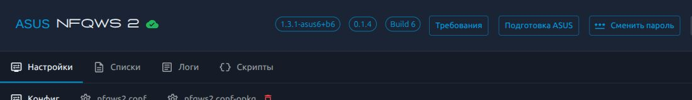

# nfqws2-asus community

  

Хочется понимать, как роутер обрабатывает трафик, и настраивать его без вечера с десятком открытых терминалов. Этот порт собирает **NFQWS2, Lua, списки и веб-панель в один бесплатный Entware-пакет** для ASUS и Asuswrt-Merlin — для изучения сетевых технологий, настройки и диагностики собственного оборудования.

Пакеты для ARMv7 и AArch64 рассчитаны на широкий круг современных ASUS с Entware. У отдельных моделей и прошивок возможны исключения: фактическая работа зависит ещё от ядра и пути обработки трафика. [Проверенные модели и условия](COMPATIBILITY.md) отмечаем отдельно.

Проект ещё экспериментальный. Самая интересная часть работы сейчас — разобраться, что происходит между запущенным движком и настоящим клиентским трафиком. Поэтому здесь есть проверка очереди и диагностика: надпись «служба работает» сама по себе мало о чём говорит.

## Почему community

ASUS бывает непростой платформой для таких задач. В похожих роутерах могут отличаться ядро, фирменные компоненты и пути обработки трафика; ARK и ускорение добавляют свои особенности. Поэтому мало увидеть запущенную службу — нужно понять, доходят ли до неё пакеты. Технический снимок состояния помогает разбирать конкретную ситуацию и делать подсказки точнее.

У проекта большой потенциал именно благодаря общему опыту. Добровольно отправленные диагностические отчёты дают материал для статистики: помогают сопоставлять поведение разных роутеров и прошивок, замечать повторяющиеся проблемы с ARK и очередью, точнее выбирать следующие проверки. Даже отчёт о неудаче полезен: он помогает понять, где искать причину и какие условия ещё нужно проверить.

Следующий шаг — **обмен рабочими стратегиями**. Хотим собирать примеры с понятным контекстом: какой сервис работает, у какого оператора, в каком регионе и с какими параметрами. Тогда следующему человеку будет проще найти подходящий вариант и проверить его у себя. Эта функция пока в планах.

Чем больше будет реальных проверок и обратной связи, тем точнее станут рекомендации и тем больше моделей мы сможем проверить. Участие в community добровольное: сначала пользователь видит, чем делится, затем сам решает отправить.

## Уже можно попробовать

- Менять стратегии и списки, выбирать устройства для обработки, управлять службой из браузера.
- Проверять состояние ARK и поступление пакетов в NFQUEUE.
- Подготовить настройки ARK с резервной копией и последующим восстановлением.
- Собрать диагностический JSON, посмотреть его целиком и сохранить на компьютер.
- По своему решению отправить просмотренный отчёт в поддержку, если отправка настроена оператором.
- Отдельно установить DPI Detector, выбрать сетевые проверки и посмотреть результаты в панели. Готовый результат можно добровольно приложить к диагностике.

Отчёт не уходит автоматически. В него не включаются пароли, ключи, IP/MAC-адреса, содержимое конфигов, списков и сырых журналов. Недоступные данные остаются отмеченными как недоступные — программа не придумывает ответ за роутер.

## С чего начать

Работайте с оборудованием, которым вправе управлять, и сохраните настройки перед установкой. Проект предоставляется «как есть»; особенности прошивки и выбранные параметры имеют значение. Короткая [памятка по использованию](USAGE.md).

1. Посмотреть [совместимость](COMPATIBILITY.md) и определить основной ABI Entware.
2. Выбрать [подходящий IPK](DOWNLOADS.md) и сверить его с `SHA256SUMS`.
3. Пройти [установку](INSTALL.md), открыть адрес своего ASUS на порту **90** и проверить настройки.
4. Создать новое соединение с выбранного LAN-клиента и проверить рост очереди.

Один IPK содержит core и WebUI. ARMv7-пакет включает runtime для `armv7-2.6` и `armv7-3.2`; AArch64 выпускается отдельно для `aarch64-3.10`. **MIPS не поддерживается.** Зависимости PHP и системных библиотек устанавливает `opkg` из Entware.

Если ядро не поддерживает NFQUEUE, служба остановится на предварительной проверке, до подключения правил к трафику. Пакет не перепрошивает роутер и не меняет ARK автоматически. Как проходит проверка и как удалить пакет — в [инструкции](INSTALL.md#если-ядро-не-поддерживает-nfqueue). Для удаления достаточно `/opt/bin/opkg remove nfqws2-asus`; настройки ARK, если вы меняли их отдельно, восстанавливаются отдельно.

## Что важно знать про ARK

На испытанной Merlin работа NFQUEUE зависела от состояния ARK. Проверенный режим — ASUS загрузился без этого модуля. Простая остановка ARK после загрузки не равнозначна такому состоянию.

Пакет не прошивает роутер и не заменяет ядро или модули. Подготовка ARK выполняется отдельной явной кнопкой; перед изменениями сохраняется резервная копия. Для применения может потребоваться ручная перезагрузка через штатную панель ASUS. Отключаемые функции перестанут выполнять свои задачи.

## Если что-то не работает

Не спешите перезагружать роутер: вместе с отказом можно потерять и подсказку о его причине. Откройте **«Подготовка ASUS» → «Собрать диагностику»** и во время сбора повторите проблемный запрос с выбранного устройства.

[Что входит в отчёт и как его читать](DIAGNOSTICS.md). Если сама панель недоступна, её кнопка помочь не сможет — сохраните симптомы и сведения о модели/прошивке отдельно.

## Куда хочется двигаться

В Build 7 появился **[DPI Detector](DPI-DETECTOR.md)**: необязательная установка, все семь групп проверок, остановка и результаты прямо в панели. Это ещё один способ понять поведение сети с самого роутера. Для письма с диагностикой можно отдельно выбрать готовый результат, целиком посмотреть оба файла и только затем решить, отправлять ли их. Автоматической отправки нет.

Ещё одно направление — обмен стратегиями обработки для конкретного сервиса: какие параметры помогли, у какого оператора и в каком регионе. **Кнопки отправки стратегий пока нет.**

Также продолжается изучение других семейств ASUS. Разбор образа прошивки помогает найти ограничения, но аппаратную проверку не заменяет. [Планы и границы обещаний](ROADMAP.md).

## Бесплатно, с добровольной поддержкой

Пакеты и возможности проекта остаются бесплатными. Диагностика и участие в community доступны независимо от донатов.

Если проект пригодился, в будущем можно будет **«Оставить на соджу 🍶»** — поддержать разработку и тестирование. Способ приёма поддержки ещё выбирается; платёжных ссылок пока нет. Это добровольный вклад без обязательной подписки и обещаний определённого результата.

## Откуда всё выросло

Спасибо авторам [nfqws2-keenetic](https://github.com/nfqws/nfqws2-keenetic), [nfqws-keenetic-web](https://github.com/nfqws/nfqws-keenetic-web), [zapret2](https://github.com/bol-van/zapret2) и [DPI Detector](https://github.com/Runnin4ik/dpi-detector). Здесь адаптируются установка, служба, интерфейс и диагностика ASUS; бинарник движка и upstream Lua не переписываются.

Это самостоятельный порт, без официальной связи с ASUS, Entware или авторами upstream. Авторство и лицензии сохранены: [LICENSE](LICENSE), [UPSTREAM.md](UPSTREAM.md).

В этой первой частной выкладке [исходники приложены отдельным архивом](nfqws2-asus-source-b11.zip); личные настройки, журналы и резервные копии устройств в него не входят. Изменения перечислены в [CHANGELOG](CHANGELOG.md).

## Обновляться стало проще

В Build 11 плашки версий открывают окно обновления. Если есть новый выпуск,
соответствующая плашка становится оранжевой. Сначала панель готовит пакет и
резервную копию, затем вы подтверждаете установку. Настройки и списки
сохраняются; остановленная вами служба сама не включается.

Пока проект приватный, подписанные пакеты доставляет закрытый канал на VPS.
GitHub хранит исходники и IPK; пароль GitHub роутеру не нужен. Подробнее —
[обновление пакета](PACKAGE-UPDATES.md).

DPI Detector теперь сохраняет штатные настройки и наглядные результаты
оригинала. Можно выбрать группы тестов, изменить параметры и цели перед
запуском, а результат при желании приложить к диагностике после просмотра.
