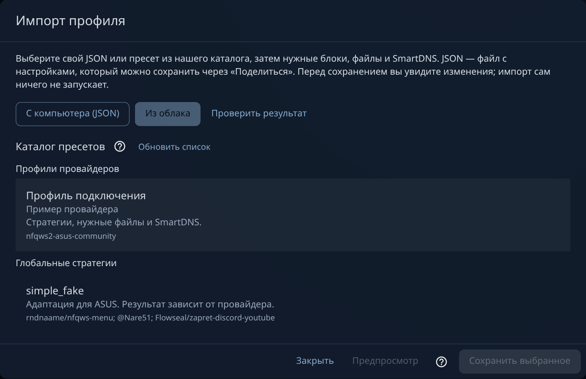
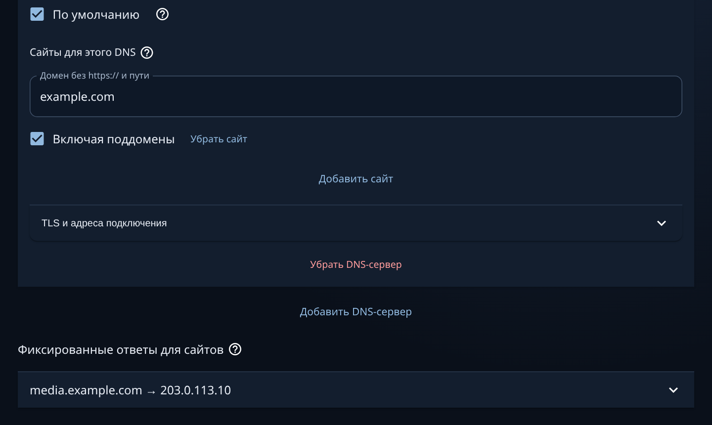
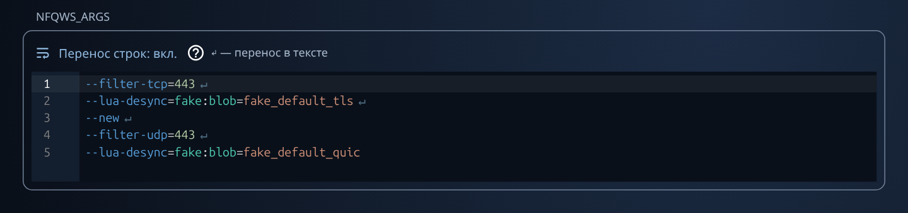

# NFQWS2 ASUS Community

NFQWS2 с веб-панелью для ASUS: стратегии, устройства, SmartDNS и обмен профилями.

**Build 68 · RU / EN · две архитектуры Entware**

[Установить](QUICKSTART.md) · [Скачать IPK](DOWNLOADS.md) · [Совместимость](COMPATIBILITY.md) · [Что нового](CHANGELOG.md)

Проверенные модели: **GT-BE19000AI** и **RT-AC87U**.

## Быстрый старт

Для готовой Entware: войдите по SSH **в роутер** и вставьте одну команду.

```sh
( nfqws_url=https://raw.githubusercontent.com/madworldpay/nfqws2-asus-community/main/install.sh; nfqws_file=$(mktemp) && trap 'rm -f "$nfqws_file"' 0 && { curl -fL --connect-timeout 10 --max-time 60 "$nfqws_url" -o "$nfqws_file" || wget --https-only -T 20 -t 2 -O "$nfqws_file" "$nfqws_url"; } && sh "$nfqws_file" )
```

Установщик сам выберет актуальный IPK и проверит SHA256. Настройки сохраняются.
[Ручная установка IPK](MANUAL-INSTALL.md).

1. Откройте `http://IP-роутера:90` с данными администратора ASUS.
2. Нажмите **«Проверка ARK»**: этот модуль может мешать NFQWS2. Если нужна подготовка, выполните подсказки панели и сохраните бэкап настроек.
3. Выберите WAN, устройства и стратегию либо импортируйте свой JSON или пресет из облака. Сохраните.
4. Настройте **SmartDNS**: выберите DoT/DoH для нужных сайтов или импортируйте DNS вместе со стратегией.
5. Запустите NFQWS2 и проверьте сервисы с выбранного устройства.

[Команды и порядок действий](QUICKSTART.md) · [Совместимость](COMPATIBILITY.md) · [Установка](INSTALL.md).

## Что важно

- Один IPK содержит движок, WebUI, встроенные Lua и служебные утилиты. Обновления доступны кнопкой из GitHub.
- **SmartDNS — отдельная утилита, которую устанавливает и настраивает наша панель.** Она даёт ASUS выбор DNS для отдельных сайтов и закрепление IP: до **32 DNS**, **256 привязок «домен → DNS»** и **64 фиксированных ответов**. [Зачем это нужно и как настроить](SMARTDNS.md).
- **Каталог пресетов в облаке:** профили провайдеров и глобальные стратегии доступны прямо в импорте. Свой JSON можно открыть с компьютера. [Как выбрать](PRESETS.md).
- Импорт и экспорт выборочные: можно передать одну стратегию, один файл или один DNS с сайтами. [Как это работает](IMPORT.md).
- Рост счётчика очереди подтверждает поступление пакетов. Сайт, видео и голос проверяйте с клиента.

Оба языка — **RU / EN** — входят в каждый IPK. «Кроличья нора» включается при первом открытии; обычная светлая и тёмная темы доступны в меню.

**«С чего начать»** показывает этапы настройки. Значок **«?»** объясняет поле или действие.

## Внутри панели

<table>
<tr><th>Пресеты из облака или свой JSON</th><th>DNS для выбранных сайтов</th></tr>
<tr><td><a href="IMPORT.md"></a></td><td><a href="SMARTDNS.md"></a></td></tr>
</table>

**Редактор стратегий:** подсветка, проверка кавычек и различимые переносы строк.



Тема «Кроличья нора». На скриншотах — демонстрационные данные.

[Использование](USAGE.md) · [Диагностика](DIAGNOSTICS.md) · [DPI Detector](DPI-DETECTOR.md) · [Обновление](PACKAGE-UPDATES.md) · [Изменения](CHANGELOG.md).

Самостоятельный community-порт. Пакеты бесплатные, участие добровольное.
Спасибо [NFQWS2 Keenetic](https://github.com/nfqws/nfqws2-keenetic),
[WebUI Keenetic](https://github.com/nfqws/nfqws-keenetic-web),
[zapret2](https://github.com/bol-van/zapret2),
[SmartDNS](https://github.com/pymumu/smartdns) и
[DPI Detector](https://github.com/Runnin4ik/dpi-detector).
[Авторство и лицензии](UPSTREAM.md) · [LICENSE](LICENSE) · [Исходники](source/).
