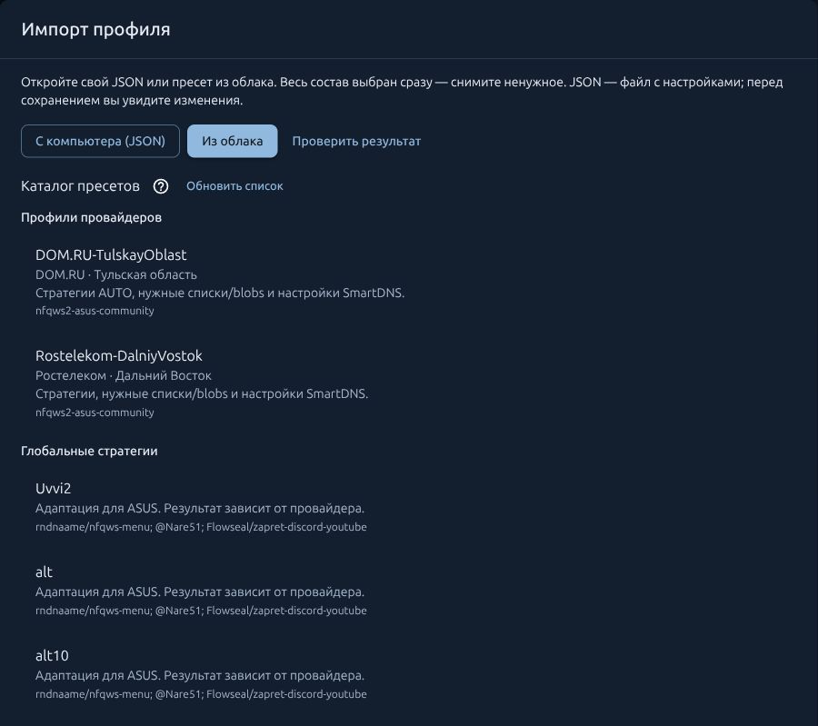

# NFQWS2 ASUS Community

**Настройте доступ к YouTube, Instagram и Discord без VPN — прямо на роутере.**

NFQWS2 помогает обходить DPI-блокировки провайдера. Выберите готовую стратегию,
укажите устройства домашней сети и управляйте обработкой через браузер.
На телевизоре, телефоне или ПК отдельный клиент NFQWS2 не нужен.

Результат зависит от блокировок вашего провайдера и подходящей стратегии;
работу видео, перемотки и голосовых звонков проверяйте отдельно.

**Это приложение для установленной прошивки:** пакет для ASUS с Asuswrt-Merlin/Entware
или нативный пакет для OpenWrt. Прошивать роутер ради установки самого пакета не требуется.

**Бесплатно · RU / EN · ASUS/Entware · OpenWrt**


## Что вы получаете

| Плюс | Чем полезен дома |
| --- | --- |
| **Доступ к сервисам без VPN** | Можно подобрать обход DPI для YouTube, Instagram, Discord и других сервисов, сохранив прямое подключение без VPN-туннеля |
| **Управление через браузер** | Запуск, остановка, устройства, стратегии и логи собраны в одной панели; для повседневной настройки не нужно редактировать конфиги по SSH |
| **Настройка на роутере** | Можно обрабатывать трафик всей домашней сети или только выбранных устройств |
| **Готовые профили из каталога** | Можно начать с профиля провайдера или импортировать свой JSON вместе со списками и нужными файлами |
| **DNS для конкретных сайтов** | SmartDNS позволяет назначать сайтам отдельные DoT/DoH-серверы или фиксированные IP |
| **Предпросмотр и возврат изменений** | До импорта видно «было / станет»; последний импорт можно отменить, а пробное подключение DNS откатывается без подтверждения |
| **Диагностика и обновления в панели** | Можно проверить поступление пакетов, собрать сведения об ошибке и установить обновление с проверкой подписи и SHA256 |

В сравнении с ручной установкой движка здесь уже объединены **NFQWS2, WebUI, Lua,
управление службой и средства настройки**. Методы обработки основаны на upstream
[NFQWS2 / zapret2](https://github.com/bol-van/zapret2); преимущества этой сборки —
интеграция с роутером и удобство управления.

**SmartDNS и DPI Detector устанавливаются отдельно кнопками панели**, когда нужны.
Готовый профиль — отправная точка: результат зависит от провайдера и выбранных сервисов.

## Быстрый старт

### ASUSWRT-Merlin / Entware

Нужны работающие SSH и Entware в `/opt`. Войдите по SSH **в роутер** и выполните:

```sh
( nfqws_url=https://raw.githubusercontent.com/madworldpay/nfqws2-asus-community/main/install.sh; nfqws_file=$(mktemp) && trap 'rm -f "$nfqws_file"' 0 && { curl -fL --connect-timeout 10 --max-time 60 "$nfqws_url" -o "$nfqws_file" || wget --https-only -T 20 -t 2 -O "$nfqws_file" "$nfqws_url"; } && sh "$nfqws_file" )
```

### OpenWrt

Entware не требуется. Войдите по SSH **в роутер с OpenWrt** от `root` и выполните:

```sh
( nfqws_url=https://raw.githubusercontent.com/madworldpay/nfqws2-asus-community/main/install.sh; nfqws_file=$(mktemp) && trap 'rm -f "$nfqws_file"' 0 && { curl -fL --connect-timeout 10 --max-time 60 "$nfqws_url" -o "$nfqws_file" || uclient-fetch -T 20 -O "$nfqws_file" "$nfqws_url"; } && sh "$nfqws_file" )
```

Оба установщика выбирают пакет для своей платформы, проверяют его и сохраняют
настройки при обновлении. В конце появится адрес панели.

### После установки

1. Откройте `http://IP-роутера:90`. На ASUS выполните проверку ARK по подсказкам панели. Если ARK отсутствует, подготовка не нужна.
2. Выберите устройства. Импортируйте профиль из облака или свой JSON, проверьте предпросмотр и сохраните выбранное.
3. При необходимости подключите DNS через мастер SmartDNS и подтвердите результат.
4. Запустите NFQWS2. Проверьте нужные сайты, видео и голос с выбранного устройства.

При первой установке обработка выключена до настройки.
При обновлении сохраняются настройки и прежнее состояние службы.

<a id="внутри-панели"></a>

## Как выглядит панель

**Каталог профилей — выберите готовую стратегию для своего подключения.**

[](images/cloud-catalog.jpg)

| Импорт: свой JSON или профиль из каталога | SmartDNS: отдельный DNS для нужных сайтов |
| --- | --- |
| [](images/import-cloud.png) | [](images/smartdns.png) |

<details>
<summary><strong>Ещё скриншот: редактор стратегий</strong></summary>

Подсветка, проверка кавычек и различимые переносы строк помогают редактировать стратегию.

[](images/strategy-editor.png)

</details>

Нажмите на скриншот, чтобы открыть его в полном размере.

## Какие сайты и устройства обрабатывать

В панели это **два независимых выбора**: какие сайты обрабатывать и с каких устройств.

| «Режим работы» | Что означает |
| --- | --- |
| **List** | Обработка доменов из вашего списка `user.list` |
| **Auto** | Ваш список плюс автоматическое добавление доменов в `auto.list` при обнаружении проблем с соединением; исключения учитываются |
| **All** | Обработка всего подходящего под настройки трафика, кроме доменов из `exclude.list` |

**Auto пополняет список доменов, а не подбирает рабочую стратегию автоматически.**
Во всех режимах действуют порты, протоколы и фильтры выбранной стратегии.

| «Обрабатывать трафик» | Для каких устройств |
| --- | --- |
| **Всех устройств** | Для всех клиентов, чей трафик проходит через настроенный роутер |
| **Только указанных устройств** | Например, только для телевизора и телефона с добавленными локальными IP |
| **Всех, кроме указанных устройств** | Для всех остальных; добавленные IP исключаются из обработки |

**Пример:** `List` + **«Только указанных устройств»** + IP телевизора —
обход применяется к доменам из списка на телевизоре; остальные устройства работают без обработки NFQWS2.

Можно указать отдельные IP или подсеть. Адреса разделяются пробелами;
для выбранных устройств лучше закрепить IP в DHCP. IPv6 включается и выбирается отдельно.
Этот выбор относится к NFQWS2; SmartDNS настраивается отдельно.

## А где VPN?

**Встроенного VPN-клиента, VPN-сервера или подписки в этом пакете нет.**
NFQWS2 применяет методы обхода DPI к трафику; он не создаёт VPN-туннель
и сам по себе не меняет ваш внешний IP. Это также не средство анонимизации.

VPN настраивается отдельно средствами прошивки или другим приложением.
Возможности VPN определяются вашей прошивкой и выбранным клиентом.

## Ограничения и известные проблемы

- **Нет одной стратегии для всех провайдеров и сервисов.** Может потребоваться другой профиль, список доменов или DNS; открытие сайта ещё не подтверждает работу видео, перемотки и голоса.
- **На некоторых ASUS модуль ARK мешает обработке трафика.** Процесс NFQWS2 может быть запущен, а пакеты в очередь не поступать. Панель показывает проверку и подготовку с резервной копией; может потребоваться отключение связанных функций ASUS и ручная перезагрузка.
- **В OpenWrt ускорение трафика может обходить NFQUEUE.** Проверяйте hardware/software flow offloading по подсказкам панели.
- **Проверенная модель и подходящая архитектура — разные вещи.** ASUS/Entware испытан на GT-BE19000AI и RT-AC87U с указанными прошивками; нативный OpenWrt — на RT-AC87U с OpenWrt 24.10. Для остальных связок важны архитектура пакетов, возможности ядра и статус аппаратной проверки.
- **IPv4/IPv6, HTTPS, QUIC, видео и голос требуют отдельных проверок.** Рост очереди подтверждает поступление пакетов, а результат конкретного сервиса и скорость нужно проверять с вашего устройства.


<a id="что-умеет-панель"></a>

## Возможности подробнее

<details>
<summary><strong>Все разделы панели и технические возможности</strong></summary>

| Возможность | Что получает пользователь |
| --- | --- |
| Стратегии и устройства | Выбор WAN, обработка всех или выбранных устройств, отдельные настройки IPv6 |
| Редактор стратегий | Подсветка, проверка кавычек, визуальный перенос строк и возврат к штатным стратегиям |
| Свой JSON и пресеты из облака | Профили провайдеров и глобальные стратегии; весь состав JSON выбран сразу, ненужное можно отключить |
| Предпросмотр и отмена импорта | Сравнение «было / станет», перенос нужных файлов и возврат последнего импорта |
| SmartDNS | До **32 DNS**, **256 привязок «домен → DNS»** и **64 фиксированных ответов**; DoT/DoH и свой сервер |
| Диагностика и DPI Detector | Чекап, проверка поступления пакетов, логи и отдельные сетевые тесты с роутера |
| Обмен профилями | Экспорт отдельных блоков, списков, blobs и DNS; просмотр и правка отправляемой копии |
| Обновления | Установка из панели с проверкой подписи, SHA256 и сохранением настроек |

Пакет содержит NFQWS2, WebUI, встроенные Lua и служебные утилиты.
**SmartDNS и DPI Detector устанавливаются отдельно кнопками панели**, когда нужны.
**«С чего начать»** ведёт по настройке, а **«?»** объясняет поля и действия.

</details>

## Обновления и каталог профилей

> **Каталог стратегий перенесён на новый источник.** Для импорта и отправки профилей используйте актуальный пакет. Уже применённые стратегии продолжают работать; свой JSON также можно открыть через «С компьютера (JSON)».

## Делитесь рабочими стратегиями

Получили хороший результат для YouTube, Instagram, Discord или другого сервиса —
**поделитесь профилем через «Экспорт / поделиться»**. Такие отчёты помогают улучшать стратегии
и пополнять облачный каталог для разных провайдеров и регионов.

Выберите стратегию, нужные списки/blobs и DNS, укажите провайдера и результат
проверки, затем откройте предпросмотр. **«Скачать JSON»** сохраняет копию вам,
**«Отправить»** передаёт её проекту. Участие добровольное; отправка не публикует
профиль в каталоге автоматически.

## Как устроены проверка и поддержка

- Перед изменением DNS мастер проверяет профиль, предлагает пробное подключение и возвращает прежний DNS без подтверждения.
- При импорте видно, что изменится. При отправке можно проверить точный состав и отредактировать копии; рабочие настройки от этого не меняются.
- Вместе с каждым выпуском опубликованы SHA256 и архив соответствующих исходников.
- Работа сервиса проверяется с телефона или ПК: рост очереди подтверждает поступление пакетов, а видео, перемотка и голос требуют проверки самого приложения.

Если что-то не получилось, соберите диагностику через **«Экспорт / поделиться»**
и опишите, какие действия привели к ошибке.
Для описания воспроизводимой ошибки есть [Issues](https://github.com/madworldpay/nfqws2-asus-community/issues).
Настройки и диагностические файлы можно передать разработчику через предпросмотр в панели.

Самостоятельный community-порт. Пакеты бесплатные, участие добровольное.
Спасибо [NFQWS2 Keenetic](https://github.com/nfqws/nfqws2-keenetic),
[WebUI Keenetic](https://github.com/nfqws/nfqws-keenetic-web),
[zapret2](https://github.com/bol-van/zapret2),
[SmartDNS](https://github.com/pymumu/smartdns) и
[DPI Detector](https://github.com/Runnin4ik/dpi-detector).

Наша ASUS-адаптация распространяется по [MIT](LICENSE). Сторонние компоненты сохраняют
свои лицензии и авторство.
[Авторство и лицензии компонентов](UPSTREAM.md) · [Полные уведомления](THIRD-PARTY-NOTICES.txt).

## Документация

Начните с нужной задачи; основные действия уже приведены на самой странице инструкции.

| Задача | Инструкция |
| --- | --- |
| Установить или удалить | [Быстрый старт](QUICKSTART.md) · [Установка и удаление](INSTALL.md) |
| Выбрать файл для ручной установки | [Пакеты](DOWNLOADS.md) · [Установка IPK](MANUAL-INSTALL.md) |
| Настроить работу программы | [Панель и устройства](USAGE.md) · [Импорт и обмен профилями](IMPORT.md) |
| Выбрать готовую стратегию или DNS | [Каталог профилей](PRESETS.md) · [SmartDNS](SMARTDNS.md) |
| Обновить программу | [Обновление](PACKAGE-UPDATES.md) |
| Разобраться с проблемой | [Диагностика](DIAGNOSTICS.md) · [DPI Detector](DPI-DETECTOR.md) |
| Проверить совместимость | [ASUS / Entware](COMPATIBILITY.md) · [OpenWrt](OPENWRT.md) |
| Поделиться результатом | [Помощь проекту](CONTRIBUTING.md) |

[English](README.en.md)
