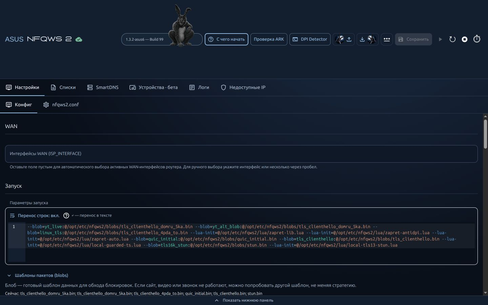

# NFQWS2 ASUS Community

**Настройте доступ к YouTube, Instagram и Discord без VPN — прямо на роутере.**

Начните с **«Импорт профиля»**: выберите готовую стратегию из облака, свой JSON
или вставьте текст NFQWS2 из Keenetic. Проверьте блоки, списки и blobs
в предпросмотре, сохраните изменения и выберите устройства домашней сети.
NFQWS2 обрабатывает трафик на роутере; отдельный клиент на телевизоре, телефоне или ПК не нужен.

Результат зависит от блокировок вашего провайдера и подходящей стратегии;
работу видео, перемотки и голосовых звонков проверяйте отдельно.

**Это приложение для установленной прошивки:** пакет для ASUS с Asuswrt-Merlin/Entware
или нативный пакет для OpenWrt. Прошивать роутер ради установки самого пакета не требуется.

**Бесплатно · RU / EN · ASUS/Entware · OpenWrt**

💬 **[Чат сообщества в Telegram](https://t.me/nfqws2AsusCommunityChat)** — помощь с настройкой и обсуждение стратегий.

**Build 99:** [скачать выпуск](https://github.com/madworldpay/nfqws2-asus-community/releases/tag/build99) · [история изменений](CHANGELOG.md).

**Разные стратегии для разных устройств · бета.** Общий режим остаётся по умолчанию. В разделе «Устройства · бета» можно выбрать отдельную стратегию для телевизора, телефона или ПК, задать приоритеты и проверить назначения до применения. [Как настроить](docs/DEVICE-PROFILES.md) · [реальные снимки](SCREENSHOTS.md#build99-device-profiles).

**Встроенный DPI Detector помогает проверить результат.** Запустите одинаковые тесты до и после смены стратегии, сохраните TXT на свой ПК или телефон и проверьте нужные сервисы. [Как пользоваться](DPI-DETECTOR.md) · [крупные реальные скрины сравнения](docs/DETECTOR-COMPARISON.md).

[Установка](#быстрый-старт) · [Импорт](#импорт-профиль-и-все-необходимые-файлы) · [Профили устройств](docs/DEVICE-PROFILES.md) · [Галерея](SCREENSHOTS.md)

## Что вы получаете

| Плюс | Чем полезен дома |
| --- | --- |
| **Импорт готового профиля** | Профиль провайдера или общая стратегия из подписанного каталога, свой JSON и заявленные списки/blobs; состав и зависимости видны до применения |
| **Конвертер Keenetic** | Вставьте текст NFQWS2 из Keenetic: пути адаптируются, недостающие файлы показываются до сохранения |
| **Предпросмотр и возврат изменений** | До импорта видно «было / станет»; последний импорт можно отменить, а пробное подключение DNS откатывается без подтверждения |
| **Доступ к сервисам без VPN** | Можно подобрать обход DPI для YouTube, Instagram, Discord и других сервисов, сохранив прямое подключение без VPN-туннеля |
| **Управление через браузер** | Запуск, остановка, устройства, стратегии и логи собраны в одной панели; для повседневной настройки не нужно редактировать конфиги по SSH |
| **Настройка на роутере** | Можно обрабатывать трафик всей домашней сети или только выбранных устройств |
| **Профили устройств · бета** | Отдельные стратегии, локальный список устройств, ручной IP/MAC и приоритеты; [инструкция](docs/DEVICE-PROFILES.md) |
| **DNS для конкретных сайтов** | SmartDNS позволяет назначать сайтам отдельные DoT/DoH-серверы или фиксированные IP |
| **Диагностика и обновления в панели** | Проверка пакетов и ошибок, подписанные обновления; на ASUS перед установкой создаётся резервная копия, а после возвращается прежнее состояние служб |
| **DPI Detector в панели** | Оригинальное меню с управлением с телефона, скачивание TXT и отдельная проверка контрольных URL Facebook, YouTube и Discord; поддержка оригинального Detector зависит от архитектуры |
| **Меньше ожидания недоступных адресов на ASUS** | Подтверждённо недоступный IP временно исключается; если у сайта есть рабочие адреса, приложение быстрее переходит к ним |

В сравнении с ручной установкой движка здесь уже объединены **NFQWS2, WebUI, Lua,
управление службой и средства настройки**. Методы обработки основаны на upstream
[NFQWS2 / zapret2](https://github.com/bol-van/zapret2); преимущества этой сборки —
интеграция с роутером и удобство управления.

**SmartDNS и DPI Detector устанавливаются отдельно кнопками панели**, когда нужны.
Готовый профиль — отправная точка: результат зависит от провайдера и выбранных сервисов.

## Быстрый старт

### ASUSWRT-Merlin / Entware

**Если Entware уже работает в `/opt`, переходите к команде установки.**
На свежей ASUSWRT-Merlin сначала подготовьте Entware:

1. Подключите USB-накопитель с Linux-файловой системой — обычно ext4; ext2/ext3 также подходят. Перед форматированием сохраните нужные файлы с накопителя.
2. Включите SSH для локальной сети в **«Администрирование → Система»** и подключитесь к роутеру с учётной записью администратора ASUS.
3. В SSH выполните `amtm`, выберите `ep` и дождитесь завершения установки Entware.
4. Нажмите `e`, затем Enter, чтобы выйти из меню `amtm` обратно в ту же SSH-консоль. Проверьте Entware командой `/opt/bin/opkg print-architecture`.

### Установка одной командой

Команда общая для ASUS/Entware и OpenWrt. Вставьте её целиком в SSH-консоль роутера:

```sh
(
  umask 077
  nfqws_dir=/tmp/nfqws2-install.$$
  mkdir "$nfqws_dir" || exit 1
  trap 'rm -rf "$nfqws_dir"' 0
  nfqws_url=https://raw.githubusercontent.com/madworldpay/nfqws2-asus-community/main/install.sh
  { curl -fL --connect-timeout 10 --max-time 60 "$nfqws_url" -o "$nfqws_dir/install.sh" || uclient-fetch -T 20 -O "$nfqws_dir/install.sh" "$nfqws_url"; } &&
  sh "$nfqws_dir/install.sh"
)
```

**ASUS вручную:** скачайте IPK своей архитектуры и перенесите его через WinSCP/SCP
или сетевую папку флешки по Samba. [Ручная установка с примерами для Проводника](MANUAL-INSTALL.md).

### OpenWrt

**Для OpenWrt используется та же команда выше.** Войдите по SSH от `root`; Entware не требуется.

**Выбрать файл вручную:** [нативные пакеты OpenWrt и их установка](OPENWRT.md#установить-пакет-вручную).

Установщик сам определяет платформу, выбирает и проверяет пакет, сохраняет
настройки при обновлении. В конце появится адрес панели.

**Разовый переход для прежних сборок.** Чтобы установить актуальный выпуск
и получать следующие обновления через панель, один раз повторите общую команду
выше. Настройки, списки, данные входа и выбранное состояние
службы сохраняются. После перехода обновляйтесь обычными кнопками панели.

### После установки

**Вход в панель ASUS:** используйте логин и пароль администратора роутера.
Если панель не может прочитать системные учётные данные ASUS, автоматически
включается резервный вход: **логин `root`, пароль `asus`**.
Ранее заданный отдельный пароль панели сохраняется при обновлении — используйте его.
Кнопка **«Сменить пароль»** позволяет задать свой пароль панели.

1. Откройте `http://IP-роутера:90` и **«С чего начать»**. На ASUS выполните проверку ARK по подсказкам панели. Если ARK отсутствует, подготовка не нужна.
2. Выберите устройства. Импортируйте профиль из облака или свой JSON, проверьте предпросмотр и сохраните выбранное. Для текста NFQWS2 из Keenetic используйте **«Импорт профиля → Вставить стратегию Keenetic»**.
3. При необходимости подключите DNS через мастер SmartDNS и подтвердите результат.
4. Запустите NFQWS2. Проверьте нужные сайты, видео и голос с выбранного устройства.

**DPI Detector важен для проверки выбранной стратегии.** Кнопка **«DPI Detector»** сверху открывает установку, оригинальное меню и справку. Повторяйте тесты **1–3** до и после изменения стратегии в одинаковых условиях: так видно, где остаются проблемы DNS, TLS или QUIC. Процент OK относится только к проверенным целям; ошибки сами по себе не доказывают DPI-блокировку. Дополнительно проверьте видео, перемотку и другие нужные функции на своём устройстве. Сохраните результат клавишей **S**, затем скачайте TXT прямо в окне Detector. [Как читать и сравнивать отчёты](DPI-DETECTOR.md). За помощью с подбором стратегий Keenetic можно обратиться в [чат NFQWS2 Keenetic](https://t.me/nfqws).

При первой установке обработка выключена до настройки.
При обновлении сохраняются настройки и прежнее состояние службы.

<a id="внутри-панели"></a>

[Пример сравнения и как проверить свой профиль](docs/DETECTOR-COMPARISON.md): штатная и личная стратегии на одной линии DOM.RU, с включённым NFQWS2 в обоих прогонах; ограничения и чтение результатов Detector. Это не рекомендация профиля для других операторов или регионов.

### Импорт: профиль и все необходимые файлы

**«Импорт профиля → Из облака»** загружает выбранную запись из подписанного каталога. Проверьте блоки стратегии, списки, blobs и предпросмотр «было / станет». Ненужные части можно отключить; недостающие зависимости нужно устранить до применения. Для своего JSON работает тот же предпросмотр, а **«Вставить стратегию Keenetic»** преобразует текст NFQWS2 и проверяет ссылки на файлы. DNS выбирается отдельно и не включается автоматически.

В каталоге обновлён **«DOM.RU · Тульская область»** и добавлен **«Билайн · Москва»**. Краткие результаты Detector и условия измерений указаны в описаниях; [как выбирать эти профили](PRESETS.md#профили-с-результатами-detector).

Начиная с Build 92 под основной стратегией есть **«Дополнения · Бета»**: необязательные наборы доменов из отдельного подписанного каталога с фиксированным резервным источником на GitHub. Галочки изначально выключены. **Riot** добавляет веб-домены к выбранной базовой стратегии; работа игрового UDP и голоса не заявляется. Общий предпросмотр показывает добавленные домены, правила и затронутые блоки; несовместимое сочетание получает объяснение. При смене основной стратегии выбор сбрасывается. [Как использовать дополнения](IMPORT.md#дополнения--бета).

Начиная с Build 88 у совместимых **общих стратегий из подписанного облачного каталога** есть галочка **«Добавить обход для сайтов торрент-трекеров»**, по умолчанию выключенная. Она добавляет отдельное правило только для HTTPS-сайтов **nnmclub.to, rutracker.org, rutor.info и tapochek.net** на TCP 443; список и правило видны в предпросмотре. Работа peer/DHT и всего BitTorrent не обещается. Неподдерживаемые параметры или несовместимые файлы приводят к отказу добавления. Без галочки импортируется исходный профиль.

## Как выглядит панель

Настройки, стратегии и управление службой — в одной панели. Кнопки шапки выровнены по высоте и переносятся на строки по ширине окна. На телефоне шапка компактнее; язык, тема и ссылки перенесены в сворачиваемую нижнюю панель. Она изначально свёрнута, а выбор раскрытия запоминается отдельно для узкого и широкого окна. В портретной и горизонтальной ориентации доступны прокрутка настроек и нижняя панель. На низком экране и в режиме «Версия для ПК» можно прокрутить всю страницу; раскрытая нижняя панель имеет свою прокрутку. Масштабирование браузера разрешено.

В [галерее с пояснениями](SCREENSHOTS.md) — новые реальные снимки **Build 99**: главное окно RU/EN, мобильная разметка, нижняя панель, профили устройств и библиотека стратегий, меню Detector с тестами 1–3, выбор DNS в проверке сервисов и завершённое обновление. Пример карточек устройств явно отмечен как несохранённый черновик. Снимки Build 96/85 и реальные исторические прогоны Detector сохранены с исходными версиями и датами.

[](images/screenshots/build99-panel-overview-ru.jpg)

[](SCREENSHOTS.md#скриншоты-панели)

## Какие сайты и устройства обрабатывать

В общей конфигурации это **два независимых выбора**: какие сайты обрабатывать и с каких устройств. Отдельные стратегии задаются в разделе «Устройства · бета», описанном ниже.

| «Режим работы» | Что означает |
| --- | --- |
| **List** | Обработка доменов из вашего списка `user.list` |
| **Auto** | Ваш список плюс автоматическое добавление доменов в `auto.list` при обнаружении проблем с соединением; исключения учитываются |
| **All** | Обработка всего подходящего под настройки трафика, кроме доменов из `exclude.list` |

**Auto пополняет список доменов, а не подбирает рабочую стратегию автоматически.**
Режим задаёт доменные списки для основных TCP и QUIC-блоков. Отдельные UDP-блоки, пользовательская стратегия и обработка IP-списков используют свои фильтры и не ограничиваются этим выбором автоматически. Во всех режимах действуют порты и протоколы выбранной стратегии.

| «Обрабатывать трафик» | Для каких устройств |
| --- | --- |
| **Всех устройств** | Для всех клиентов, чей трафик проходит через настроенный роутер |
| **Только указанных устройств** | Например, только для телевизора и телефона с добавленными локальными IP |
| **Всех, кроме указанных устройств** | Для всех остальных; добавленные IP исключаются из обработки |

**Пример:** `List` + **«Только указанных устройств»** + IP телевизора —
обход применяется к доменам из списка на телевизоре; остальные устройства работают без обработки NFQWS2.

Можно указать отдельные IP или подсеть. Адреса разделяются пробелами;
для выбранных устройств лучше закрепить IP в DHCP. IPv6 включается и выбирается отдельно.
Этот выбор относится к NFQWS2; SmartDNS настраивается отдельно.

## Разные стратегии для разных устройств · бета

Если общей стратегии достаточно, оставьте режим **«Общий»**. Для отдельной настройки откройте **«Устройства · бета»**, добавьте устройство из локального списка или вручную по IP/MAC и выберите для него стратегию. Карточки проверяются сверху вниз; порядок меняется перетаскиванием или кнопками ↑/↓. Устройства без отдельного назначения используют общую стратегию, действующие исключения сохраняются.

Библиотека принимает копию текущей стратегии, единый JSON с ресурсами и профили подписанного каталога. **Предпросмотр → «Сохранить черновик» → «Применить сохранённый режим»** — отдельные шаги. DNS остаётся общим; дополнительные стратегии требуют памяти роутера. Перед обновлением пакета при активном раздельном режиме сначала примените «Общий».

[Пошаговая инструкция и лимиты](docs/DEVICE-PROFILES.md) · [Снимки библиотеки, карточек и предпросмотра](SCREENSHOTS.md#build99-device-profiles)

## А где VPN?

**Встроенного VPN-клиента, VPN-сервера или подписки в этом пакете нет.**
NFQWS2 применяет методы обхода DPI к трафику; он не создаёт VPN-туннель
и сам по себе не меняет ваш внешний IP. Это также не средство анонимизации.

VPN настраивается отдельно средствами прошивки или другим приложением.
Возможности VPN определяются вашей прошивкой и выбранным клиентом.

## Ограничения и известные проблемы

- **Нет одной стратегии для всех провайдеров и сервисов.** Может потребоваться другой профиль, список доменов или DNS; открытие сайта ещё не подтверждает работу видео, перемотки и голоса.
- **На некоторых ASUS модуль ARK мешает обработке трафика.** Процесс NFQWS2 может быть запущен, а пакеты в очередь не поступать. Панель показывает проверку и подготовку с резервной копией; может потребоваться отключение связанных функций ASUS и ручная перезагрузка.
- **В OpenWrt ускорение трафика может обходить NFQUEUE.** Проверяйте hardware/software flow offloading по подсказкам панели.
- **Проверенная модель и подходящая архитектура — разные вещи.** ASUS/Entware испытан на GT-BE19000AI и RT-AC87U с указанными прошивками; пользователь сообщества также подтвердил работу NFQWS на RT-AC68U / Merlin 386.14.2. Нативный OpenWrt испытан на RT-AC87U с OpenWrt 24.10. Для остальных связок важны архитектура пакетов, возможности ядра и статус аппаратной проверки.
- **IPv4/IPv6, HTTPS, QUIC, видео и голос требуют отдельных проверок.** Рост очереди подтверждает поступление пакетов, а результат конкретного сервиса и скорость нужно проверять с вашего устройства.

<a id="что-умеет-панель"></a>

## Возможности подробнее

<details>
<summary><strong>Все разделы панели и технические возможности</strong></summary>

| Возможность | Что получает пользователь |
| --- | --- |
| **Разные стратегии по устройствам · бета** | Общий режим или отдельные стратегии; локальное обнаружение, IP/MAC вручную, приоритеты и библиотека. Черновик сохраняется отдельно от применения; DNS общий — [инструкция](docs/DEVICE-PROFILES.md) |
| Стратегии и устройства | Выбор WAN, обработка всех или выбранных устройств, отдельные настройки IPv6 |
| Редактор стратегий | Подсветка, проверка кавычек, визуальный перенос строк и возврат к штатным стратегиям |
| Свой JSON и пресеты из облака | Профили провайдеров и глобальные стратегии; весь состав JSON выбран сразу, ненужное можно отключить |
| Стратегия из Keenetic | Вставка текста NFQWS2, адаптация путей и проверка недостающих файлов до сохранения — [инструкция](IMPORT.md#стратегия-из-keenetic) |
| Шаблоны пакетов (blobs) | Выбор другого шаблона без замены стратегии и загрузка `.bin` с устройства — [инструкция](USAGE.md#шаблоны-пакетов-blobs) |
| Предпросмотр и отмена импорта | Сравнение «было / станет», перенос нужных файлов и возврат последнего импорта |
| SmartDNS | До **32 DNS**, **256 привязок «домен → DNS»** и **64 фиксированных ответов**; DoT/DoH и свой сервер |
| Диагностика и DPI Detector | Чекап, проверка поступления пакетов и логи; оригинальный терминал, TXT на своё устройство, «Проверка сервисов» с контекстом запросов и удаление через «Ещё» с отдельным подтверждением |
| Обмен профилями | Экспорт отдельных блоков, списков, blobs и DNS; просмотр и правка отправляемой копии |
| Обновления | Проверка подписи и SHA256, сохранение настроек; резервная копия пакета и автоматический откат при перехваченной ошибке на ASUS |
| Недоступные IP (ASUS) | Список адресов со сроками, перепроверка и очистка; фильтрация обычного UDP DNS и быстрый отказ на порту 443 |
| Перезапуск и восстановление | Кнопка ↻, таймер 4/12/24 часа или свой интервал; необязательное восстановление после сбоя |
| Проверка ARK (ASUS) | Проверка модуля, подготовка с бэкапом и восстановление изменённых настроек — [инструкция](DIAGNOSTICS.md) |
| MTProto для Telegram | Установка с Docker, на Entware или Linux; готовые ссылка, секрет, скрипт и стек Portainer — [инструкция](#прокси-telegram) |
| Технический канал | Временный доступ Администратора по выданной ссылке, срок и отключение — [инструкция](DIAGNOSTICS.md#технический-канал) |

Пакет содержит NFQWS2, WebUI, встроенные Lua и служебные утилиты.
**SmartDNS и DPI Detector устанавливаются отдельно кнопками панели**, когда нужны.
**«С чего начать»** ведёт по настройке, а **«?»** объясняет поля и действия.

</details>

### Перезапуск службы

Значок **↻** перезапускает NFQWS2, а **⏱** открывает выбор интервала: 4, 12, 24 часа или от 1 до 168 часов вручную. Это может пригодиться устройствам с небольшим объёмом ОЗУ. Таймер перезапускает только работающую службу. Переключатель **«Восстанавливать службу»** разрешает до трёх попыток после сбоя с паузами 1, 5 и 15 минут; затем нужен ручной запуск. Обе функции изначально выключены. Ручная остановка имеет приоритет. На OpenWrt нужен работающий системный cron.

### Недоступные IP на ASUS

Вкладка **«Недоступные IP»** помогает сократить зависания, когда сервис выдаёт несколько адресов, а часть из них недоступна. После независимого подтверждения адрес исключается на **24 часа**, при повторном случае — на **7 дней**. Единичного тайм-аута или сбоя QUIC недостаточно. Функция включена по умолчанию; переключатель **«Запоминать недоступные адреса»** позволяет её отключить.

Если в обычном ответе DNS по UDP есть рабочие альтернативы, недоступный адрес убирается. Новые TCP/UDP-соединения к нему на порту **443** завершаются без долгого ожидания. В списке видны оставшийся срок и результат проверки; доступны **«Перепроверить»**, **«Убрать»** и **«Очистить список»**. Автопроверка возвращает адрес после трёх успешных проверок; проверки идут по очереди, не чаще раза в 15 минут для каждого IP. Кнопка перепроверки ставит проверку в очередь. Список хранится в `/opt/etc/nfqws2/ip-health/bans.json`; просматривать и очищать его удобнее в панели.

Устройства из исключений не затрагиваются. При остановке обработчика ограничения перестают действовать. **DNS по TCP, DoH и DoT не фильтруются; одновременная работа нескольких WAN не поддерживается.** В нативном OpenWrt эта функция пока недоступна. Подходящая стратегия NFQWS2 по-прежнему нужна.

### Прокси Telegram

Кнопка **MTProto для Telegram** внизу панели готовит установку на выбранное устройство: с Docker, на ASUS с Entware или на Linux с systemd. Адрес ASUS или AI Board подставляется автоматически и остаётся редактируемым. Секрет `dd`, ссылка подключения и команда генерируются автоматически; рядом есть копирование и скачивание скрипта. Для Docker доступны готовый стек Portainer (`compose.yaml`) и команда для терминала: оба используют закреплённый образ [LordArrin на основе Flowseal](https://github.com/LordArrin/tg-ws-proxy-docker) для x86-64 / ARM64. Для подключения вне дома нужен доступный извне адрес и порт. Установщик сообщает об успехе после проверки настоящего ответа Telegram. Работающий прокси и настройки NFQWS установщик не заменяет.

Команду выполняйте на выбранном устройстве. Для Portainer выберите **Docker → Portainer**, затем **Stacks → Add stack → Web editor → Deploy the stack**; для запуска скрипта — **Docker → Терминал**. Без Docker нужен свободный TCP-порт 1024–65535 и запуск от root: на ASUS — Entware, на Linux — systemd, Python 3.8+ и python3-venv. Установщик не открывает межсетевой экран; доступ к выбранному порту настраивается отдельно. Локальная ссылка с IP роутера работает из его сети; при CGNAT внешний доступ по адресу провайдера без дополнительного решения недоступен.

Сохраните ссылку и конфигурацию до закрытия окна: панель не сохраняет сгенерированный ключ. **«Другой секрет»** меняет только текст будущей установки. Для установленного прокси используйте показанную команду диагностики; после установки проверьте сообщения и медиа в Telegram.

## Обновления и каталог профилей

**Обновлятор на ASUS/Entware** перед установкой останавливает службы и создаёт резервную копию. После проверки возвращает прежнее состояние; выключенный NFQWS2 остаётся выключенным. При ошибке проверяет прежнюю установку и восстанавливает службы, а после начала замены пакета применяет откат. Сбой питания и прямой запуск opkg требуют отдельной проверки — [подробнее об обновлении и восстановлении](PACKAGE-UPDATES.md).

Окно обновления показывает текущий этап и процент прохождения этапов, а при ошибке сохраняет её причину и журнал. Кнопка «Скопировать ошибку» помогает передать версии, этап и коды. Изменённые настройки, Lua, blobs и существующие пользовательские копии сохраняются; состояние SmartDNS восстанавливается по последнему подтверждённому профилю.

Начиная с Build 87 время подготовки копии учитывает число файлов и задержку записи USB. Если обработчик Build 85/86 отменяет обновление с `timed_out`, один раз повторите обычную команду установки выше: она запускает исправленный автономный обработчик. Удаление пакета и перезагрузка не требуются.

Каталог стратегий размещён на ASUS. Отправленные пользователями профили и
диагностика принимаются на ASUS и доставляются в Gmail проекта; выпуски
загружаются с GitHub. Для этих функций VPS не требуется.

Для импорта и отправки профилей используйте актуальный пакет. Уже применённые
стратегии продолжают работать; свой JSON также можно открыть через
**«С компьютера (JSON)»**.

## Делитесь рабочими стратегиями

Получили хороший результат для YouTube, Instagram, Discord или другого сервиса —
**поделитесь профилем через «Экспорт / поделиться»**. Такие отчёты помогают улучшать стратегии
и пополнять облачный каталог для разных провайдеров и регионов.

Выберите стратегию, нужные списки/blobs и DNS, укажите провайдера и результат
проверки, затем откройте предпросмотр. **«Скачать JSON»** сохраняет копию вам,
**«Отправить разработчику»** передаёт её проекту. Для скачивания JSON настройка отправки не нужна; наведите на **«Предпросмотр»** или нажмите его, чтобы узнать, какие поля ещё заполнить. Если подтверждение отправки потерялось, новый предпросмотр готовит новую попытку; возможна копия. Участие добровольное; отправка не публикует
профиль в каталоге автоматически.

## Как устроены проверка и поддержка

- Перед изменением DNS мастер проверяет профиль, предлагает пробное подключение и возвращает прежний DNS без подтверждения.
- При импорте видно, что изменится. При отправке можно проверить точный состав и отредактировать копии; рабочие настройки от этого не меняются.
- Вместе с каждым выпуском опубликованы SHA256 и архив соответствующих исходников.
- Работа сервиса проверяется с телефона или ПК: рост очереди подтверждает поступление пакетов, а видео, перемотка и голос требуют проверки самого приложения.

Если что-то не получилось, соберите диагностику через **«Экспорт / поделиться»**
и опишите, какие действия привели к ошибке.
Для описания воспроизводимой ошибки есть [Issues](https://github.com/madworldpay/nfqws2-asus-community/issues).
Настройки и диагностические файлы можно передать разработчику через предпросмотр в панели.

Внизу панели есть **«Технический канал»** — временный доступ для диагностики
и настройки после предварительной договоренности с Администратором.
Он выдаёт ссылку; пользователь вставляет её и подключается. Нужен пароль панели.
Канал можно отключить в любой момент; по окончании срока и после перезагрузки
доступ прекращается. Канал позволяет Администратору выполнять команды с правами root. Срок задан ссылкой и не продлевается при переподключении. Отключение прекращает доступ; уже выполненные изменения настроек сохраняются. Это не заявка на постоянную или круглосуточную поддержку.

Самостоятельный community-порт. Пакеты бесплатные, участие добровольное.

## Поддержать проект

Если панель вам пригодилась, можно поддержать её развитие
[добровольным переводом через ЮMoney](https://yoomoney.ru/to/4100119670967911) ♡

Отзывы, рабочие стратегии и помощь другим участникам тоже очень ценны.

## Благодарности

Спасибо авторам проектов, на которых основана адаптация и её дополнительные возможности:

- [NFQWS2 Keenetic](https://github.com/nfqws/nfqws2-keenetic) и [WebUI Keenetic](https://github.com/nfqws/nfqws-keenetic-web) — основа порта и веб-интерфейса.
- [zapret2 — bol-van](https://github.com/bol-van/zapret2) — движок nfqws2 и Lua-механизмы обхода.
- [Anonym-tsk/zapret2](https://github.com/Anonym-tsk/zapret2/tree/tls-reasm-fastpath) — доработки TLS fastpath, адаптированные в сборках.
- [DPI Detector — Runnin4ik](https://github.com/Runnin4ik/dpi-detector) — самостоятельный инструмент диагностики доступности и DNS.
- [SmartDNS — pymumu](https://github.com/pymumu/smartdns) — DNS-резолвер.
- [tg-ws-proxy — Flowseal](https://github.com/Flowseal/tg-ws-proxy) и [Docker-сборка LordArrin](https://github.com/LordArrin/tg-ws-proxy-docker) — основа установки прокси для Telegram.

При исследовании способов обхода также используем материалы и инструменты
[blockcheckw](https://github.com/rcd27/blockcheckw),
[b4](https://github.com/DanielLavrushin/b4) и
[Flowseal/zapret-discord-youtube](https://github.com/Flowseal/zapret-discord-youtube).
Их упоминание не означает, что все функции этих проектов включены в пакет.

Наша ASUS-адаптация распространяется по [MIT](LICENSE). Сторонние компоненты сохраняют
свои лицензии и авторство.
[Авторство и лицензии компонентов](UPSTREAM.md) · [Полные уведомления](THIRD-PARTY-NOTICES.txt).

## Документация

Начните с нужной задачи; основные действия уже приведены на самой странице инструкции.

| Задача | Инструкция |
| --- | --- |
| Установить или удалить | [Быстрый старт](QUICKSTART.md) · [Установка и удаление](INSTALL.md) |
| Выбрать файл для ручной установки | [Пакеты](DOWNLOADS.md) · [Установка IPK](MANUAL-INSTALL.md) |
| Настроить работу программы | [Панель и устройства](USAGE.md) · [Импорт и обмен профилями](IMPORT.md) |
| Выбрать готовую стратегию или DNS | [Каталог профилей](PRESETS.md) · [SmartDNS](SMARTDNS.md) |
| Обновить программу | [Обновление](PACKAGE-UPDATES.md) |
| Разобраться с проблемой | [Диагностика](DIAGNOSTICS.md) · [DPI Detector](DPI-DETECTOR.md) |
| Проверить совместимость | [ASUS / Entware](COMPATIBILITY.md) · [OpenWrt](OPENWRT.md) |
| Поделиться результатом | [Помощь проекту](CONTRIBUTING.md) |

[English](README.en.md)
