# Panel screenshots

Panel sections with demonstration settings. Click a screenshot to open it at full size.

## NFQWS2 main panel

## Getting started

Router checkup and setup steps with their current status.

[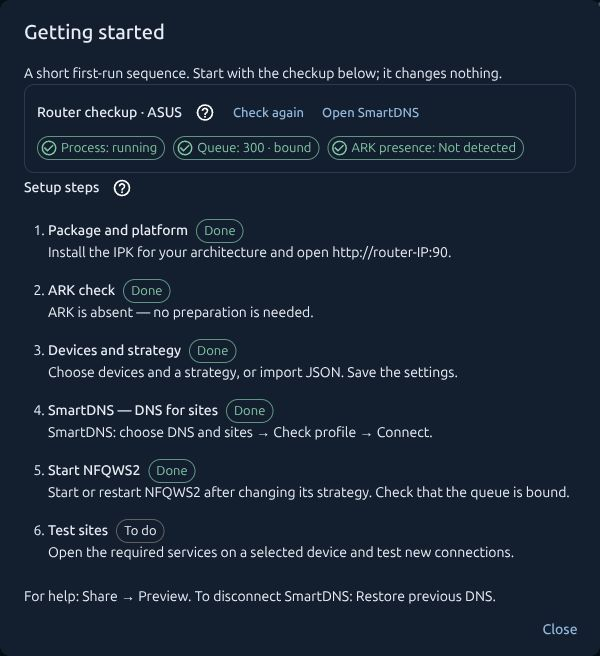](images/screenshots/getting-started-en.jpg)

## Device selection

Processing for listed devices, IPv4 examples and a reminder to reserve addresses in DHCP.

[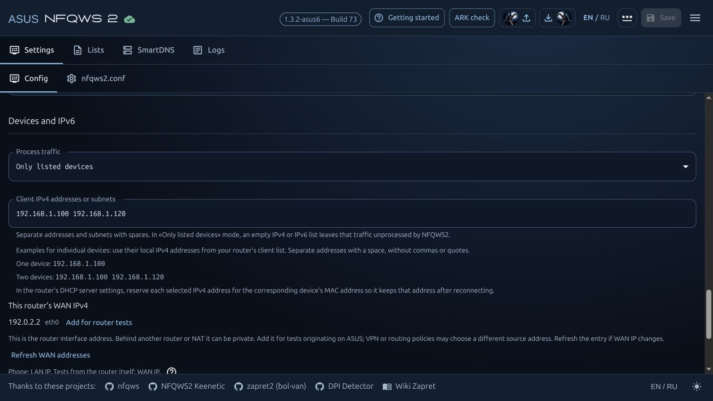](images/screenshots/devices-en.jpg)

## Strategy catalog

Provider profiles and global strategies in the import window.

[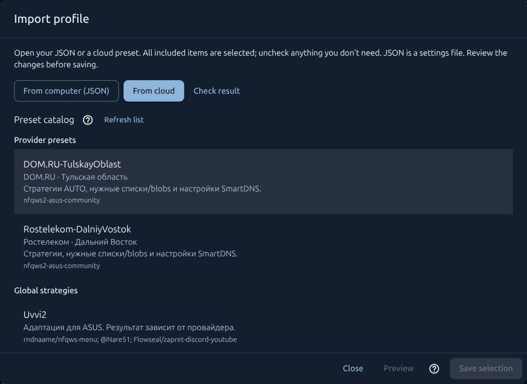](images/screenshots/profile-catalog-en.jpg)

## Import preview

Compare before and after before saving the selected changes.

[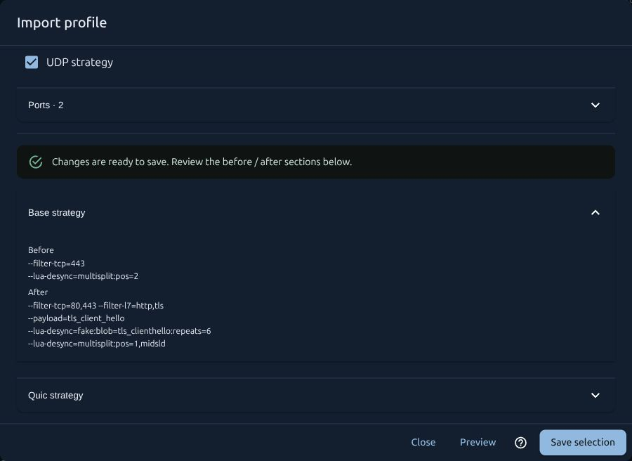](images/screenshots/import-preview-en.jpg)

## Strategy editor

Separate TCP and QUIC blocks, parameter highlighting and visible line breaks.

[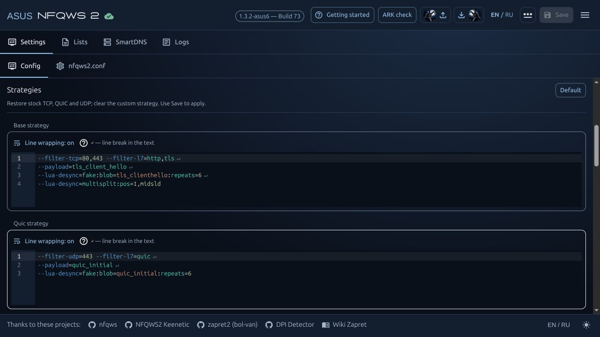](images/screenshots/strategy-editor-en.jpg)

## Domain lists

Edit your domain list and switch between files.

[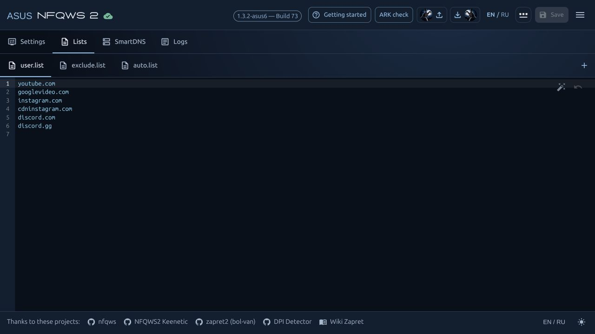](images/screenshots/domain-lists-en.jpg)

## SmartDNS: connection and restore

DNS status, checkup and the control for restoring previous settings.

[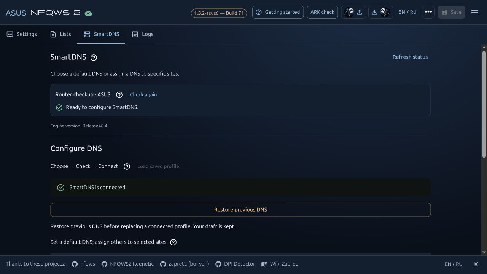](images/screenshots/smartdns-en.jpg)

## DNS for individual sites

Assign a DNS server to domains, including their subdomains.

[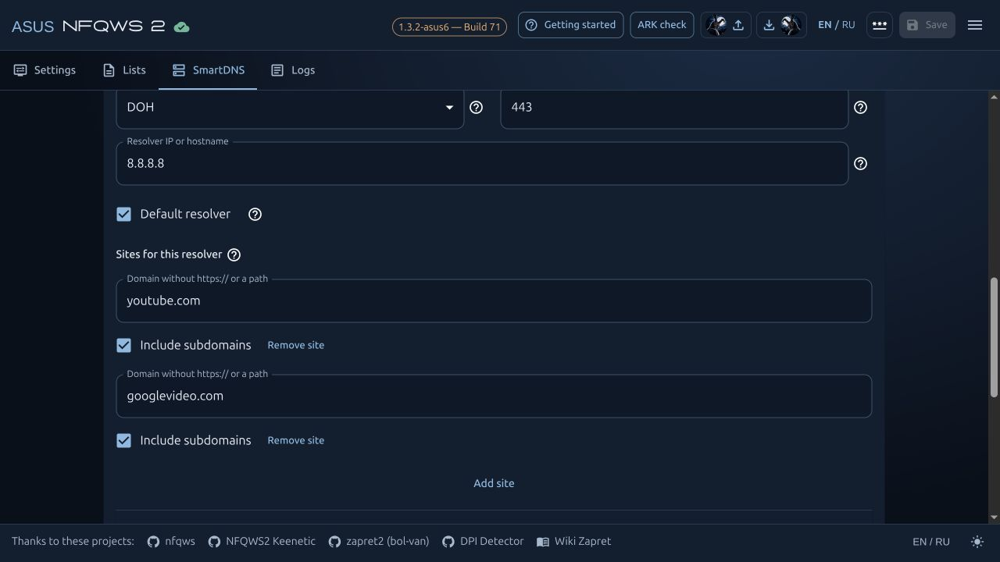](images/screenshots/dns-rules-en.jpg)

## Fixed DNS answers

A domain and a specified IP address in a separate rule.

[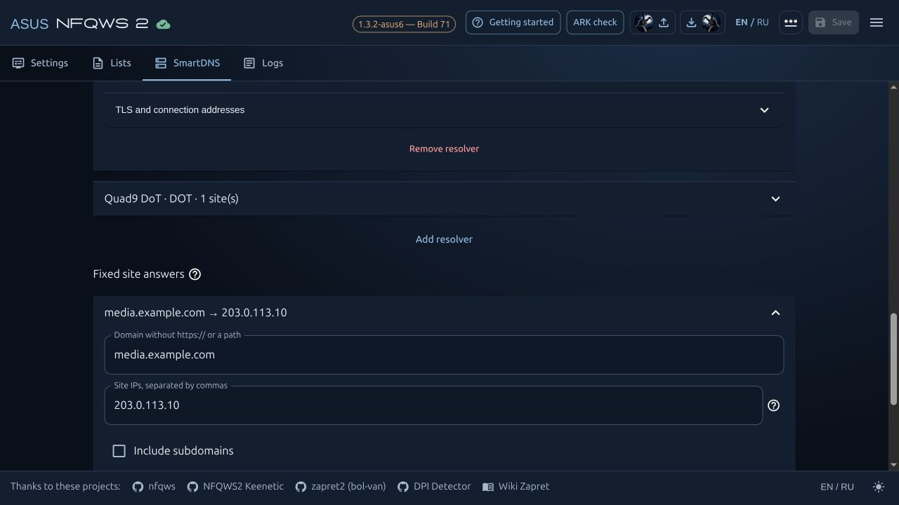](images/screenshots/fixed-dns-en.jpg)

## Diagnostics and submission contents

Select router diagnostics, a DPI result and strategy blocks.

[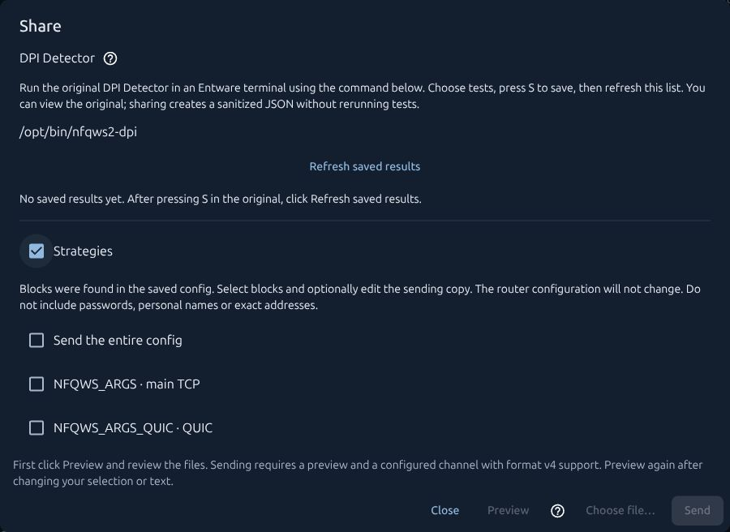](images/screenshots/diagnostics-en.jpg)

## Share a working profile

Provider, purpose and test results before reviewing the submission.

[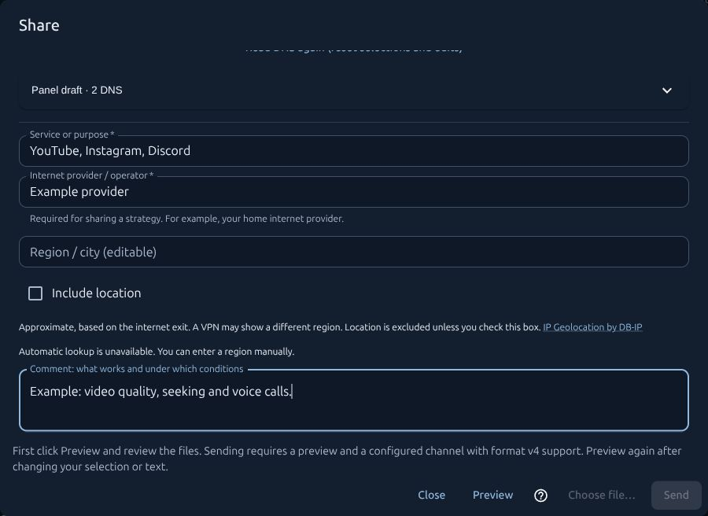](images/screenshots/profile-sharing-en.jpg)

## Updates in the panel

Changes between the installed and new versions before package preparation.

[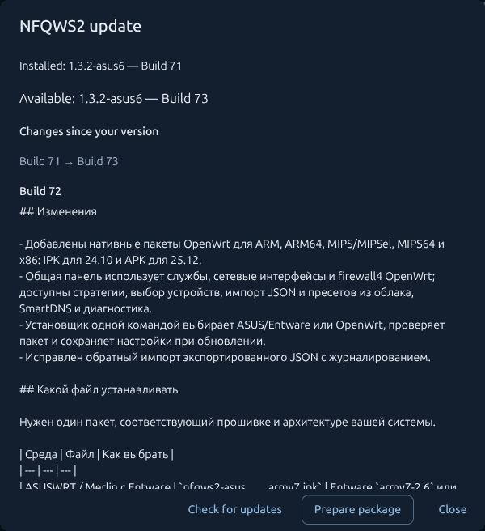](images/screenshots/updates-en.jpg)

[Project documentation](README.en.md#documentation).
