# Panel screenshots

The gallery now includes **real Build 96 screenshots**: desktop and phone panels, DPI Detector, import, SmartDNS and updates. Archived Build 85 screens with demonstration addresses, states and example entries are retained separately below. [Real historical Detector runs on Build 89](docs/DETECTOR-COMPARISON.en.md) appear beside the current Detector screens and have a separate detailed comparison.

Expand a screenshot and click it for full size. Static images have no animation; collapsed sections keep the gallery compact on phones.

[Русский](SCREENSHOTS.md) · [Documentation](README.en.md)

## Current Build 96 capabilities

| Changes after the archived screenshots | Guide |
| --- | --- |
| Compact phone header, aligned buttons, portrait/landscape scrolling; language and theme in the collapsible lower panel | [Layout and controls](USAGE.en.md) |
| One original Detector terminal, TXT reports downloaded to a PC/phone, and removal through More with separate confirmation; reports are retained by default | [Detector and reports](DPI-DETECTOR.en.md) |
| Service checks: three control HTTPS URLs for the selected Facebook, YouTube or Discord service, HTTP codes and errors, and a separate TXT with request context | [Check limits](DPI-DETECTOR.en.md#service-checks) |
| Add-ons · Beta: Riot web domains and a separate tracker-website rule; checkboxes start off, and changes appear in the combined preview | [Import add-ons](IMPORT.en.md#add-ons--beta) |
| Loading the imported SmartDNS draft while preserving unsaved manual edits | [SmartDNS editor](SMARTDNS.en.md) |
| Update phases, failure reason and log, slow-USB allowance, retained settings and previous service state | [Updates and recovery](PACKAGE-UPDATES.en.md) |

## Real Build 96 screenshots

The screenshots below come from the running Build 96 panel. They show its interface and selected actions; they do not establish full website, video, voice or game functionality. Click an image to open its original. Screens with no separate English capture are explicitly labelled as Russian UI.

### Header, phone and scrolling

Main buttons use a consistent height and wrap on narrow screens. The lower panel starts collapsed and contains language and theme controls. Landscape and short windows retain access to settings and the bottom of the page through scrolling.

Show the current desktop panel — English UI

[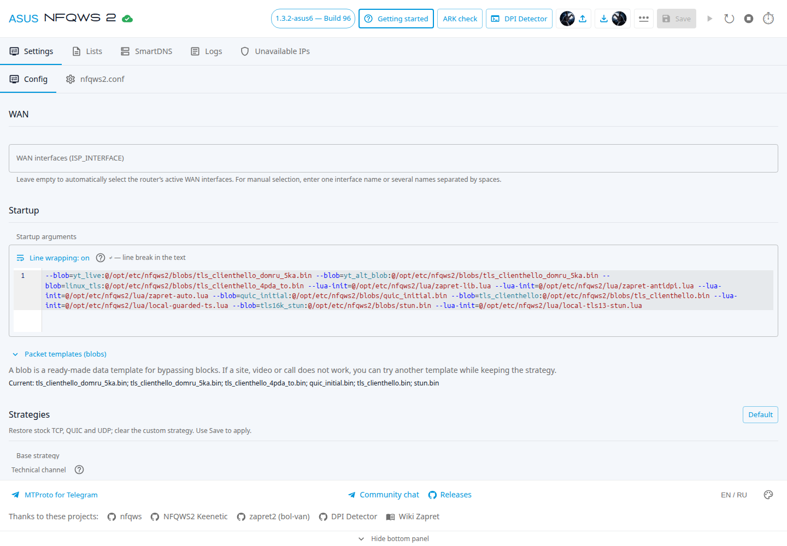](images/screenshots/build96-panel-overview-en.png)

Show the phone in portrait — English UI

[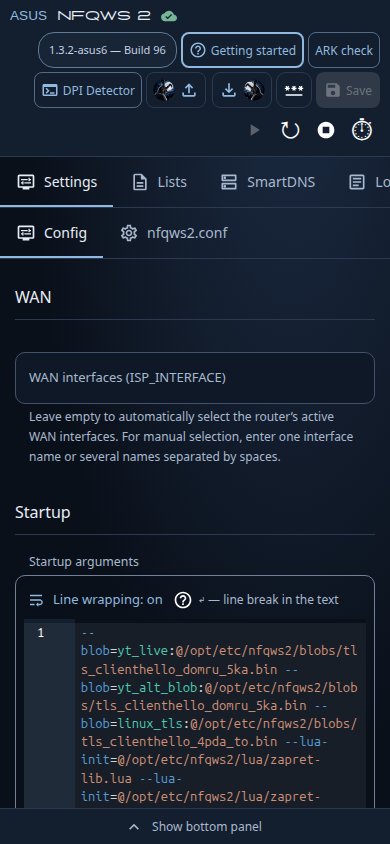](images/screenshots/build96-layout-mobile-portrait-en.png)

Show landscape and short-window scrolling — Russian UI

[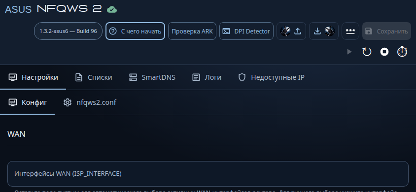](images/screenshots/build96-layout-mobile-landscape-ru.png)

[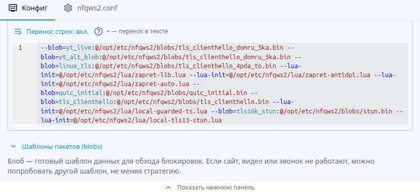](images/screenshots/build96-layout-mobile-landscape-scroll-ru.png)

Show the expanded phone footer — Russian UI

[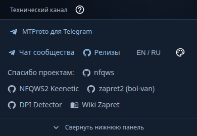](images/screenshots/build96-footer-mobile-expanded-ru.png)

### Service checks — Build 96

This view is separate from the original terminal. The screenshot shows the view **before a run**: Facebook, YouTube or Discord selection and the limits of three control URLs. After a check, exact HTTP codes, network errors, response size and its own TXT with request context become available. [Interpreting results](DPI-DETECTOR.en.md#service-checks).

[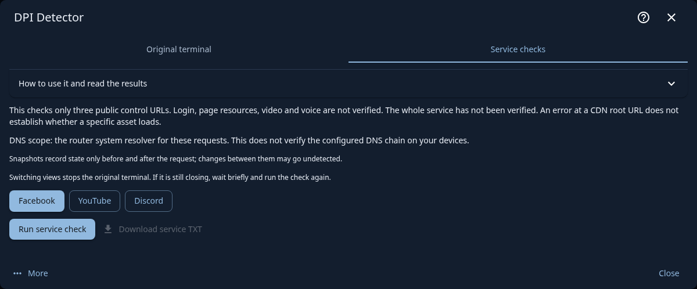](images/screenshots/build96-service-checks-en.png)

### Retaining reports when removing Detector

**More → Remove DPI Detector** opens separate confirmation. Deleting saved reports is unchecked, so ordinary removal retains TXT files. The screenshot shows the confirmation prompt; removal was not performed. Original report downloads are in the Detector window’s **TXT reports**.

Show removal confirmation — Russian UI

[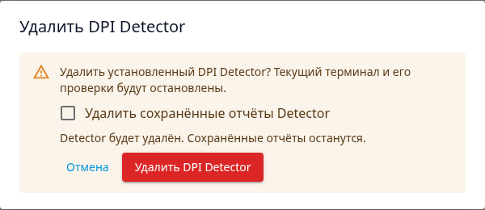](images/screenshots/build96-detector-remove-ru.png)

### Detector example: default and personal strategies

**Real historical Build 89 runs, November 5, 2026. NFQWS2 was running in both; the strategy changed.** This is one DOM.RU connection in the Tula region. Results belong to the measured configurations and do not establish the result of a changed public profile copy. [All 12 large captures, conditions and limitations](docs/DETECTOR-COMPARISON.en.md).

**Default strategy:** TCP 67/110, HTTP 16/35, TLS 1.2 and TLS 1.3 each 31/35, QUIC 19/21.

[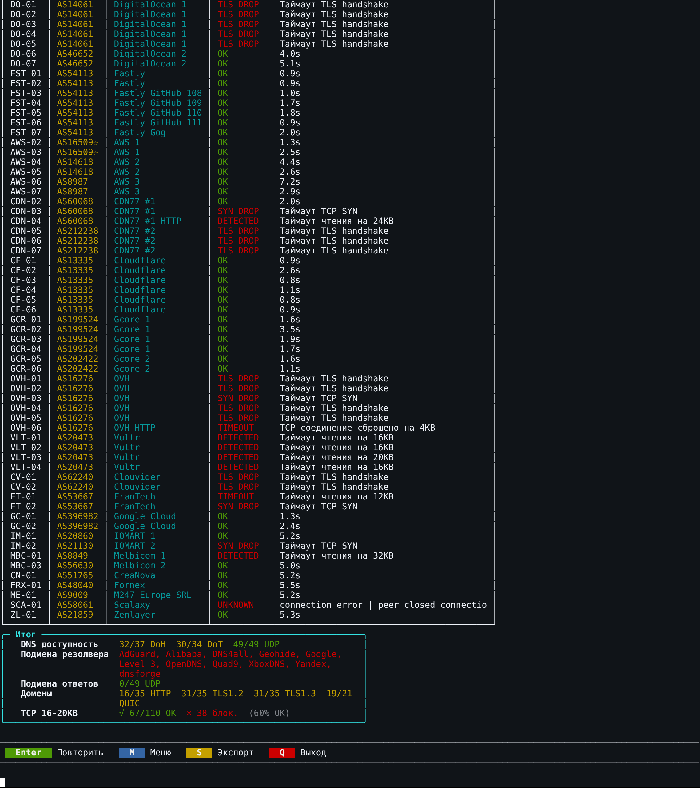](images/screenshots/detector-comparison-stock-06-bottom.png)

**Personal strategy:** TCP 97/110, HTTP 35/35, TLS 1.2 and TLS 1.3 each 35/35, QUIC 18/21. Some failures remain; the percentage does not establish full service functionality.

[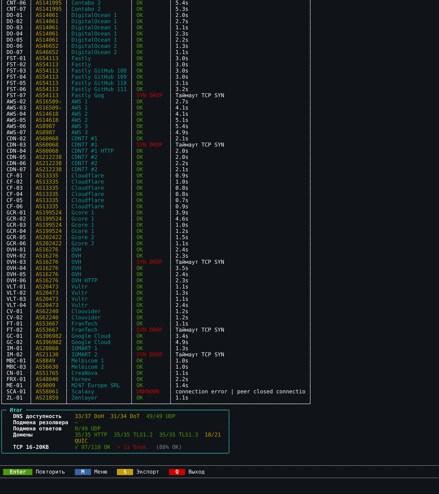](images/screenshots/detector-comparison-personal-06-bottom.png)

### Add-ons · Beta

Optional Riot and the separate tracker-website rule appear below the base strategy. Checkboxes start off; a selected add-on joins the base profile in the combined preview. Riot covers web domains, without verified game UDP functionality. [Contents and limits](IMPORT.en.md#add-ons--beta).

Show add-on selection — Russian UI

[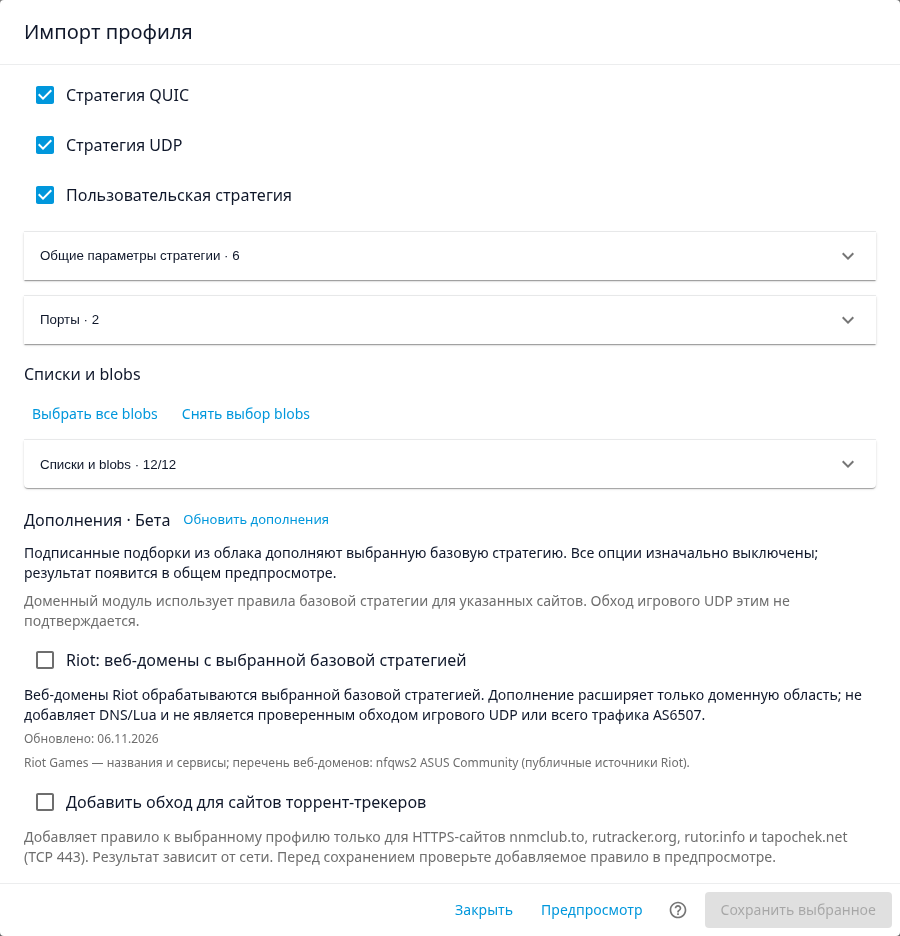](images/screenshots/build96-import-addons-ru.png)

The combined preview shows added Riot domains, extended base-strategy scope and files that would be replaced. The screenshot shows prepared changes; **Save selection** was not clicked.

[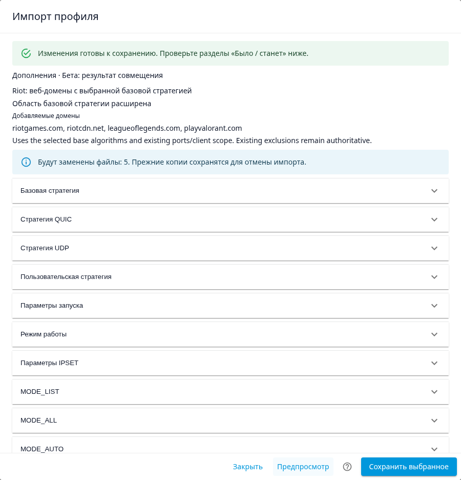](images/screenshots/build96-import-addons-preview-ru.png)

### SmartDNS editor

The editor shows the server, protocol, domains and subdomain option. Import fills the draft; validation, connection and DNS confirmation are separate. An editor screenshot does not establish a successful DNS connection. [Workflow](SMARTDNS.en.md).

Show the SmartDNS editor — Russian UI

[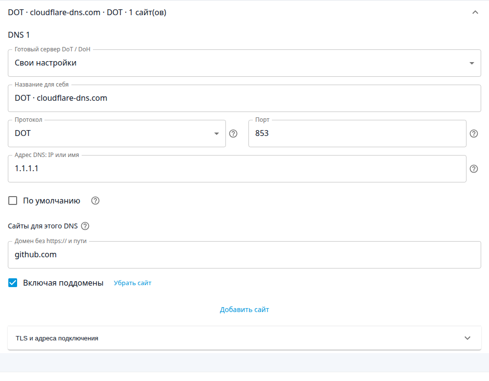](images/screenshots/build96-smartdns-editor-ru.png)

### Update window

The screenshot shows the result of the **already completed Build 96 installation** and the up-to-date message. 100% belongs to that retained operation result; no new installation was started for the screenshot. Progress represents phases rather than time remaining. The community chat and copy-link action are also visible. [Phases, logs and recovery](PACKAGE-UPDATES.en.md).

Show the completed Build 96 result — English UI

[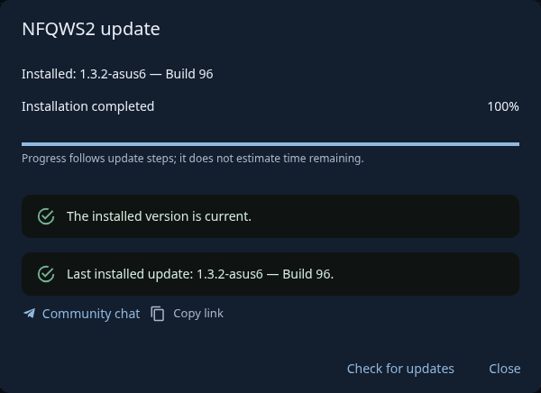](images/screenshots/build96-updates-en.png)

## Archived Build 85 gallery

### NFQWS2 main panel

Settings and service controls share one panel. The top bar provides start or restart, the service menu, schedule, import, export and update checks. Save becomes available after changing settings.

Show screenshot

[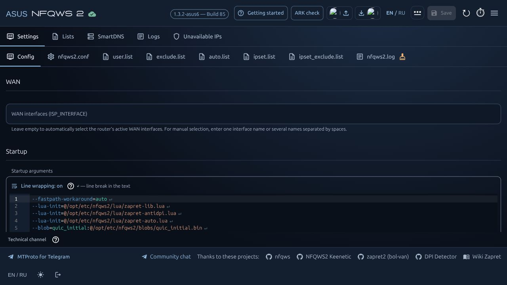](images/screenshots/panel-overview-en.jpg)

### Getting started

Open Getting started in the top bar for router checkup and setup steps. Checkup reports the process, queue binding, ARK presence and platform readiness. It changes nothing; test your sites from a client device after setup.

Show screenshot

[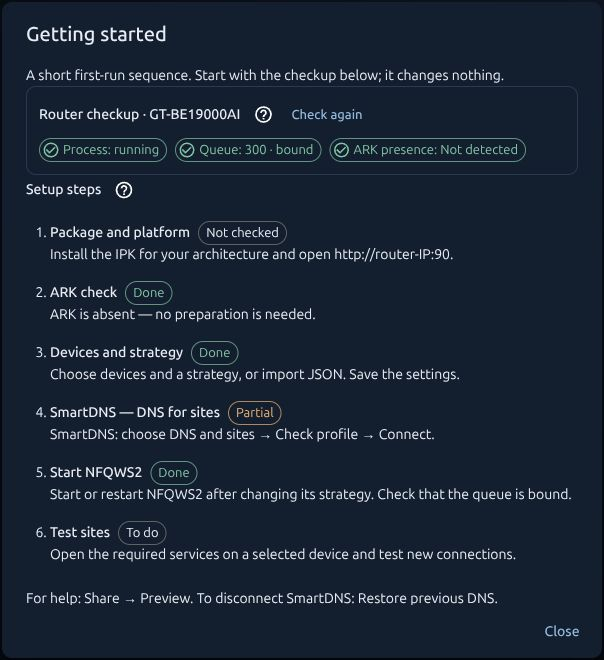](images/screenshots/getting-started-en.jpg)

### Device selection

Settings → Devices and IPv6: process all devices, only listed devices, or all except listed devices. Separate IPv4, IPv6 and subnets with spaces. Reserve addresses in DHCP; in Only listed mode, an empty list leaves that address family unprocessed.

Show screenshot

[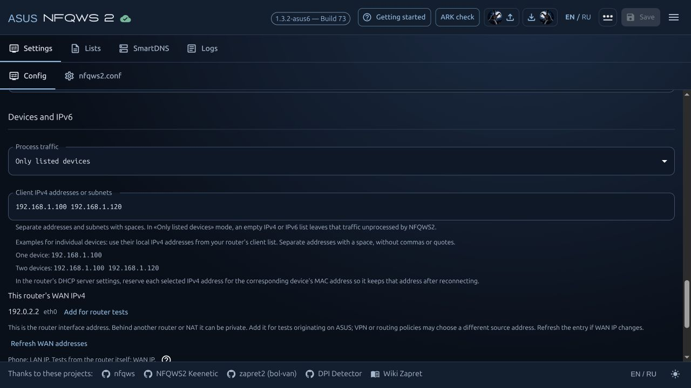](images/screenshots/devices-en.jpg)

### Strategy catalog

Import profile → From cloud lists provider presets and global strategies. Select a preset, then review its contents and changes before saving. A preset name does not guarantee success on every ISP; test it on your connection.

Show screenshot

[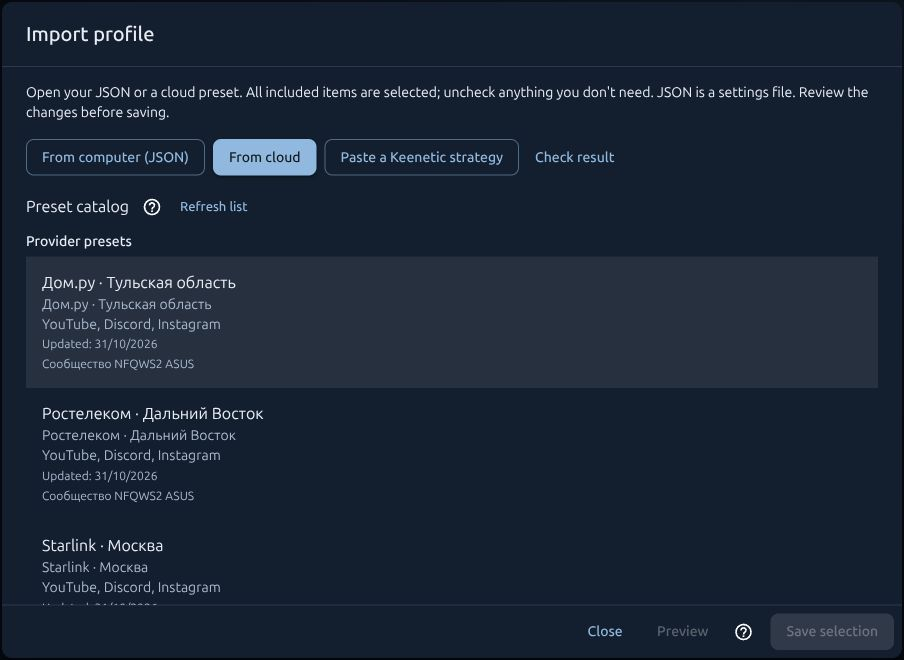](images/screenshots/profile-catalog-en.jpg)

### Import a Keenetic strategy

Choose Paste a Keenetic strategy in the import window. Paste NFQWS2 text and select Convert for ASUS to adapt paths and prepare a review. Check referenced lists and blobs; saving is a separate step.

Show screenshot

[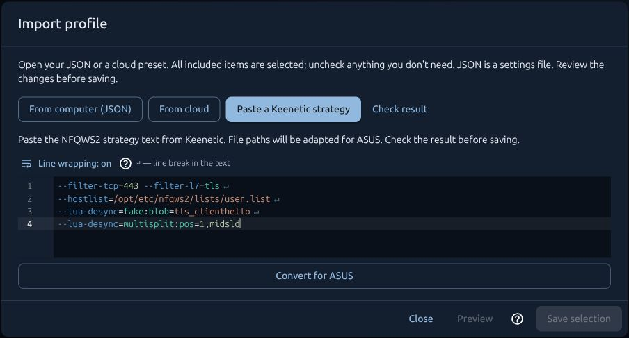](images/screenshots/keenetic-import-en.jpg)

### Import preview

After opening a JSON file or preset, select Preview. Compare before and after, and deselect unwanted sections. Running settings change only after Save selection; apply any required restarts afterwards.

Show screenshot

[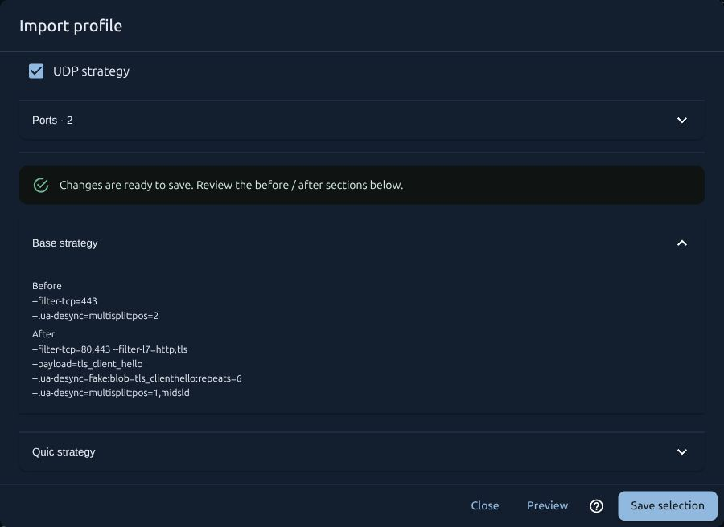](images/screenshots/import-preview-en.jpg)

### Strategy editor

Settings → Config separates startup, TCP, QUIC, UDP and custom strategy blocks. Highlighting and visible line breaks help inspect parameters. Save changes, then restart NFQWS2 to apply the strategy.

Show screenshot

[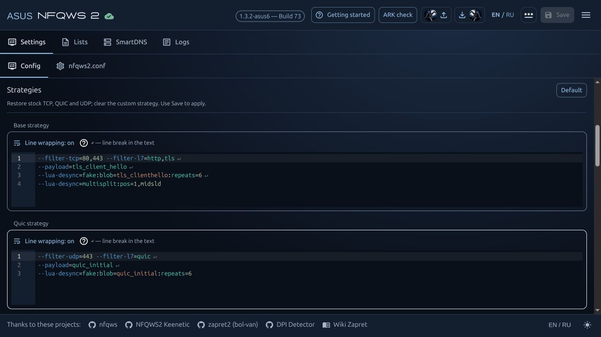](images/screenshots/strategy-editor-en.jpg)

### Packet templates — blobs

Expand Packet templates (blobs) below launch parameters. Select another file for an existing blob name, or upload a .bin from 1 byte to 256 KiB. Selection changes the draft: save and restart the service. A different blob may not suit the strategy.

Show screenshot

[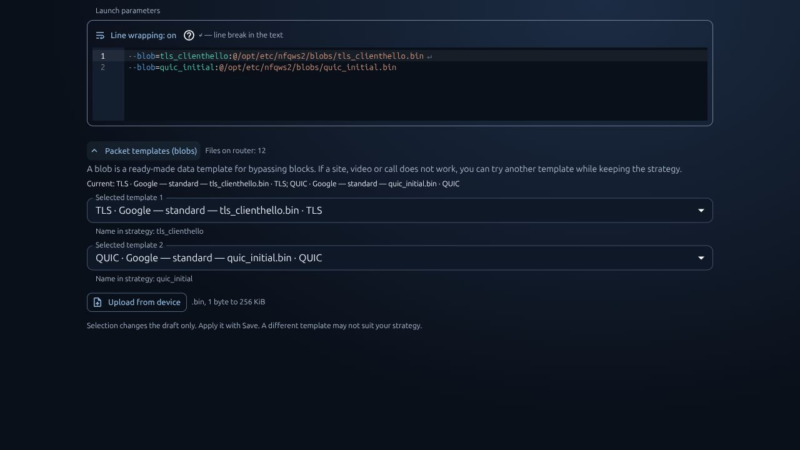](images/screenshots/blob-picker-en.jpg)

### Domain lists

Use Lists to edit domain lists and exclusions. Auto mode adds domains requiring processing to auto.list. This is separate from unavailable-IP tracking: a domain in auto.list does not establish that its IP is unavailable.

Show screenshot

[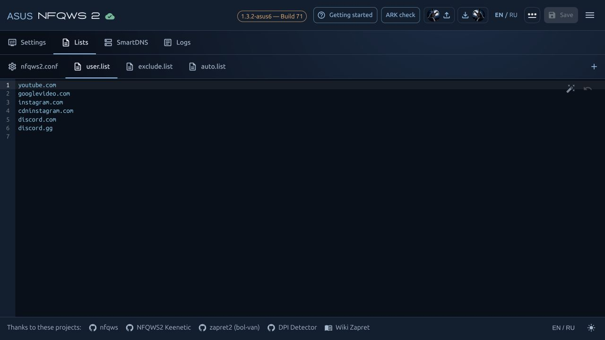](images/screenshots/domain-lists-en.jpg)

### Unavailable IPs

This tab shows confirmed unavailable addresses, exclusion time and rechecks. The first incident lasts 24 hours, a repeat 7 days; three successful checks restore an address. One timeout or QUIC failure does not add an entry. DNS filtering covers ordinary UDP DNS for selected clients; DoH, DoT and TCP DNS bypass it.

Show screenshot

[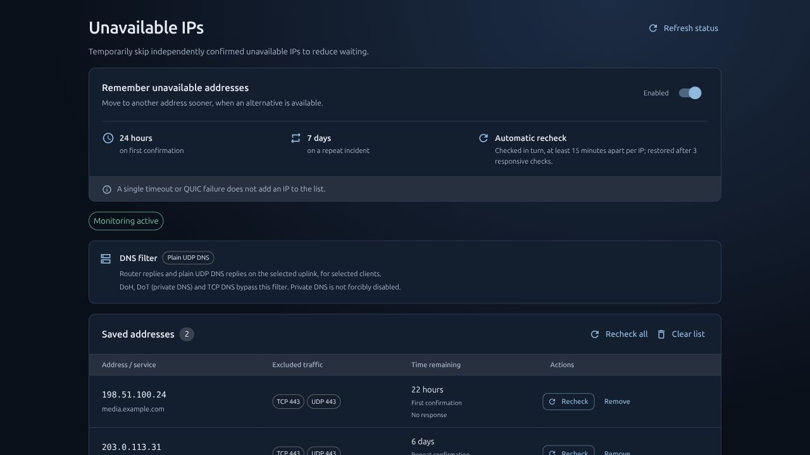](images/screenshots/unavailable-ips-en.jpg)

### Scheduled restart and recovery

Use the timer icon beside the service controls: off, every 4, 12 or 24 hours, or a custom interval. Useful on devices with limited RAM. The timer restarts only a running NFQWS2 service, never the router. Enable service recovery for up to three attempts after failure with increasing delays, then it stops; a manual stop is respected. Save the chosen settings.

Show screenshot

[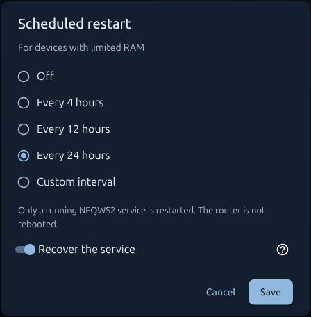](images/screenshots/restart-timer-en.jpg)

[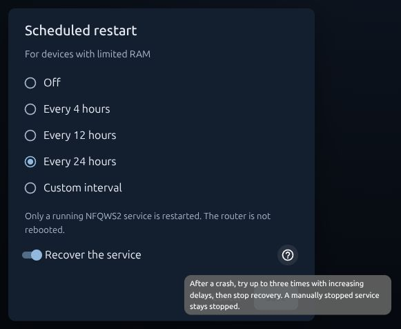](images/screenshots/service-watchdog-en.jpg)

### SmartDNS: connection and restore

The SmartDNS tab shows router readiness, the DNS profile and connection state. Prepare and validate a profile, then connect and confirm the result. Restore previous DNS returns saved settings. A successful DNS response alone does not prove that a website works.

Show screenshot

[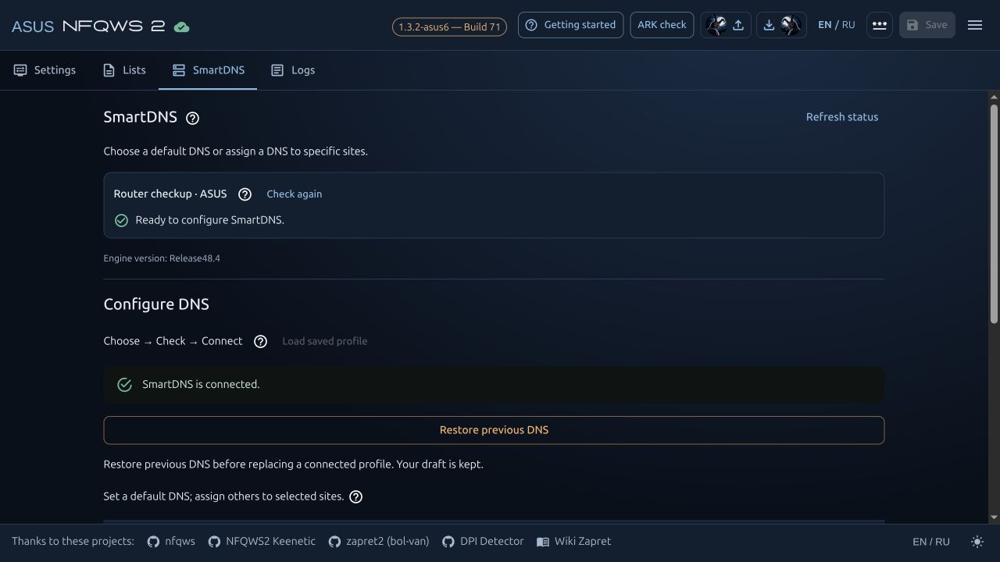](images/screenshots/smartdns-en.jpg)

### DNS for individual sites

A SmartDNS profile assigns DoH/DoT servers to domains. Include subdomains extends the rule to matching names. Editing fields prepares a profile; connection follows validation.

Show screenshot

[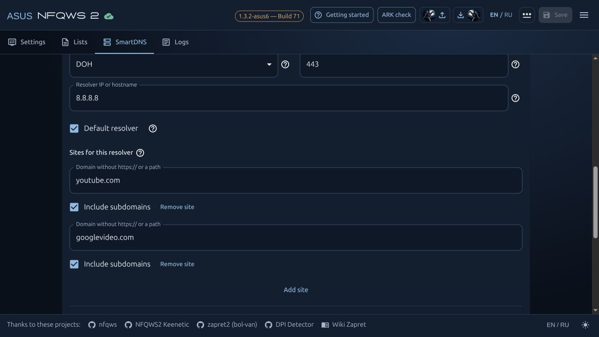](images/screenshots/dns-rules-en.jpg)

### Fixed DNS answers

A separate rule maps a domain to specified IPs. Use it when an address is known and verified; it does not automatically discover a working server. Review the record if the service changes its addresses.

Show screenshot

[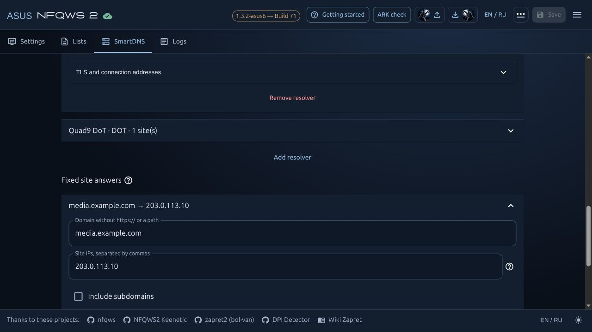](images/screenshots/fixed-dns-en.jpg)

### Diagnostics and submission contents

Export / share lets you select diagnostics, a saved DPI Detector result, strategy blocks, lists, blobs or DNS. Select all chooses materials; it does not fill in the strategy purpose. Editing a submission copy does not alter the router configuration.

Show screenshot

[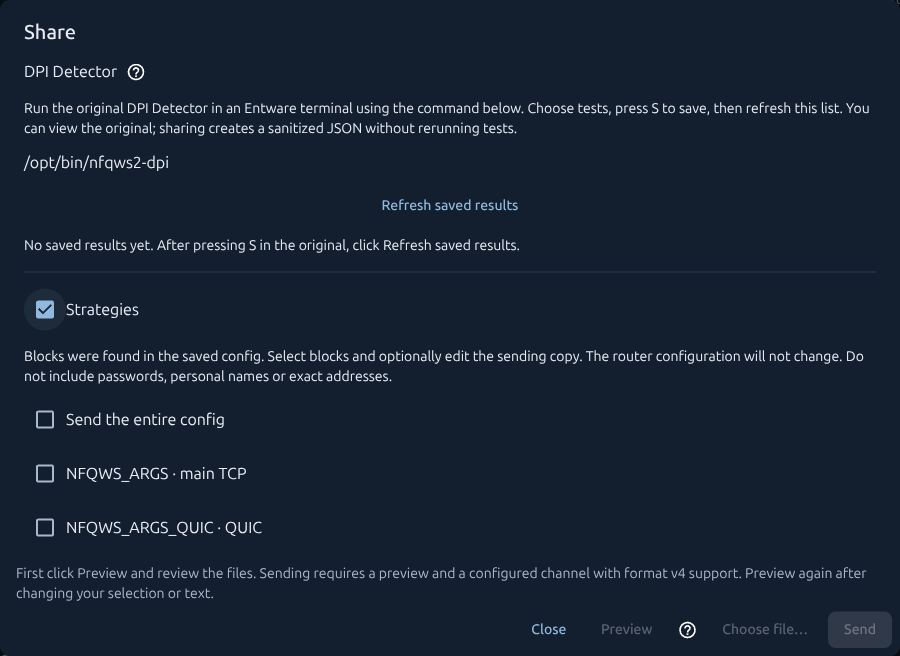](images/screenshots/diagnostics-en.jpg)

### Share a working profile

Selecting a strategy reveals Service or purpose, provider and comment fields. Describe what you tested and under which conditions. Preview prepares a review and JSON download; Send to developer is a separate action. Preview again after changing the contents or text.

Show screenshot

[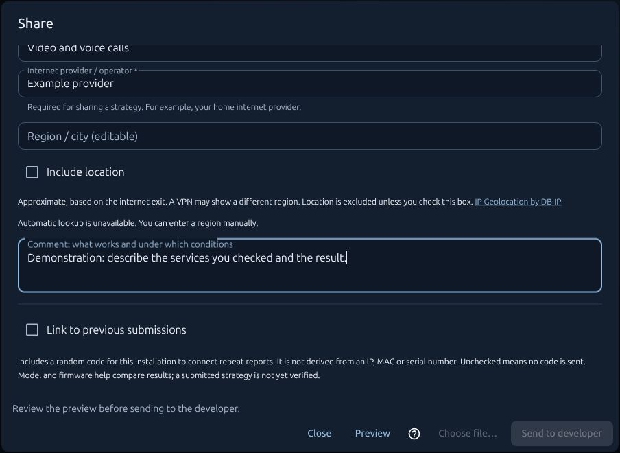](images/screenshots/profile-sharing-en.jpg)

### MTProto for Telegram — without Docker

Open MTProto for Telegram in the footer, choose Without Docker and select a device. The panel fills in the ASUS LAN address, keeps it editable, and generates a dd-secret, installer and connection link. Run installation on the selected device; it does not replace NFQWS2. A LAN link works at home; external access requires a separately configured route to the proxy.

Show screenshot

[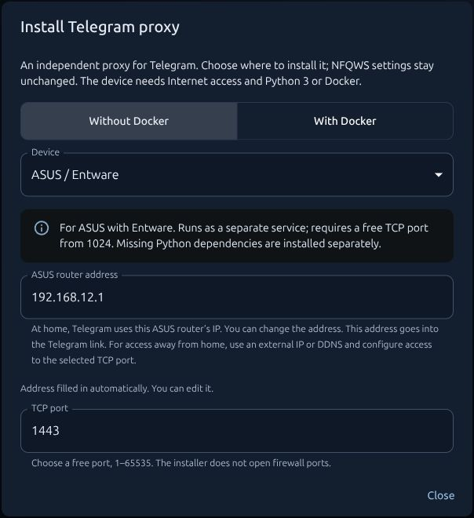](images/screenshots/mtproto-entware-en.jpg)

[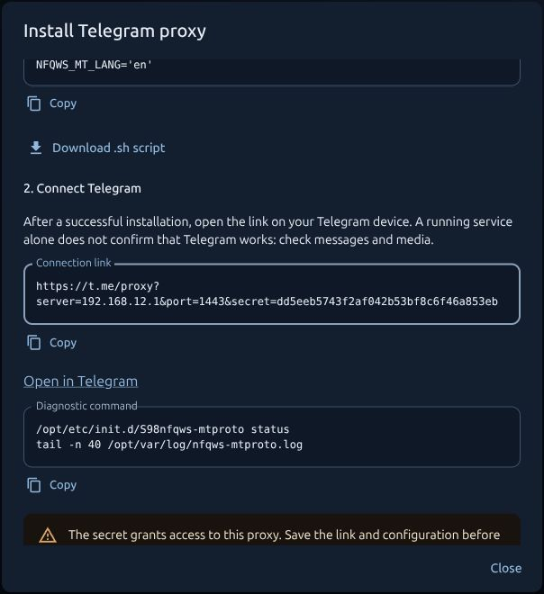](images/screenshots/mtproto-link-en.jpg)

### MTProto — Docker and Portainer

Choose With Docker, then Portainer for compose.yaml or Terminal for a command. The link uses the editable Docker host address. Save the configuration and link before closing: generating a new secret does not change an installed proxy. The installer does not open firewall ports.

Show screenshot

[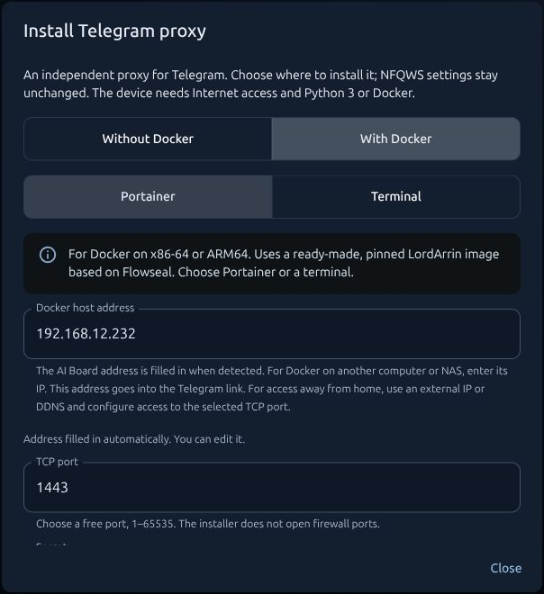](images/screenshots/mtproto-docker-en.jpg)

### Temporary technical channel

The footer button opens a field for an administrator invitation link. Arrange access beforehand: the administrator can run router commands during the session. Access expires, can be disconnected manually, and does not resume after reboot.

Show screenshot

[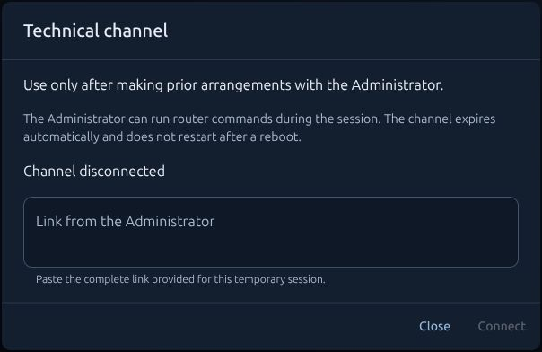](images/screenshots/technical-channel-en.jpg)

### Updates in the panel

Check for updates in the top bar shows installed and available builds with changes between them. Preparation downloads and verifies the package. Installation records service states, stops services during replacement, then restores their previous states. Recovery runs on failure. A previously stopped service should remain stopped.

Show screenshot

[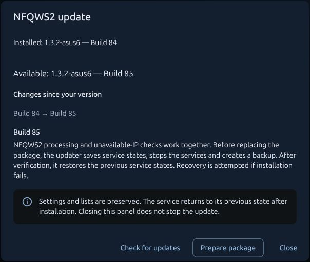](images/screenshots/updates-en.jpg)

[Project documentation](README.en.md#inside-the-panel).
