# Скриншоты панели

Разные разделы панели с демонстрационными настройками. Нажмите на снимок, чтобы открыть его в полном размере.

## Главное окно NFQWS2

[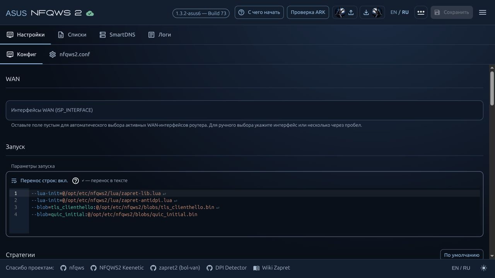](images/screenshots/panel-overview-ru.jpg)

## С чего начать

Чекап роутера и последовательность настройки с состоянием каждого этапа.

[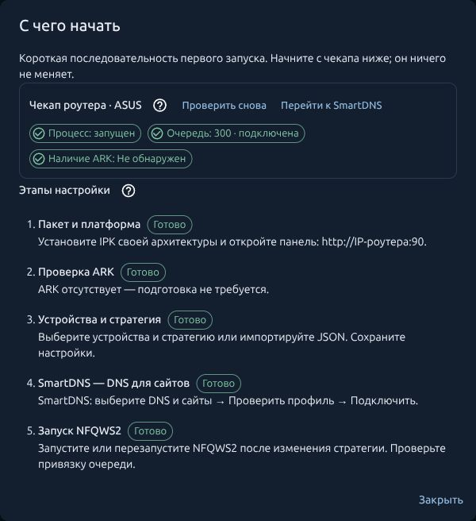](images/screenshots/getting-started-ru.jpg)

## Выбор устройств

Обработка только указанных устройств, примеры IPv4 и напоминание о закреплении адресов в DHCP.

[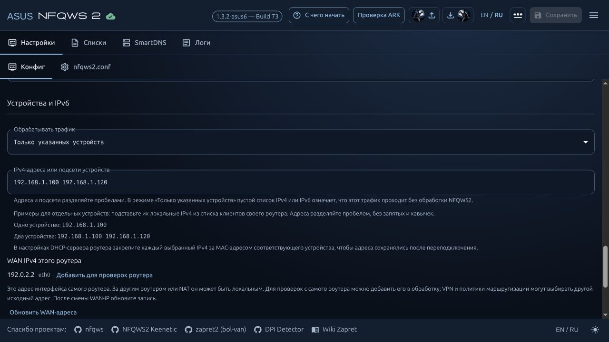](images/screenshots/devices-ru.jpg)

## Каталог стратегий

Профили провайдеров и глобальные стратегии в одном окне импорта.

[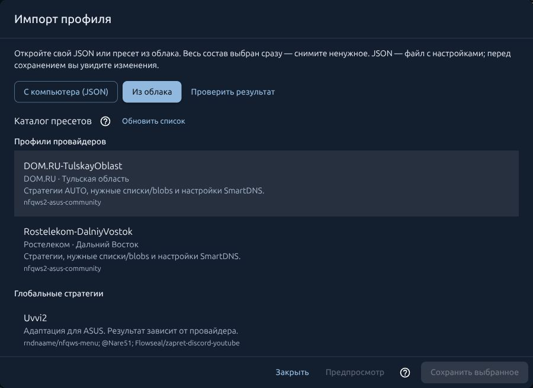](images/screenshots/profile-catalog-ru.jpg)

## Предпросмотр импорта

Сравнение «было / станет» до сохранения выбранных изменений.

[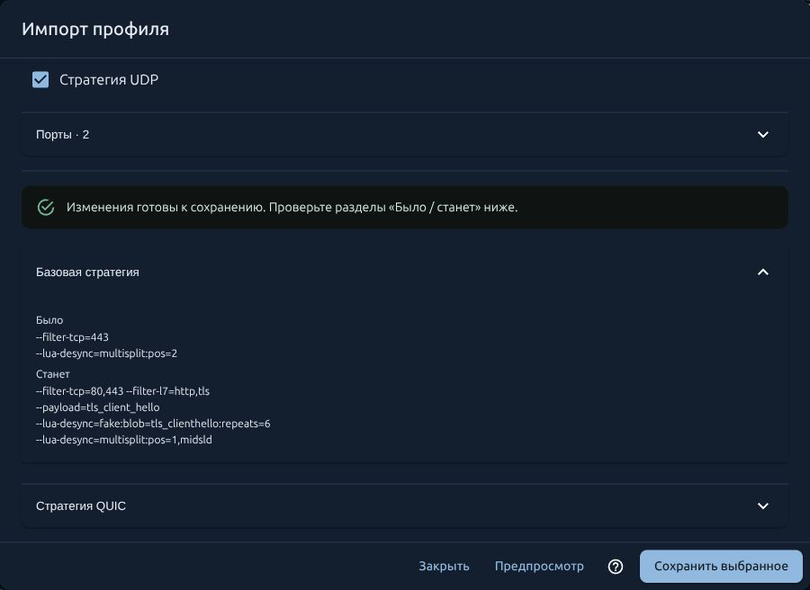](images/screenshots/import-preview-ru.jpg)

## Редактор стратегий

Отдельные блоки TCP и QUIC, подсветка параметров и различимые переносы строк.

[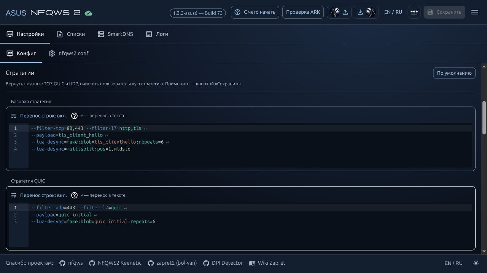](images/screenshots/strategy-editor-ru.jpg)

## Списки доменов

Редактирование своего списка и переключение между файлами.

[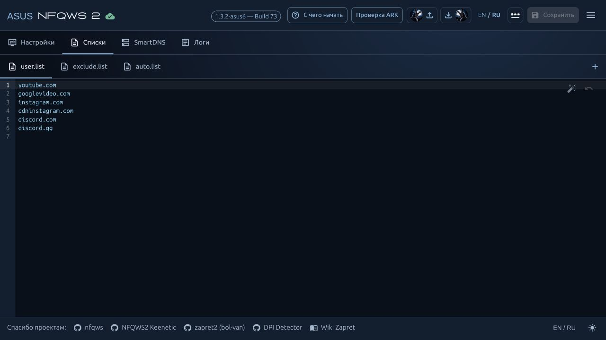](images/screenshots/domain-lists-ru.jpg)

## SmartDNS: подключение и возврат

Состояние DNS, чекап и кнопка возврата прежних настроек.

[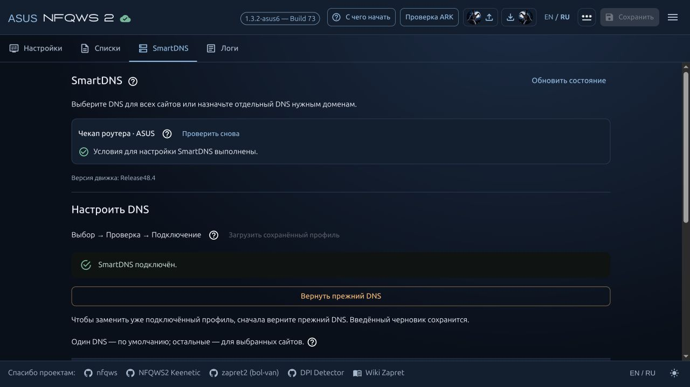](images/screenshots/smartdns-ru.jpg)

## DNS для отдельных сайтов

Пример назначения DNS доменам с учётом поддоменов.

[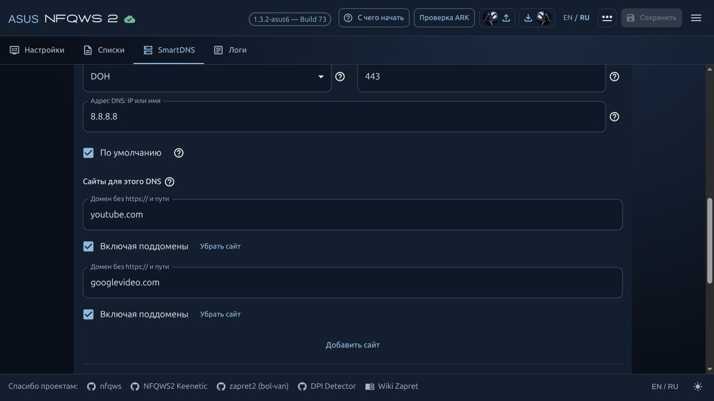](images/screenshots/dns-rules-ru.jpg)

## Фиксированные ответы DNS

Домен и заданный IP-адрес в отдельном правиле.

[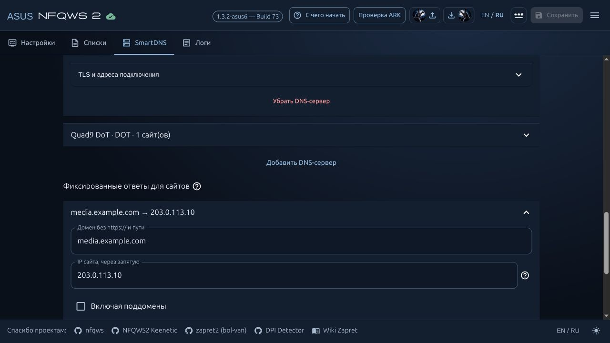](images/screenshots/fixed-dns-ru.jpg)

## Диагностика и состав отправки

Выбор диагностики, результата DPI и блоков стратегии.

[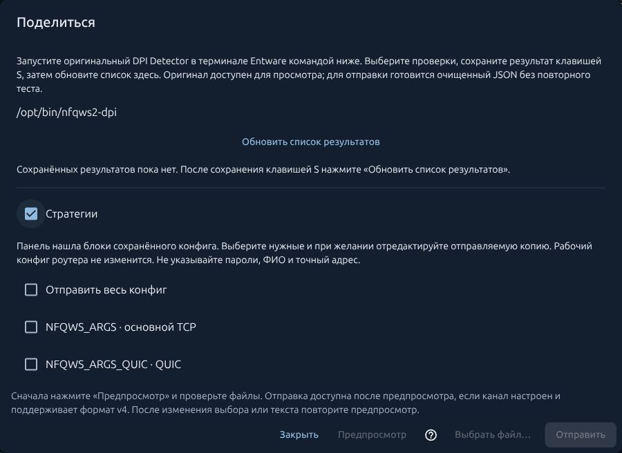](images/screenshots/diagnostics-ru.jpg)

## Поделиться рабочим профилем

Провайдер, назначение и описание результата перед предпросмотром отправки.

[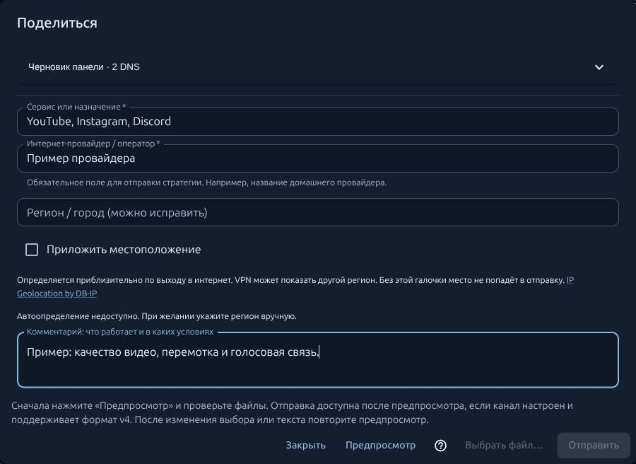](images/screenshots/profile-sharing-ru.jpg)

## Обновление из панели

Изменения между установленной и новой версией перед подготовкой пакета.

[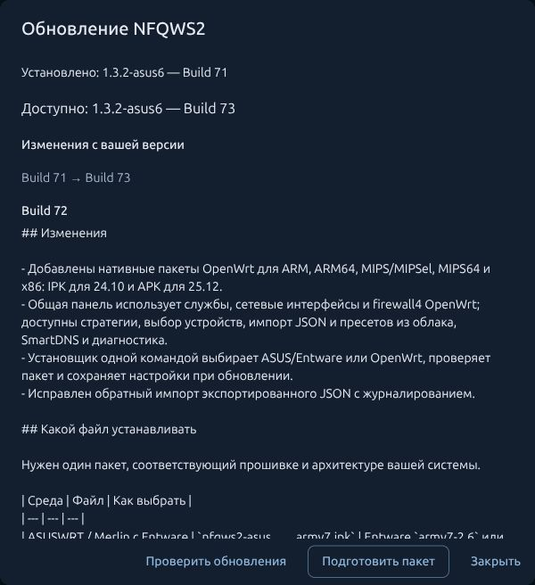](images/screenshots/updates-ru.jpg)

[На главную](README.md#внутри-панели).
