# Скриншоты панели

Галерея начинается с **реальных снимков Build 99**: панель ПК и телефона, разные стратегии для устройств, встроенный DPI Detector и обновление. Справочные снимки Build 96 и архив Build 85 сохранены отдельно. Историческое сравнение Detector остаётся привязанным к Build 89 и 5 ноября 2026 года.

Разверните нужный снимок и нажмите на него для полного размера. Изображения без анимации; разделы свёрнуты, чтобы галерея занимала меньше места на телефоне.

[English](SCREENSHOTS.en.md) · [Инструкция](README.md)

## Реальные снимки Build 99

Снимки сделаны 7 ноября 2026 года в установленной панели: ASUS/Entware и OpenWrt на ASUS. Главное окно показывает фактическую версию и состояние службы. Нажмите на изображение для полного размера.

### Главное окно и телефон

Новая вкладка «Устройства · бета» находится в общей строке разделов. На телефоне строка вкладок прокручивается горизонтально. Язык, оформление и ссылки — в сворачиваемой нижней панели.

Показать главное окно Build 99

[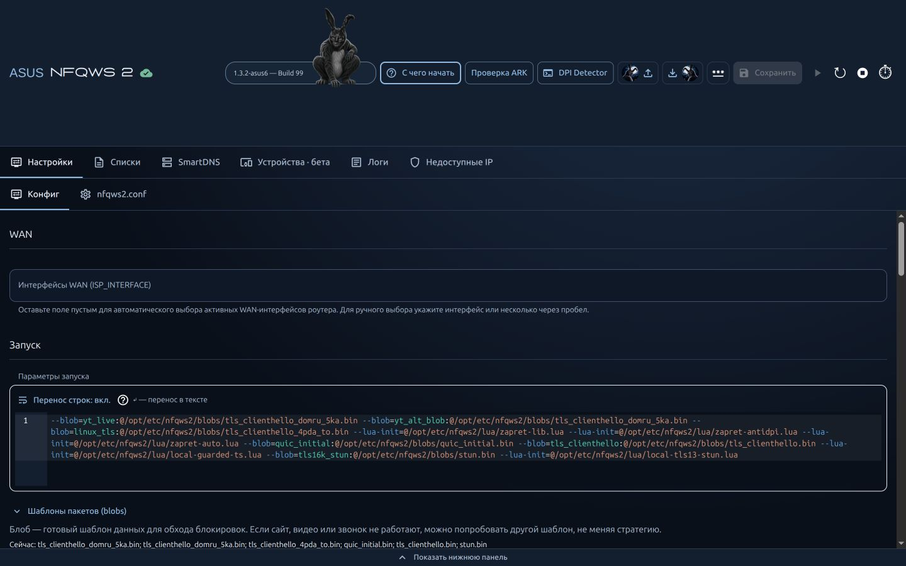](images/screenshots/build99-panel-overview-ru.jpg)

[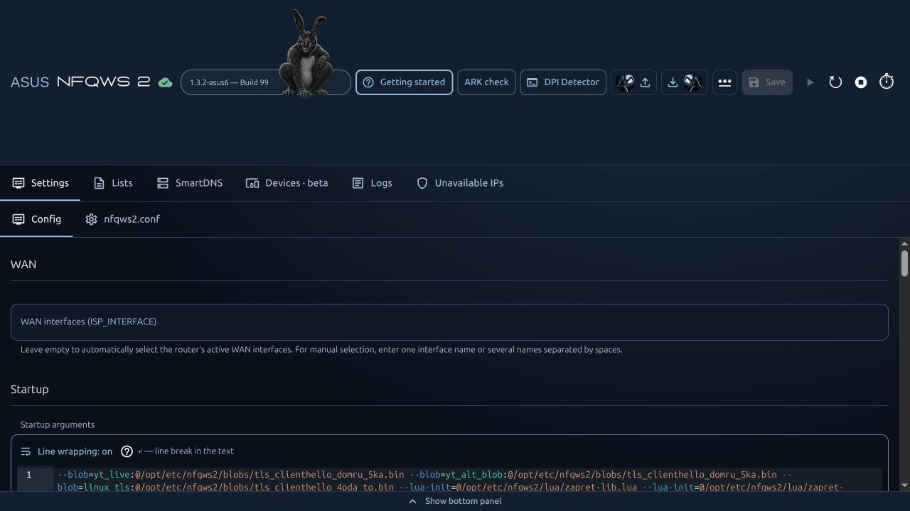](images/screenshots/build99-panel-overview-en.jpg)

Показать мобильную разметку Build 99

[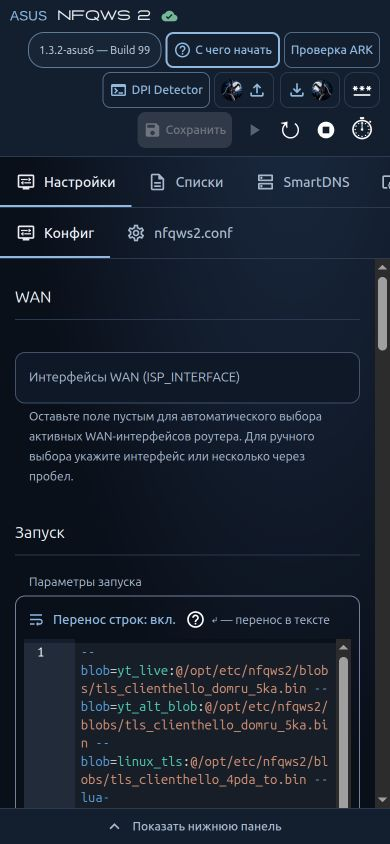](images/screenshots/build99-layout-mobile-portrait-ru.jpg)

[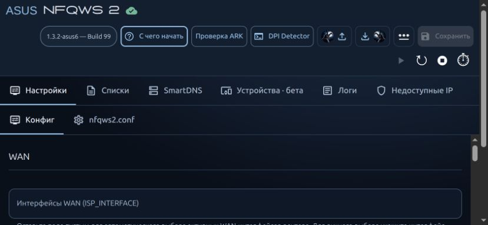](images/screenshots/build99-layout-mobile-landscape-ru.jpg)

[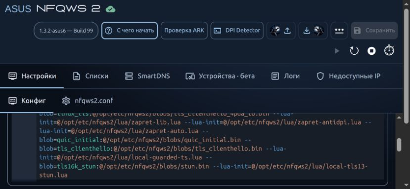](images/screenshots/build99-layout-mobile-landscape-scroll-ru.jpg)

[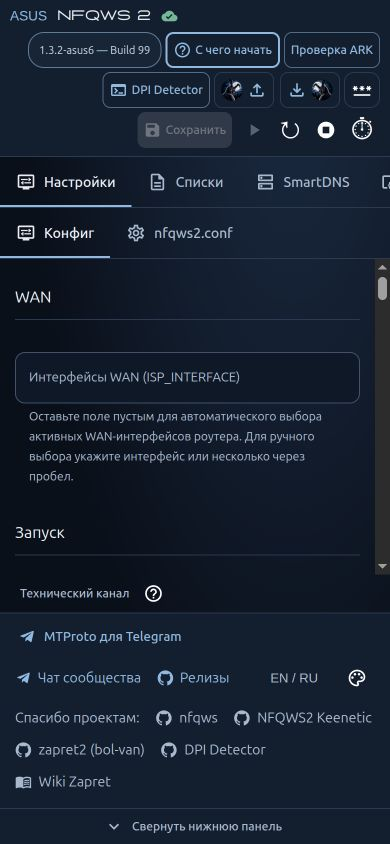](images/screenshots/build99-footer-mobile-expanded-ru.jpg)

### Разные стратегии для разных устройств · бета

**Общий режим** остаётся по умолчанию. В **«По устройствам»** можно назначить стратегии отдельным клиентам, менять приоритеты и использовать текущую или стоковую стратегию. Библиотека добавляет собственные копии, JSON с ресурсами и профили каталога. DNS остаётся общим. [Пошаговая инструкция и лимиты](docs/DEVICE-PROFILES.md).

На первом снимке — реальный общий режим. На примере с телевизором и телефоном показан **несохранённый черновик** с условными названиями и адресами. Предпросмотр проверен, но «Сохранить черновик» и «Применить сохранённый режим» для примера не нажимались: рабочий режим остался общим, служба — выключенной. Это пример интерфейса, а не доказательство подключения этих устройств или результата обхода.

Показать общий режим и библиотеку стратегий

[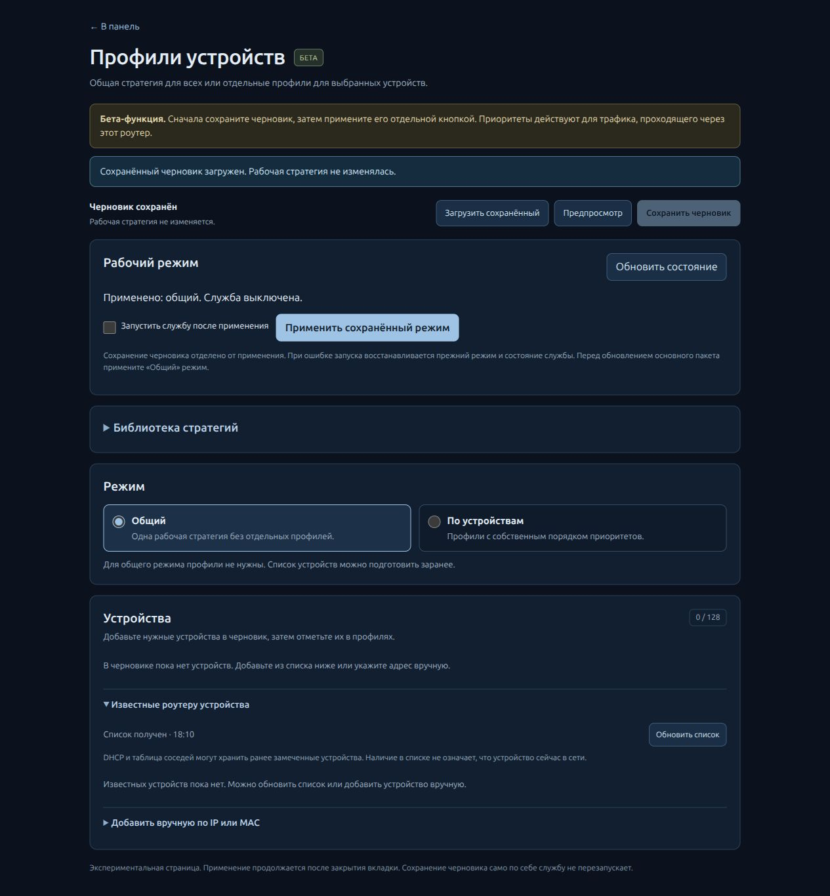](images/screenshots/build99-device-profiles-common-ru.jpg)

[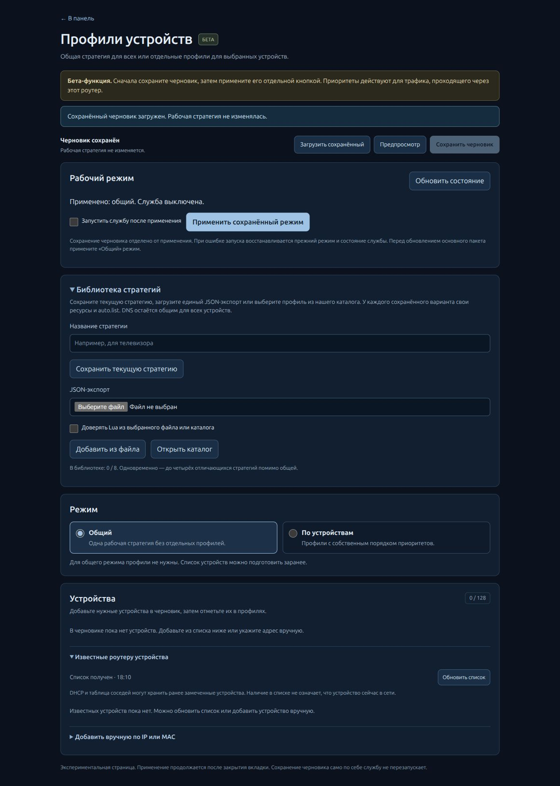](images/screenshots/build99-device-profiles-library-ru.jpg)

Показать разные стратегии, приоритеты и предпросмотр примера

[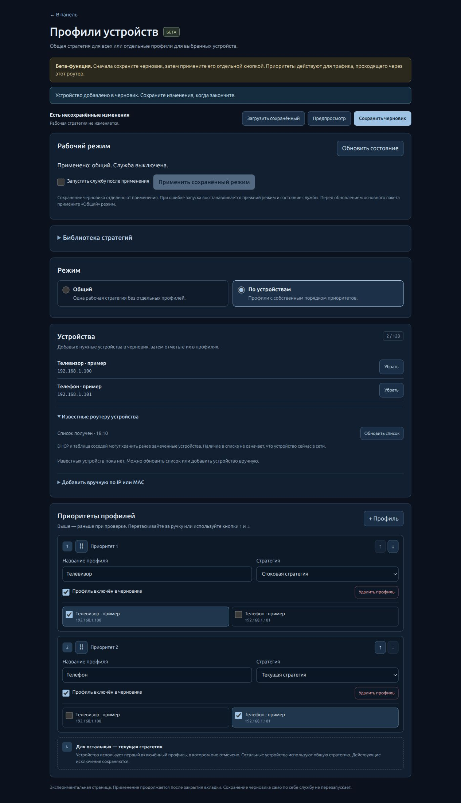](images/screenshots/build99-device-profiles-draft-ru.jpg)

[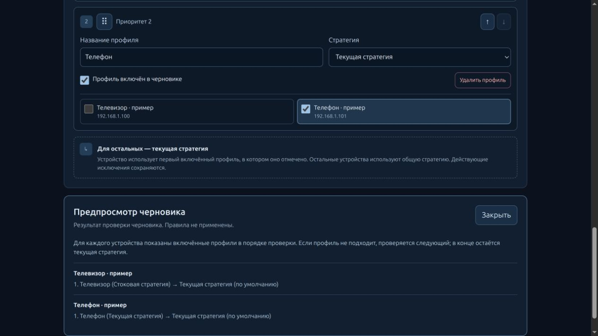](images/screenshots/build99-device-profiles-preview-ru.jpg)

### Встроенный DPI Detector и наглядный пример

Кнопка **DPI Detector** открывает оригинальное меню прямо в панели; если инструмент не установлен, здесь предлагается установка. На снимке тесты **1–3** выбраны по умолчанию. После прогона **S** сохраняет результат; в **«Отчётах TXT»** можно скачать файл на свой ПК или телефон. Для сравнения двух стратегий повторяйте одинаковые тесты с включённой службой и одинаковыми условиями. [Инструкция](DPI-DETECTOR.md).

Показать оригинальное меню и проверку сервисов Build 99

[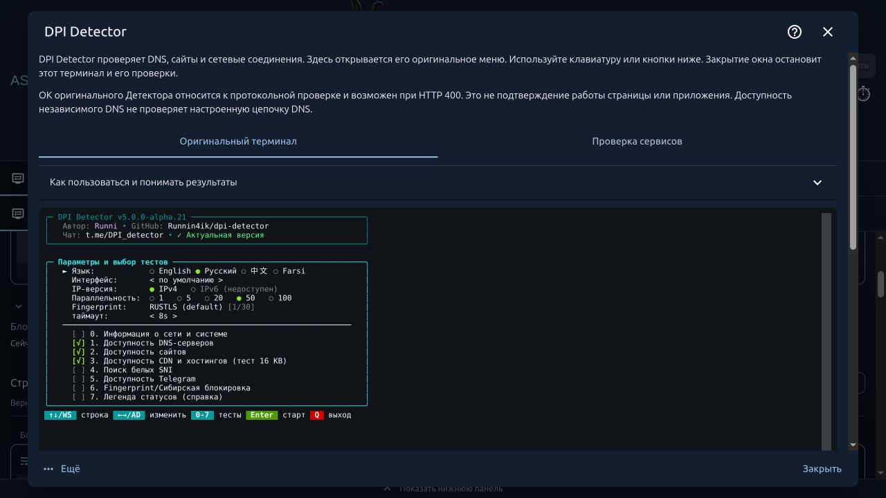](images/screenshots/build99-detector-menu-ru.jpg)

[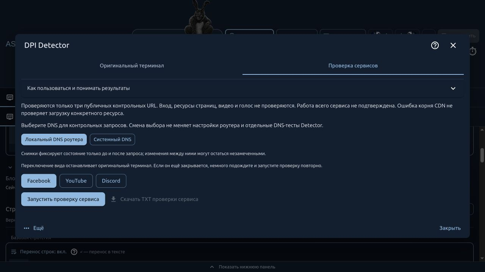](images/screenshots/build99-service-checks-ru.jpg)

**[Крупные реальные скрины: штатная стратегия и личная DOM.RU](docs/DETECTOR-COMPARISON.md).** На одной линии TCP изменился с **67/110 до 97/110**, HTTP — с **16/35 до 35/35**. При этом QUIC был **19/21 и 18/21**: улучшение части тестов не означает улучшения всех протоколов. Это исторические измерения Build 89 от 5 ноября, NFQWS2 включён в обоих прогонах. Результаты не переносятся автоматически на другой профиль, провайдера или регион.

«Проверка сервисов» дополняет оригинальное меню: локальный DNS роутера или системный резолвер, HTTP-коды, ошибки и отдельный TXT. Она проверяет контрольные URL, а не весь сайт, видео или голос. Путь DNS указан в отчёте; смена выбора не переключает настройки SmartDNS.

### Подтверждённое обновление

На снимке — итог завершённой установки Build 99 и сообщение об актуальной версии. Новая установка ради снимка не запускалась. 100% обозначает пройденные этапы, а не оценку оставшегося времени. [Обновление и восстановление](PACKAGE-UPDATES.md).

Показать завершённое обновление Build 99

[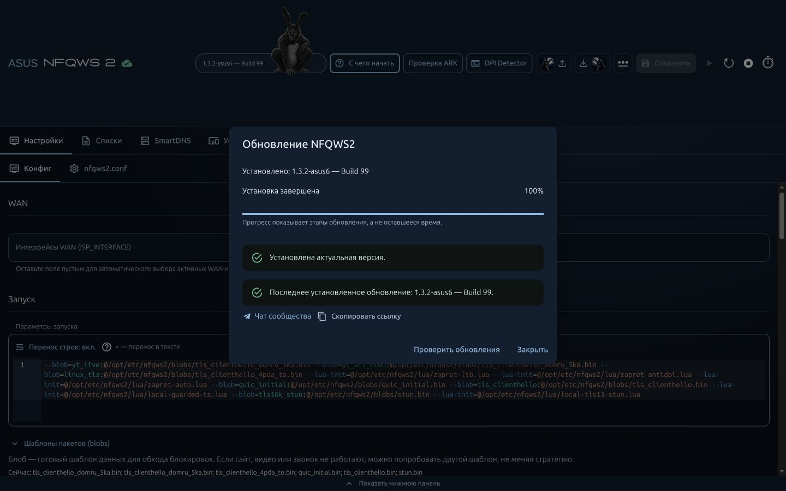](images/screenshots/build99-updates-ru.jpg)

## Справочные экраны Build 96

| Что изменилось после архивных снимков | Где описано |
| --- | --- |
| Компактная шапка телефона, выровненные кнопки, прокрутка в портретной и горизонтальной ориентации; язык и тема в сворачиваемой нижней панели | [Разметка и управление](USAGE.md) |
| Один оригинальный терминал Detector, «Отчёты TXT» со скачиванием на ПК/телефон и удаление через «Ещё» с отдельным подтверждением; отчёты сохраняются по умолчанию | [Detector и отчёты](DPI-DETECTOR.md) |
| «Проверка сервисов»: три контрольных HTTPS-URL выбранного Facebook, YouTube или Discord, HTTP-коды и ошибки, отдельный TXT с контекстом запросов | [Границы проверки](DPI-DETECTOR.md#проверка-сервисов) |
| «Дополнения · Бета»: Riot для веб-доменов и отдельное правило торрент-сайтов; галочки выключены, изменения видны в общем предпросмотре | [Импорт дополнений](IMPORT.md#дополнения--бета) |
| Загрузка импортированного черновика SmartDNS с сохранением несохранённых ручных правок | [Редактор SmartDNS](SMARTDNS.md) |
| Этапы обновления, причина отказа и журнал, учёт медленного USB, сохранение настроек и прежнего состояния служб | [Обновление и восстановление](PACKAGE-UPDATES.md) |

## Реальные снимки Build 96

Снимки ниже получены в работающей панели Build 96. Они показывают интерфейс и выбранные действия; доступность всех функций сайта, видео, голоса или игры по ним не устанавливается. Нажмите на изображение, чтобы открыть оригинал.

### Шапка, телефон и прокрутка

Основные кнопки выровнены по высоте, на узком экране переносятся на строки. Нижняя панель изначально свёрнута; язык и тема находятся в ней. На горизонтальном и низком экране настройки и низ страницы остаются доступны с прокруткой.

Показать главное окно Build 96

[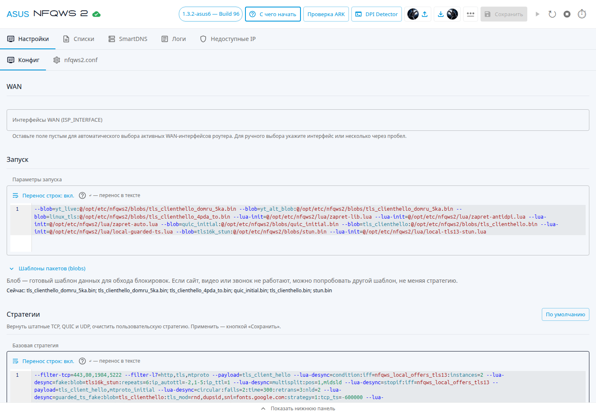](images/screenshots/build96-panel-overview-ru.png)

Показать телефон: портретная и горизонтальная ориентация

[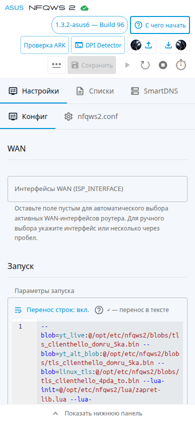](images/screenshots/build96-layout-mobile-portrait-ru.png)

[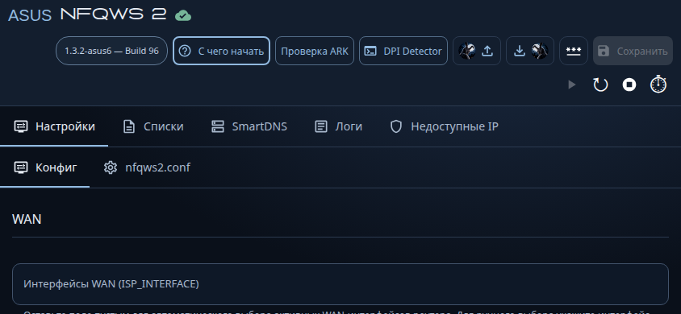](images/screenshots/build96-layout-mobile-landscape-ru.png)

[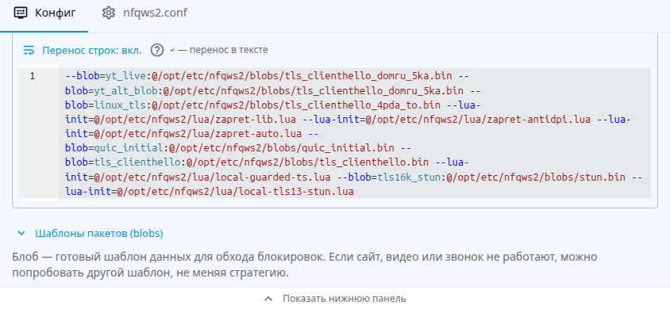](images/screenshots/build96-layout-mobile-landscape-scroll-ru.png)

Показать раскрытую нижнюю панель телефона

[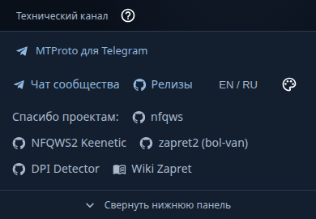](images/screenshots/build96-footer-mobile-expanded-ru.png)

### Проверка сервисов — Build 96

Новый режим отделён от оригинального терминала. На снимке показано окно **до запуска**: выбор Facebook, YouTube или Discord и объяснение границ трёх контрольных URL. После проверки доступны точные HTTP-коды, сетевые ошибки, объём ответа и собственный TXT с контекстом запросов. [Как читать результат](DPI-DETECTOR.md#проверка-сервисов).

[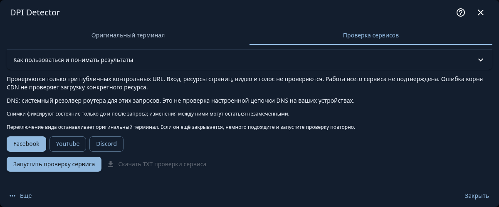](images/screenshots/build96-service-checks-ru.png)

### Сохранение отчётов при удалении Detector

«Ещё → Удалить DPI Detector» открывает отдельное подтверждение. Галочка удаления сохранённых отчётов выключена: при обычном удалении TXT остаются. На снимке показан запрос подтверждения, удаление не выполнялось. Скачивание оригинальных отчётов находится в «Отчётах TXT» окна Detector.

Показать подтверждение удаления

[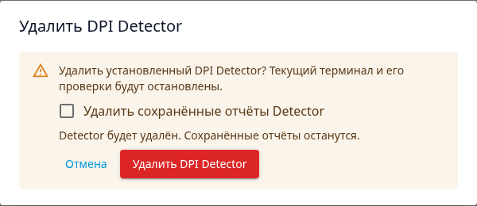](images/screenshots/build96-detector-remove-ru.png)

### Наглядный пример Detector: штатная и личная стратегии

**Исторические реальные прогоны Build 89, 5 ноября 2026 года. NFQWS2 включён в обоих случаях; менялась стратегия.** Это одна линия DOM.RU в Тульской области. Итоги принадлежат измеренным конфигурациям и не подтверждают результат изменённой публичной копии профиля. [Все 12 крупных кадров, условия и ограничения сравнения](docs/DETECTOR-COMPARISON.md).

**Штатная стратегия:** TCP 67/110, HTTP 16/35, TLS 1.2 и TLS 1.3 по 31/35, QUIC 19/21.

[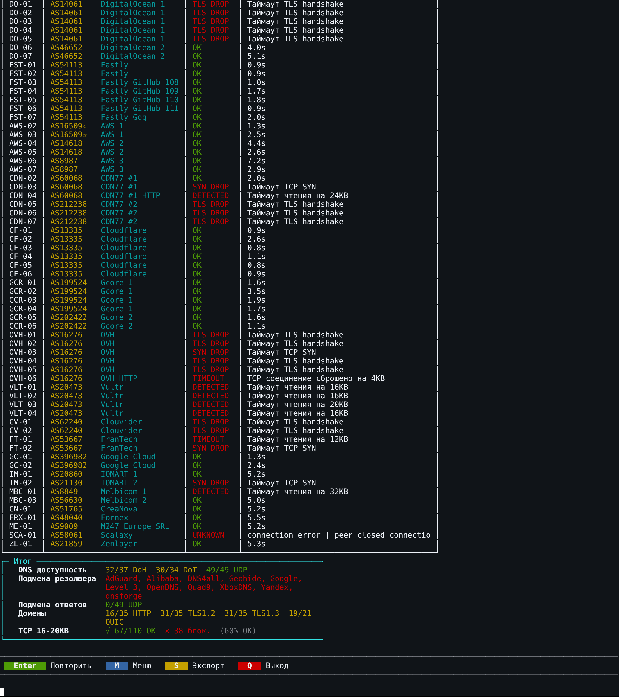](images/screenshots/detector-comparison-stock-06-bottom.png)

**Личная стратегия:** TCP 97/110, HTTP 35/35, TLS 1.2 и TLS 1.3 по 35/35, QUIC 18/21. Часть ошибок сохраняется; процент не равен работоспособности всего сервиса.

[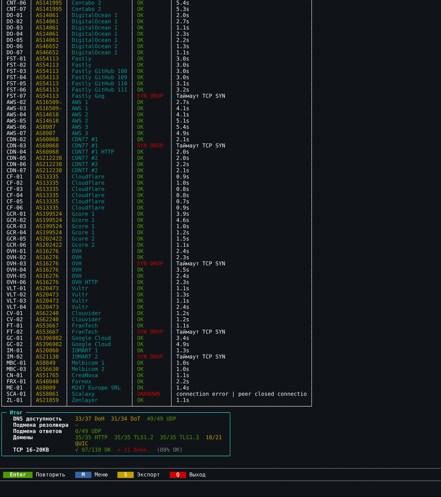](images/screenshots/detector-comparison-personal-06-bottom.png)

### Каталог: профили с результатами Detector

Опубликованная ревизия 6 содержит 30 профилей. Ниже — две реальные карточки из панели Build 96 после обновления каталога. В описаниях указаны условия и отдельные показатели; для Билайн результат исходной конфигурации отделён от ещё не измеренной обезличенной копии. Дата «Обновлено» в карточке показывается в UTC; дата измерений приведена в описании. [Как выбирать профиль](PRESETS.md#профили-с-результатами-detector).

Показать карточки DOM.RU и Билайн

[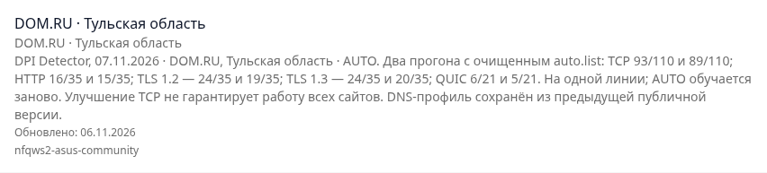](images/screenshots/catalog6-domru-results-ru.png)

[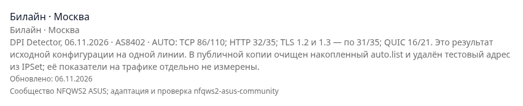](images/screenshots/catalog6-beeline-moskva-ru.png)

### Дополнения · Бета

Под основной стратегией видны необязательные Riot и отдельное правило торрент-сайтов. Галочки выключены; выбранное дополнение рассматривается вместе с базовым профилем в общем предпросмотре. Riot относится к веб-доменам, работа игрового UDP не подтверждается. [Состав и ограничения](IMPORT.md#дополнения--бета).

Показать выбор дополнений

[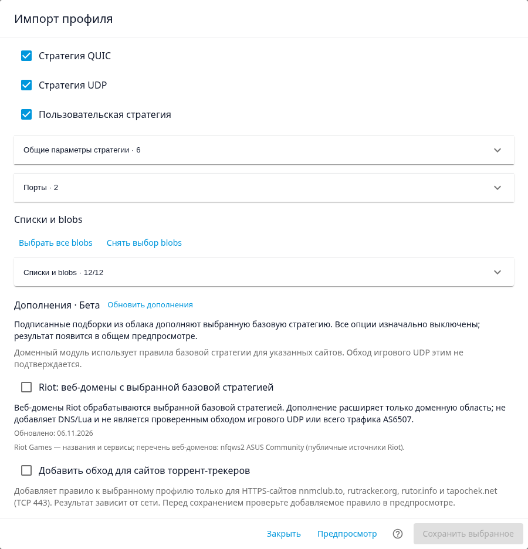](images/screenshots/build96-import-addons-ru.png)

Общий предпросмотр показывает добавленные Riot-домены, расширение области базовой стратегии и файлы, которые будут заменены. На снимке изменения только подготовлены: «Сохранить выбранное» не нажимали.

[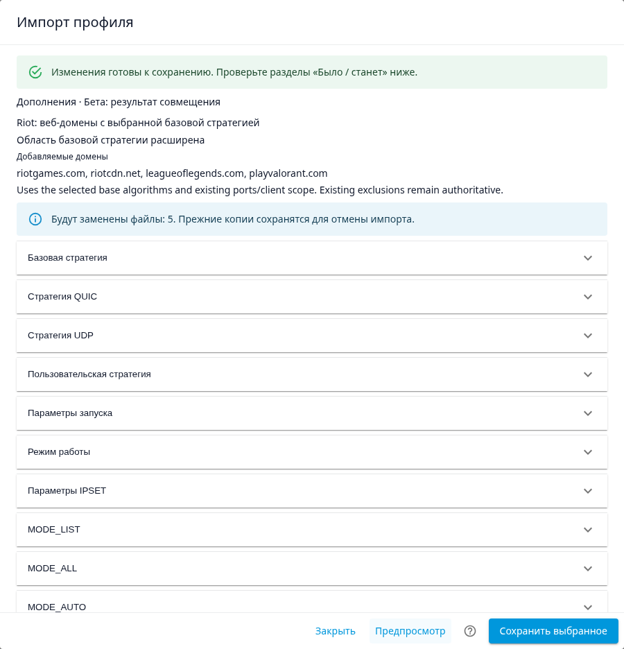](images/screenshots/build96-import-addons-preview-ru.png)

### Редактор SmartDNS

В редакторе видны сервер, протокол, домены и включение поддоменов. Импорт заполняет черновик, а проверка, подключение и подтверждение DNS выполняются отдельно. Снимок редактора не подтверждает успешное подключение. [Порядок работы](SMARTDNS.md).

Показать редактор SmartDNS

[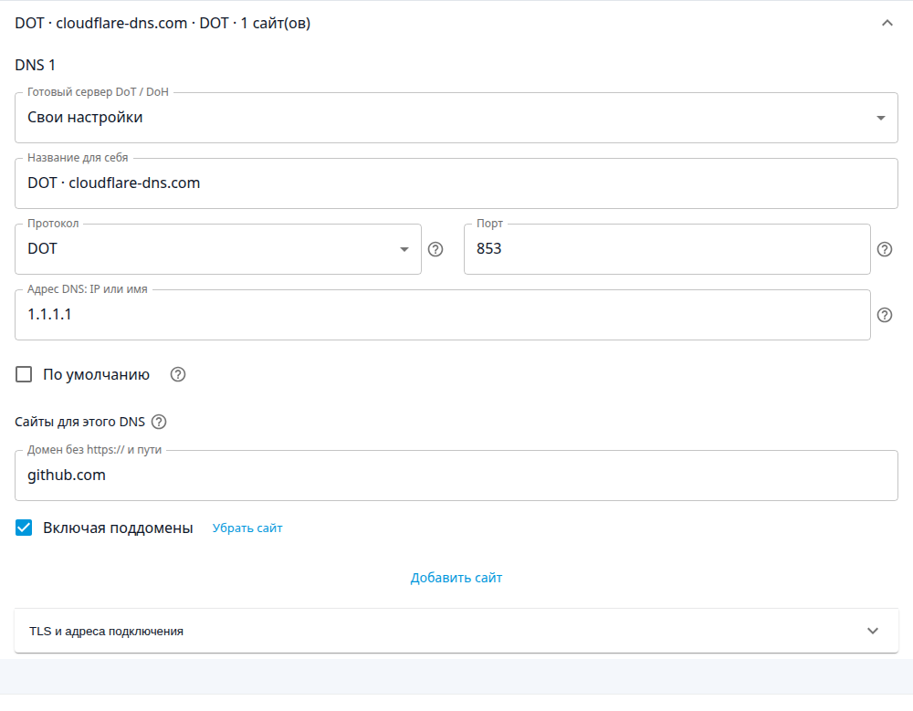](images/screenshots/build96-smartdns-editor-ru.png)

### Окно обновлений

На снимке показан итог **уже завершённой установки Build 96** и сообщение, что версия актуальна. 100% относится к сохранённому результату этой операции; новая установка ради снимка не запускалась. Прогресс обозначает этапы, а не оставшееся время. Здесь же доступны чат сообщества и копирование ссылки. [Этапы, журнал и восстановление](PACKAGE-UPDATES.md).

Показать результат установленной Build 96

[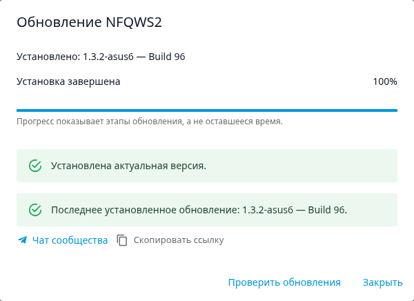](images/screenshots/build96-updates-ru.png)

## Архивная галерея Build 85

### Главное окно NFQWS2

Настройки и управление службой собраны в одной панели. Сверху доступны запуск или перезапуск, меню управления, таймер, импорт, экспорт и проверка обновлений. Кнопка «Сохранить» становится доступной после изменения настроек.

Показать снимок

[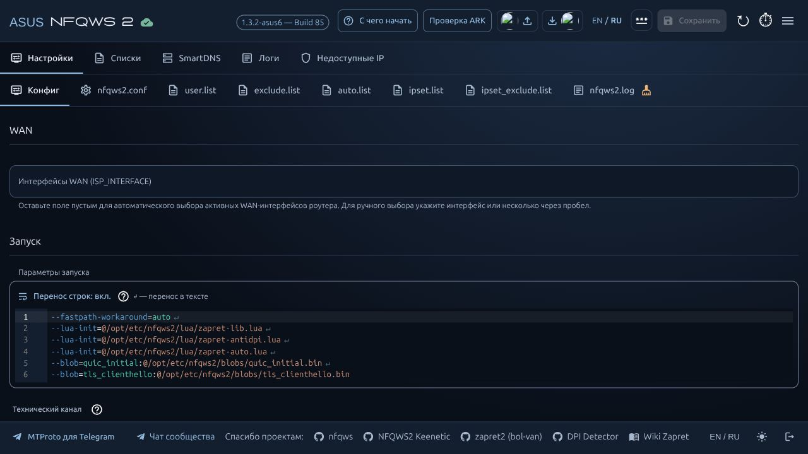](images/screenshots/panel-overview-ru.jpg)

### С чего начать

Кнопка «С чего начать» сверху открывает чекап и этапы настройки. Чекап показывает процесс, привязку очереди, наличие ARK и готовность платформы. Сам чекап ничего не меняет; после настройки проверьте сайты со своего устройства.

Показать снимок

[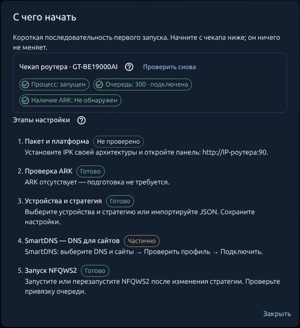](images/screenshots/getting-started-ru.jpg)

### Выбор устройств

«Настройки» → «Устройства и IPv6»: обрабатывать все устройства, только перечисленные или всех, кроме перечисленных. IPv4, IPv6 и подсети разделяются пробелами. Закрепите адреса в DHCP; в режиме «Только указанных» пустой список соответствующего семейства проходит без обработки.

Показать снимок

[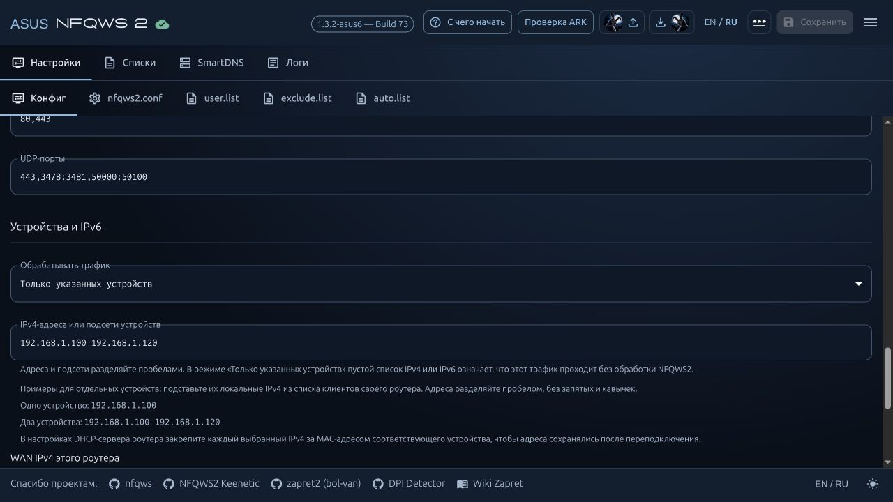](images/screenshots/devices-ru.jpg)

### Каталог стратегий

«Импорт профиля» → «Из облака»: профили провайдеров и глобальные стратегии. Выберите вариант, посмотрите состав и изменения перед сохранением. Название профиля не гарантирует работу у любого провайдера — результат проверяется на вашем подключении.

Показать снимок

[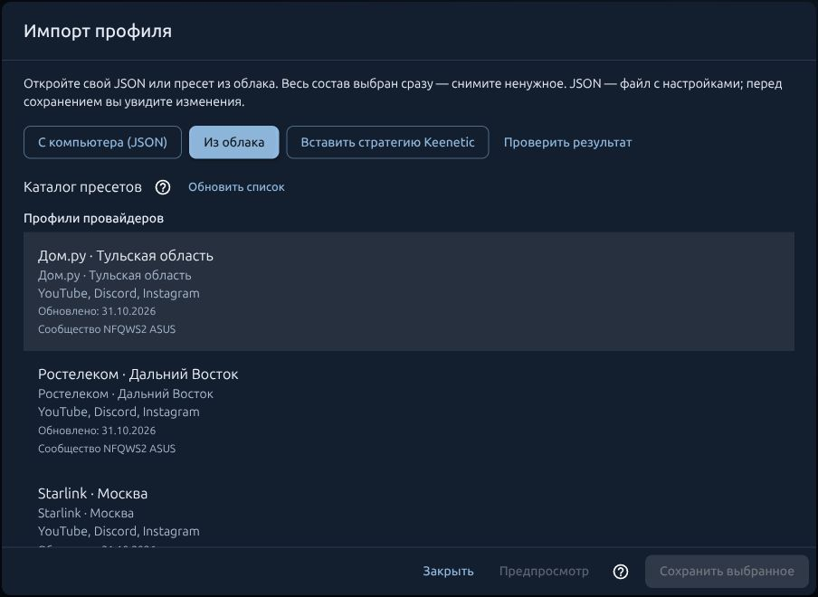](images/screenshots/profile-catalog-ru.jpg)

### Импорт стратегии Keenetic

В окне импорта выберите «Вставить стратегию Keenetic». Вставьте текст для NFQWS2 и нажмите «Преобразовать под ASUS»: панель адаптирует пути и подготовит результат для проверки. Проверьте ссылки на списки и blobs; сохранение выполняется отдельно.

Показать снимок

[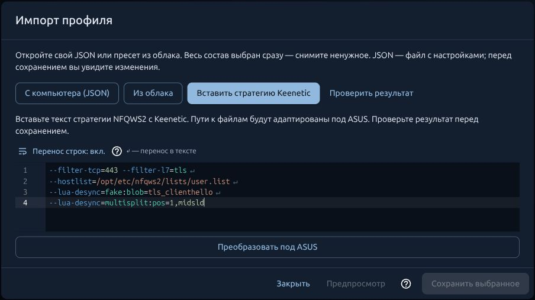](images/screenshots/keenetic-import-ru.jpg)

### Предпросмотр импорта

После выбора JSON или пресета нажмите «Предпросмотр». Сравните «было / станет» и снимите ненужные разделы. До «Сохранить выбранное» рабочие настройки не меняются; после сохранения примените необходимые перезапуски.

Показать снимок

[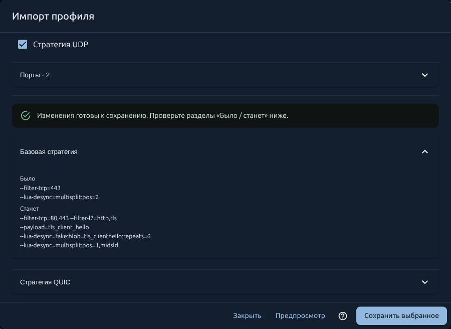](images/screenshots/import-preview-ru.jpg)

### Редактор стратегий

«Настройки» → «Конфиг»: отдельные блоки запуска, TCP, QUIC, UDP и пользовательской стратегии. Подсветка и обозначение переносов помогают проверять параметры. Сначала сохраните изменения, затем перезапустите NFQWS2 для применения стратегии.

Показать снимок

[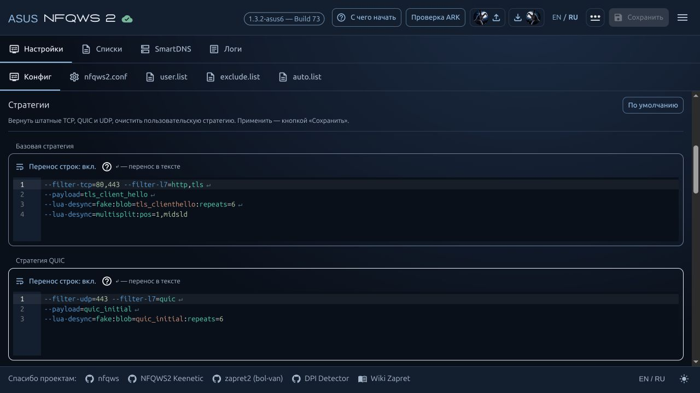](images/screenshots/strategy-editor-ru.jpg)

### Шаблоны пакетов — blobs

Под параметрами запуска раскройте «Шаблоны пакетов (blobs)». Здесь можно выбрать другой файл для уже используемого имени или загрузить свой .bin от 1 байта до 256 КиБ. Выбор меняет черновик: нажмите «Сохранить» и перезапустите службу. Другой blob может не подойти стратегии.

Показать снимок

[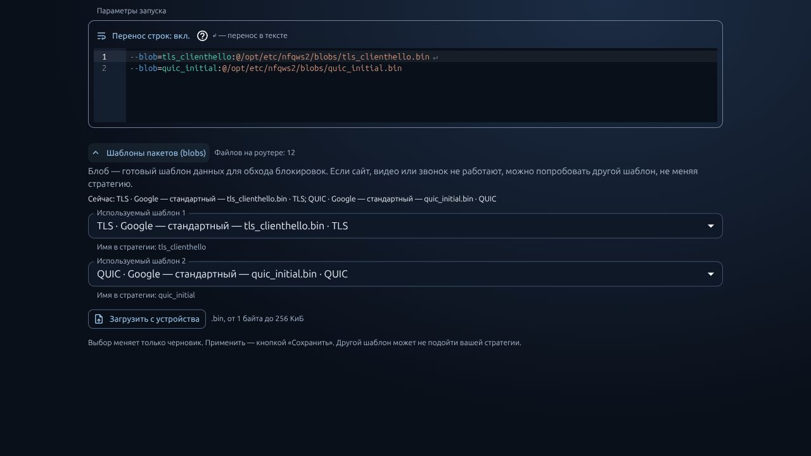](images/screenshots/blob-picker-ru.jpg)

### Списки доменов

На вкладке «Списки» редактируются пользовательские списки и исключения. auto.list заполняется автоматическим режимом доменами, которым понадобилась обработка. Это отдельный список: попадание домена в auto.list не означает подтверждённую недоступность его IP.

Показать снимок

[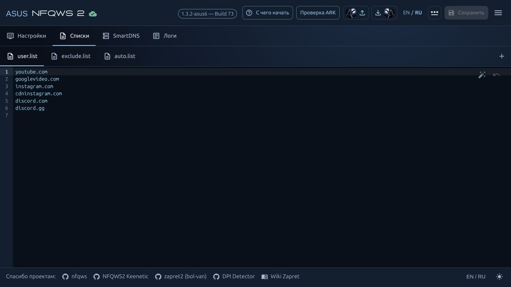](images/screenshots/domain-lists-ru.jpg)

### Недоступные IP

Одноимённая вкладка показывает подтверждённо недоступные адреса, срок исключения и перепроверки. Первое подтверждение — 24 часа, повторное — 7 дней; возврат после трёх успешных проверок. Одиночный тайм-аут или сбой QUIC не создаёт запись. DNS-фильтр работает с обычным UDP DNS выбранных клиентов; DoH, DoT и TCP DNS его обходят.

Показать снимок

[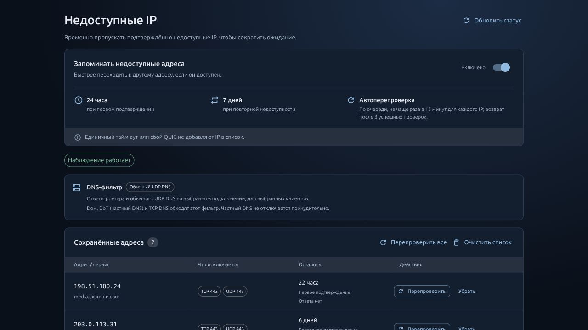](images/screenshots/unavailable-ips-ru.jpg)

### Перезапуск по таймеру и восстановление

Значок таймера рядом с управлением службой: выключено, каждые 4, 12, 24 часа или свой интервал. Полезно на устройствах с небольшим объёмом ОЗУ. Таймер перезапускает только работающий NFQWS2, роутер не перезагружается. Переключатель «Восстанавливать службу» делает до трёх попыток после сбоя с увеличением паузы, затем останавливается; ручную остановку уважает. Выберите параметры и сохраните.

Показать снимок

[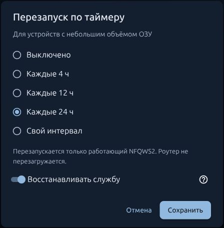](images/screenshots/restart-timer-ru.jpg)

[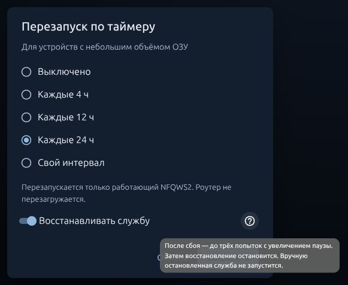](images/screenshots/service-watchdog-ru.jpg)

### SmartDNS: подключение и возврат

Вкладка SmartDNS показывает готовность роутера, профиль DNS и состояние подключения. Подготовьте профиль, проверьте его, затем подключите и подтвердите результат. «Вернуть прежний DNS» возвращает сохранённые настройки. Успешный DNS-ответ сам по себе не доказывает работу сайта.

Показать снимок

[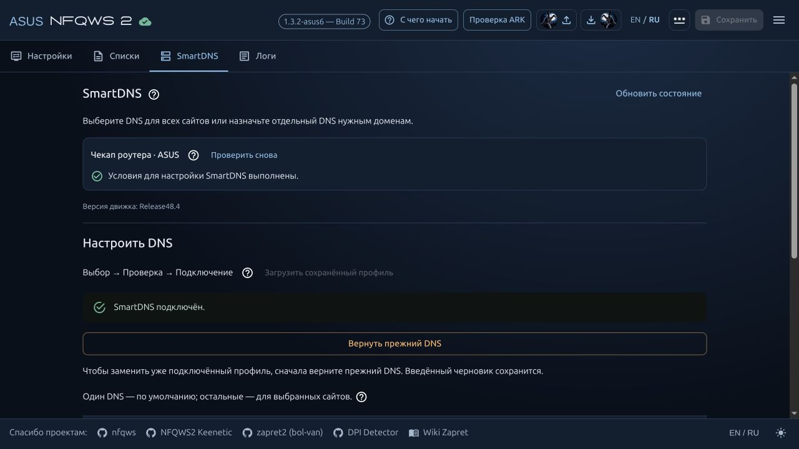](images/screenshots/smartdns-ru.jpg)

### DNS для отдельных сайтов

В профиле SmartDNS задаются DoH/DoT-серверы и домены для каждого сервера. Галочка поддоменов расширяет правило на соответствующие имена. Изменение полей — подготовка профиля; подключение выполняется после проверки.

Показать снимок

[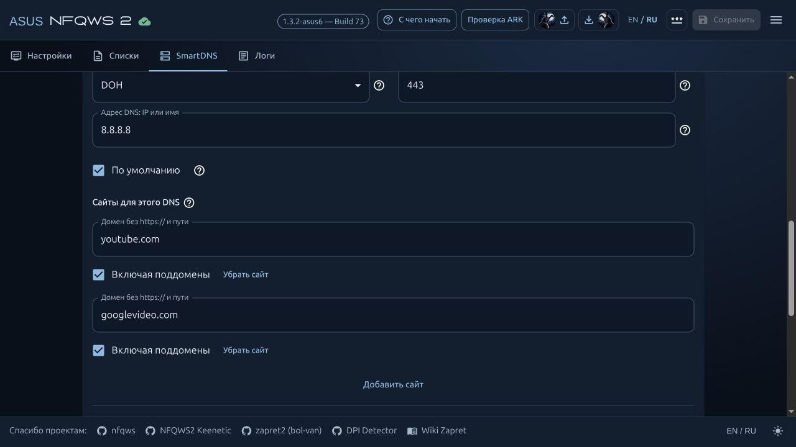](images/screenshots/dns-rules-ru.jpg)

### Фиксированные ответы DNS

Отдельное правило связывает домен с заданными IP. Используйте его, когда адрес известен и проверен; это не автоматический поиск рабочего сервера. При смене адресов сервиса запись нужно пересмотреть.

Показать снимок

[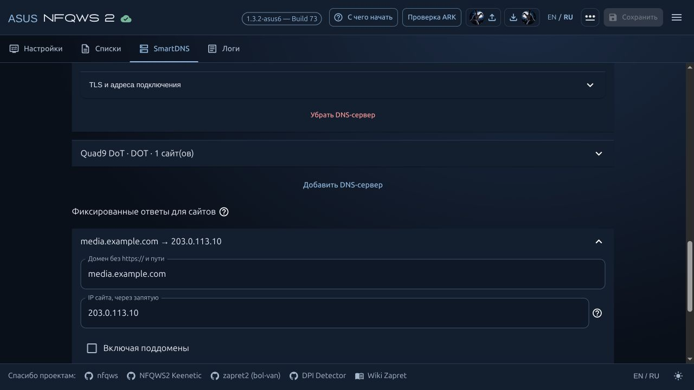](images/screenshots/fixed-dns-ru.jpg)

### Диагностика и состав отправки

«Экспорт / поделиться»: выберите диагностику, сохранённый результат DPI Detector, блоки стратегии, списки, blobs или DNS. «Выбрать всё» выбирает материалы, но не заполняет сведения о назначении стратегии. Правки отправляемой копии не меняют конфиг роутера.

Показать снимок

[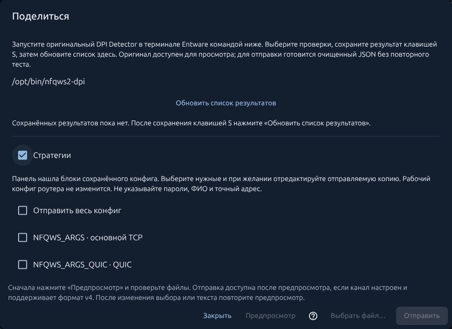](images/screenshots/diagnostics-ru.jpg)

### Поделиться рабочим профилем

При выборе стратегии появляются поля «Сервис или назначение», оператор и комментарий. Укажите, что проверено и в каких условиях. «Предпросмотр» готовит состав для проверки и скачивания JSON; «Отправить разработчику» — отдельное действие. После изменения состава или текста повторите предпросмотр.

Показать снимок

[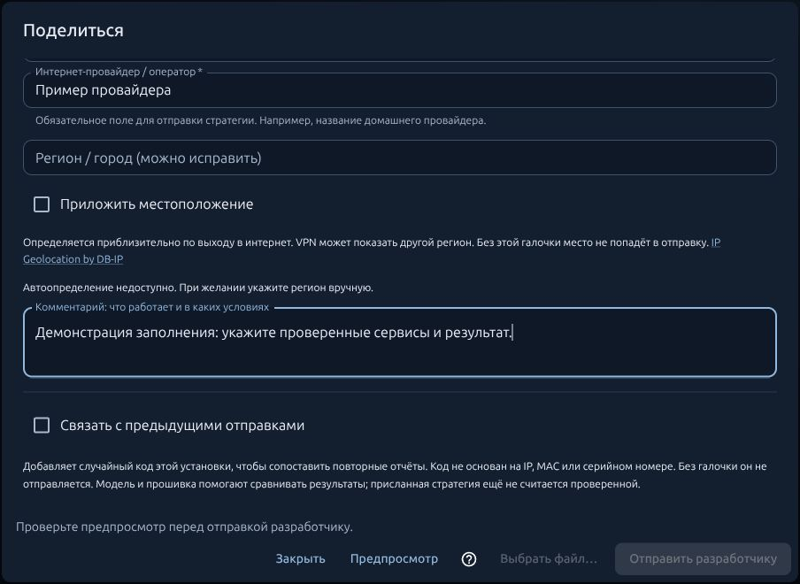](images/screenshots/profile-sharing-ru.jpg)

### MTProto для Telegram — без Docker

Внизу панели нажмите «MTProto для Telegram», затем «Без Docker» и выберите устройство. Панель автоматически подставляет локальный адрес ASUS, оставляет его редактируемым и генерирует dd-secret, команду установки и ссылку. Установка выполняется на выбранном устройстве; NFQWS2 не заменяется. Локальная ссылка доступна дома; для доступа извне нужен отдельно настроенный маршрут к прокси.

Показать снимок

[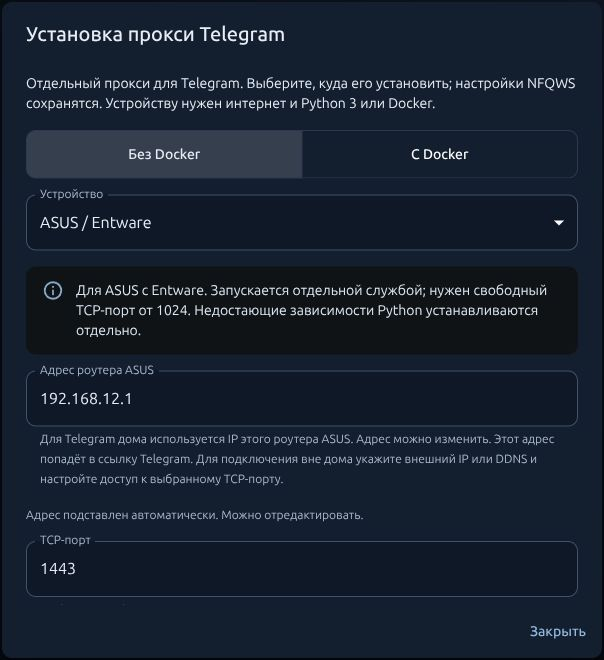](images/screenshots/mtproto-entware-ru.jpg)

[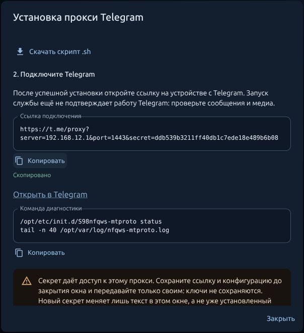](images/screenshots/mtproto-link-ru.jpg)

### MTProto — Docker и Portainer

«С Docker»: выберите Portainer для compose.yaml или терминал для команды. В ссылке используется адрес Docker-хоста, его можно исправить. Сохраните конфигурацию и ссылку до закрытия окна: новый секрет в панели не меняет уже установленный прокси. Установщик не открывает порты межсетевого экрана.

Показать снимок

[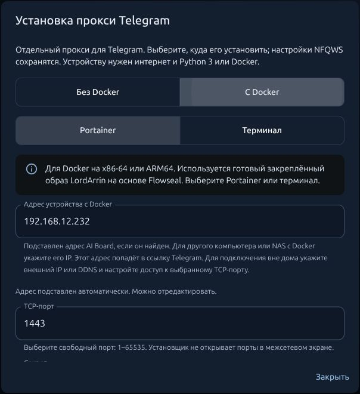](images/screenshots/mtproto-docker-ru.jpg)

### Временный технический канал

Кнопка внизу панели открывает поле ссылки от администратора. Подключайте по предварительной договорённости: во время сеанса администратор может выполнять команды на роутере. Канал ограничен сроком, отключается вручную и не запускается после перезагрузки.

Показать снимок

[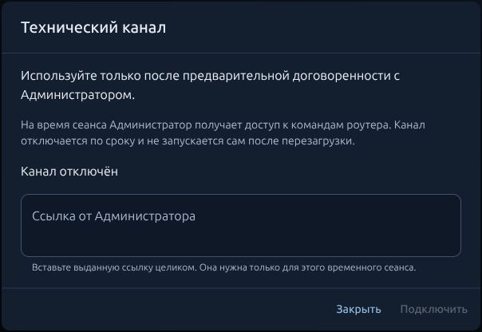](images/screenshots/technical-channel-ru.jpg)

### Обновление из панели

Кнопка проверки обновлений сверху показывает установленную и доступную сборки, а также изменения между ними. Подготовка скачивает и проверяет пакет; установка запоминает состояние служб, останавливает их на время замены и возвращает прежнее состояние. При ошибке выполняется восстановление. Выключенная до обновления служба не должна включаться сама.

Показать снимок

[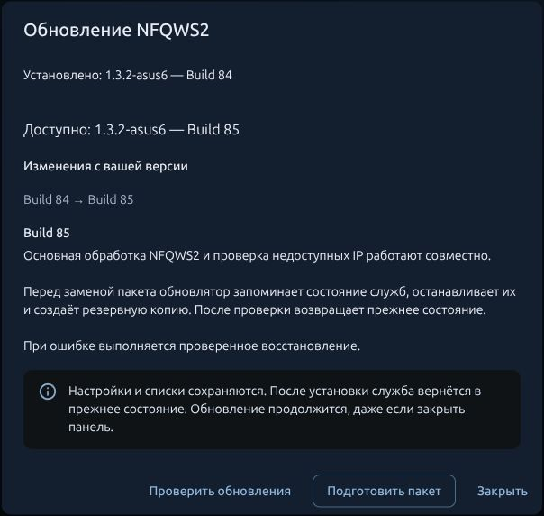](images/screenshots/updates-ru.jpg)

[На главную](README.md#внутри-панели).
