# DPI Detector: real results before and after tuning

[Русский](DETECTOR-COMPARISON.md)

Detector separates DNS, connections, TLS and data transfer. These are large screenshots of the live panel terminal from two new runs on November 5, 2026. Results and errors are unchanged. Click an image for its full **2276 × 2562** resolution.

This is one personal DOM.RU connection in the Tula region. It demonstrates a testing method, not a profile recommendation for other providers or regions.

## How a strategy affects traffic and what Detector shows

A strategy defines NFQWS2 packet-processing rules: which traffic to process, how to split it, and which techniques to apply to a connection. A suitable combination may help pass a particular provider's filtering; an unsuitable one can leave connections unavailable or make them worse.

Detector sends test requests and reports each stage: plain and encrypted DNS availability, signs of resolver or answer substitution, HTTP, TLS, QUIC, and interrupted data transfer after connecting. Repeating the tests after import helps compare strategies; TXT retains details for investigation. Checking the actual service complements these measurements.

The example changes the strategy on the same connection and repeats the same tests. Read specific rows as well as the total: some `TLS DROP` and read interruptions become `OK`, while other failures remain.

## Before: package default strategy

ASUS GT-BE19000AI; started **20:34:41 UTC**, completed **20:35:40 UTC**. NFQWS2 enabled, configuration `f516be08…`.

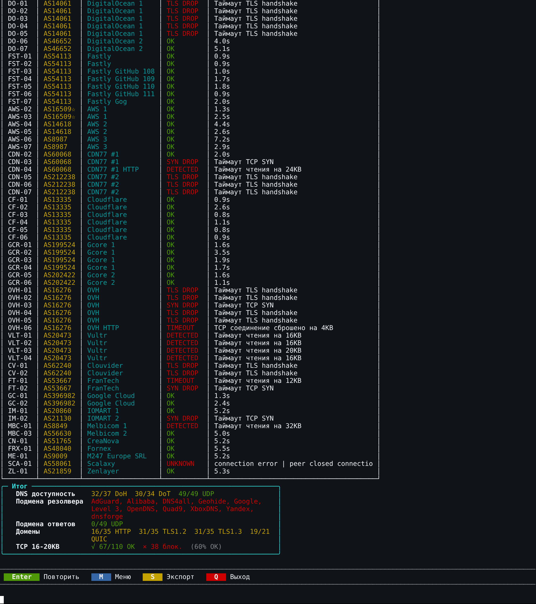

## After: personal tuned strategy

The same ASUS; started **20:36:53 UTC**, completed **20:37:40 UTC**. NFQWS2 enabled, configuration `9964bf6a…`.

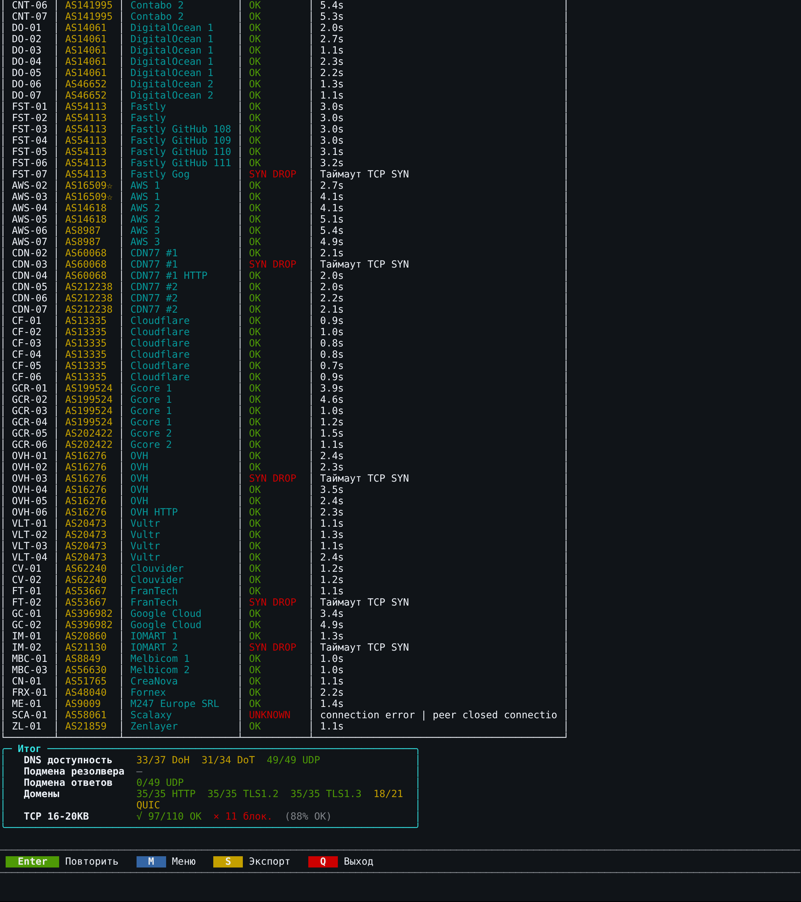

## What changed and how to investigate

TCP results improved from **67/110 to 97/110**, HTTP from **16/35 to 35/35**, and both TLS 1.2 and TLS 1.3 from **31/35 to 35/35**. DigitalOcean 1 rows changed from `TLS DROP` to `OK`; Vultr rows changed from read interruptions around 16–20 KiB to `OK`. A successful connection or TLS handshake alone does not establish complete data transfer.

The personal strategy was tuned for this connection; the default did not produce the same results here. This explains why testing an imported profile matters, without proving the exact cause of every network failure. `SYN DROP` indicates an incomplete TCP connection, `TLS DROP` an incomplete TLS handshake, and `DETECTED` a characteristic read interruption. One timeout does not prove IP blocking.

Failures remain: Detector marked **11 blocked checks**, with another indeterminate result. QUIC changed from **19/21 to 18/21**. DNS: DoH **32/37 → 33/37**, DoT **30/34 → 31/34**, UDP **49/49** in both runs. The default run's resolver-substitution flag needs separate investigation; its absence after tuning does not prove the absence of every DNS leak.

This repeated an earlier pair with TCP results of 62/110 and 98/110. Variation is a reason to repeat comparisons: targets, their DNS addresses and network state can change. The OK percentage is neither the share of all Internet sites that work nor an Internet speed measurement.

**97/110 belongs to the personal configuration. The public DOM.RU v4 candidate omits diagnostic IP branches and a separate tracker-website block. These screenshots do not establish the same result for the public profile.**

## Conditions in both runs

DPI Detector **v5.0.0-alpha.21**, zapret2 **1.0.7** with fastpath; tests **1, 2, 3**, IPv4, concurrency **50**, fingerprint **RUSTLS (default)**. Menu timeout **8 seconds**; Detector's own DNS test prints **10 seconds**. No additional bypass was used. Only the NFQWS2 strategy changed; the DNS profile was retained. Detector's DNS test queries its own server list rather than simply testing the configured resolver. Screenshots retain the native Russian interface.

## Full results for all three tests

Default strategy: parameters, DNS, sites and all TCP rows — open 6 large screens

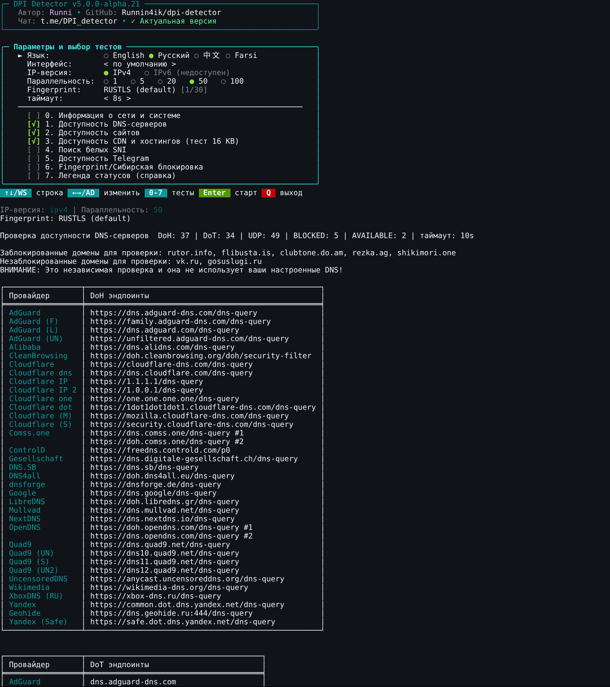

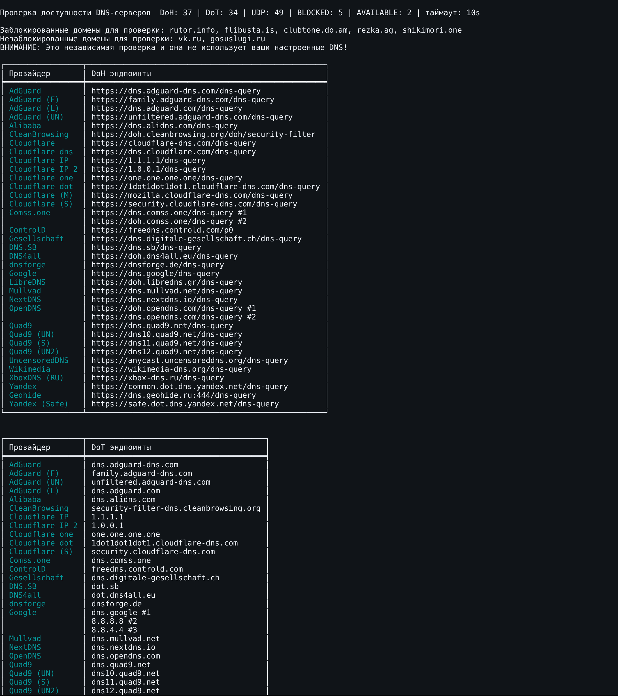

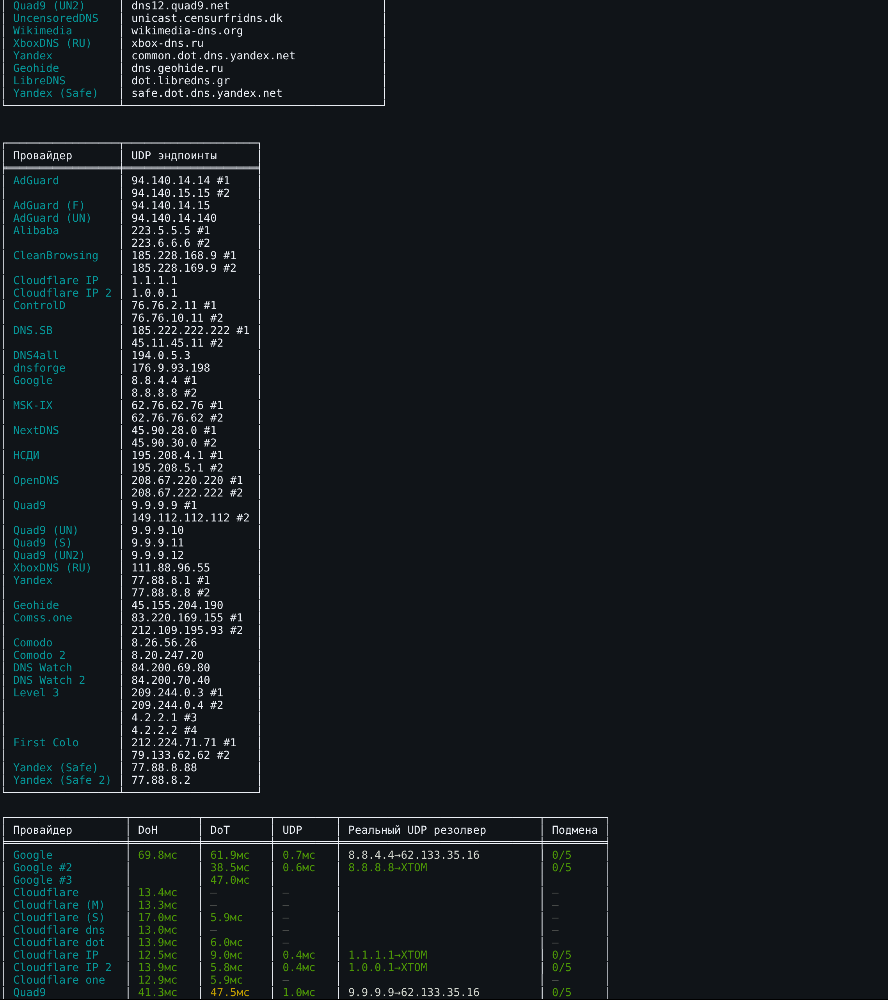

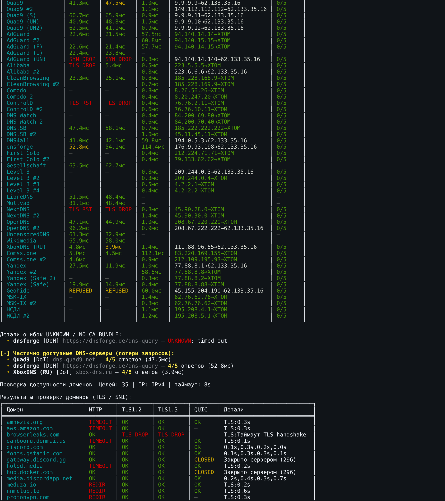

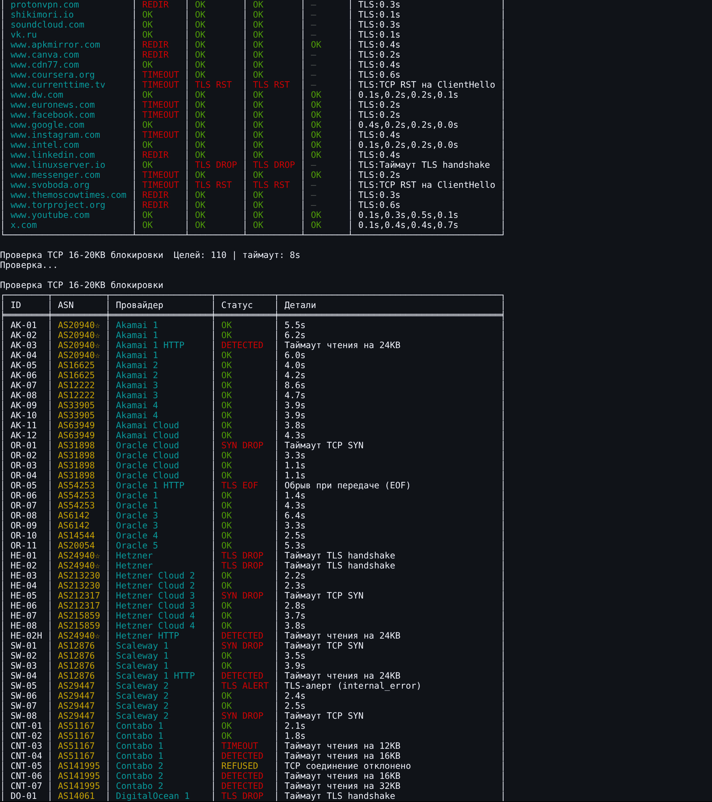

Personal strategy: parameters, DNS, sites and all TCP rows — open 6 large screens

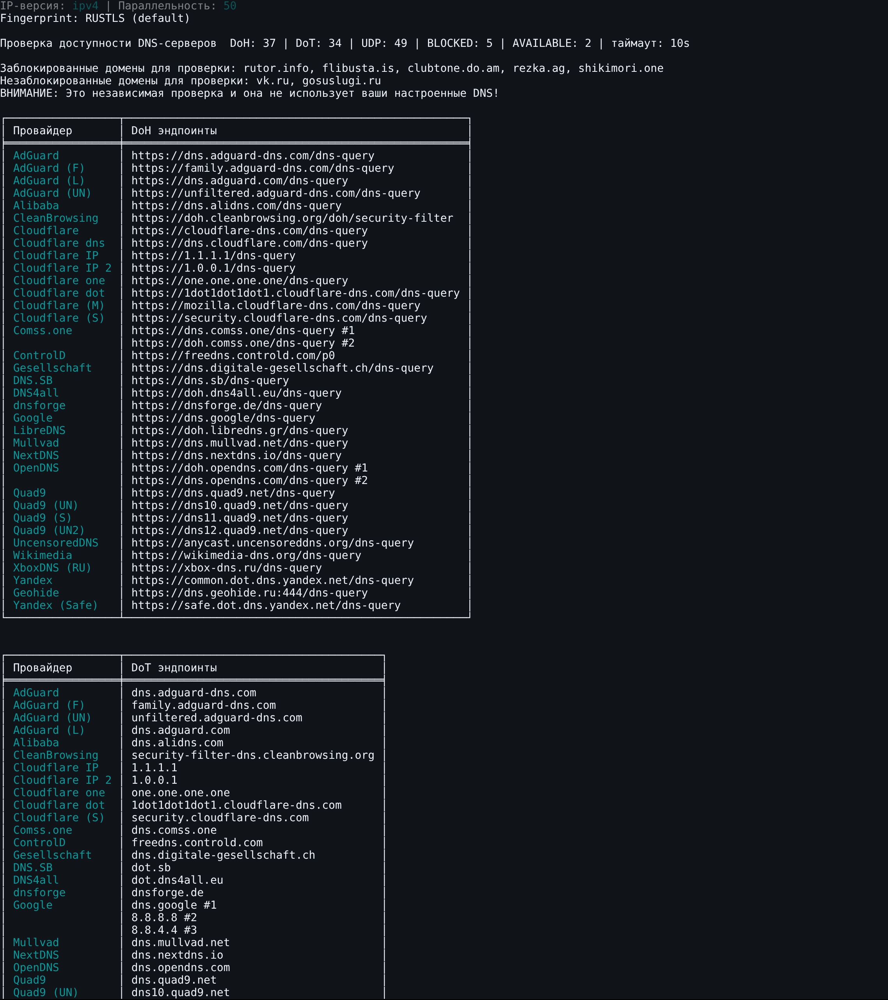

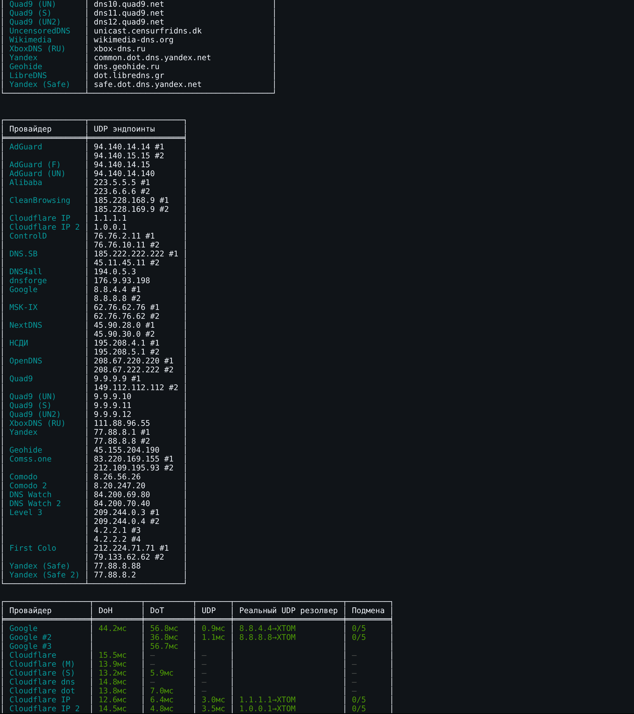

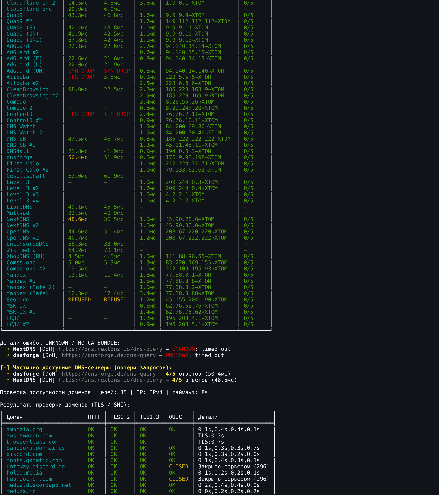

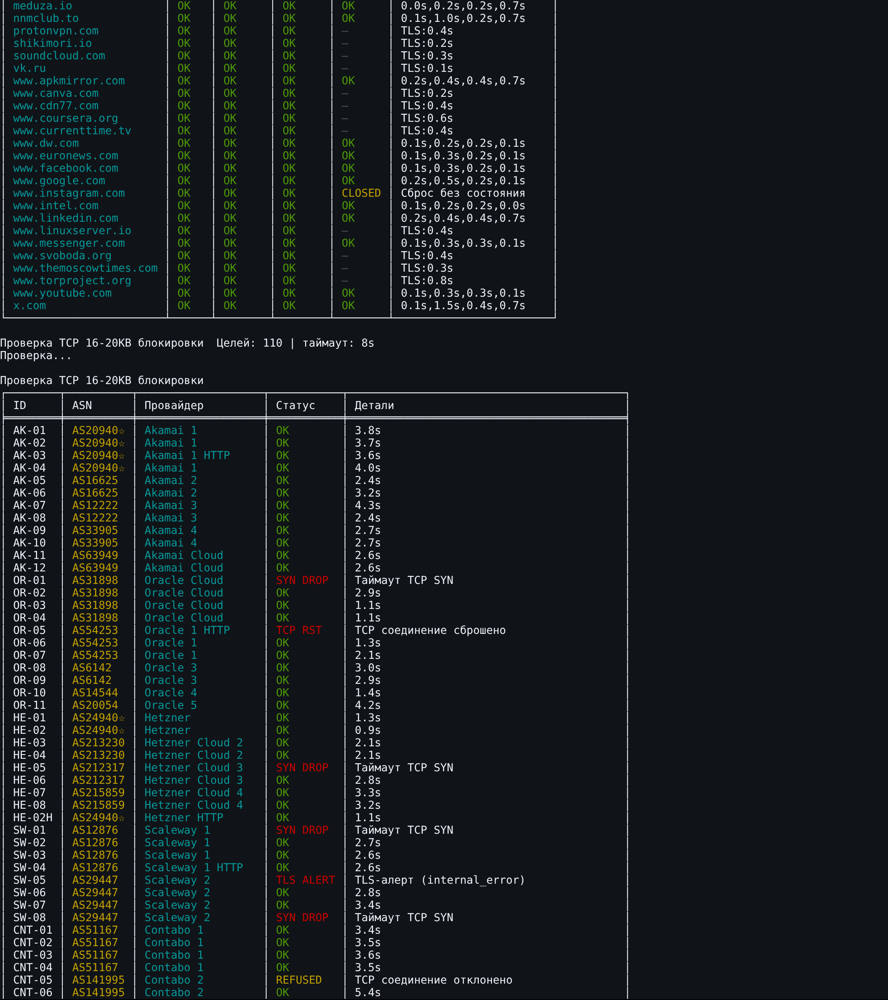

## Test your own import

1. Run tests 1–3, press **S** in the results menu, and save TXT before changing the strategy. Note the profile and date.
2. In **Import profile**, choose a suitable signed cloud profile, your JSON or **Paste Keenetic strategy**. Review blocks, lists, blobs and dependencies in the preview. DNS is selected separately. [Import guide](../IMPORT.en.md).
3. Save and restart NFQWS2. Repeat the same tests with the same parameters. Avoid changing DNS, VPN and test selections together.
4. Compare specific rows, then test the service you need: page loading, video startup and seeking, messages or voice. Repeat both strategies if results vary. If worse, undo the last import or restore your saved profile.

Closing Detector stops its current tests. After pressing **S**, refresh **Saved reports** in the Detector window to download TXT to your PC or phone. **Export / share** also supports sending through the preview. Detector does not apply or automatically select a strategy. [Controls, help and reports](../DPI-DETECTOR.en.md).
