# DPI Detector: реальные результаты до и после настройки

[English](DETECTOR-COMPARISON.en.md)

Detector показывает, где именно не проходит проверка: DNS, соединение, TLS или передача данных. Ниже — крупные скриншоты живого окна панели после двух новых прогонов 5 ноября 2026 года. Цифры и ошибки на экранах сохранены без изменения. Нажмите на изображение, чтобы открыть полный размер **2276 × 2562**.

Это личный пример одной линии DOM.RU в Тульской области. Он показывает способ проверки, а не рекомендует всем выбирать профиль DOM.RU: условия у других операторов, регионов и даже соседних абонентов могут отличаться.

## Как влияет стратегия и что показывает Detector

Стратегия задаёт правила обработки пакетов NFQWS2: какой трафик обрабатывать, как разбивать его и какие приёмы применять к соединению. Подходящий набор может помочь пройти фильтрацию конкретного оператора; неподходящий оставляет часть соединений неработающими или ухудшает их.

Detector отправляет тестовые запросы и показывает результат по этапам. Можно увидеть доступность обычного и зашифрованного DNS, признаки подмены резолвера и ответов, работу HTTP, TLS и QUIC, а также обрывы передачи после подключения. Повторный прогон после импорта помогает сравнить стратегии; TXT сохраняет подробности для разбора. Проверка нужного сервиса дополняет эти измерения.

В примере ниже на одной и той же линии изменили стратегию и повторили одинаковые тесты. Смотрите не только общий процент: на конкретных строках видно, где `TLS DROP` и обрывы чтения сменились на `OK`, а где ошибки сохранились.

## До: штатная стратегия пакета

ASUS GT-BE19000AI; начало **23:34:41 МСК**, итог **23:35:40 МСК**. NFQWS2 включён, конфигурация `f516be08…`.

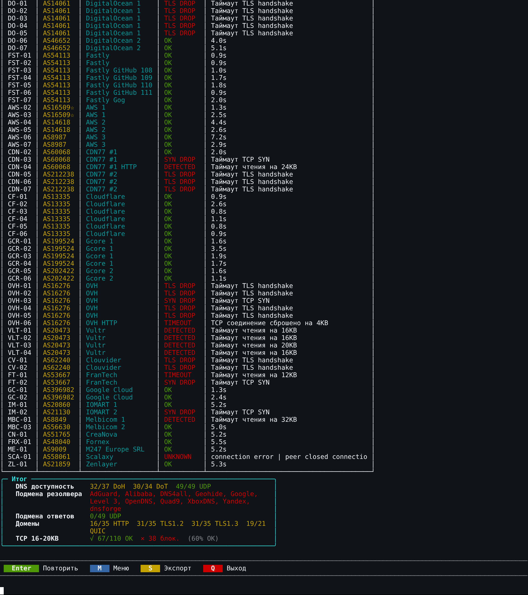

## После: личная настроенная стратегия

Тот же ASUS; начало **23:36:53 МСК**, итог **23:37:40 МСК**. NFQWS2 включён, конфигурация `9964bf6a…`.

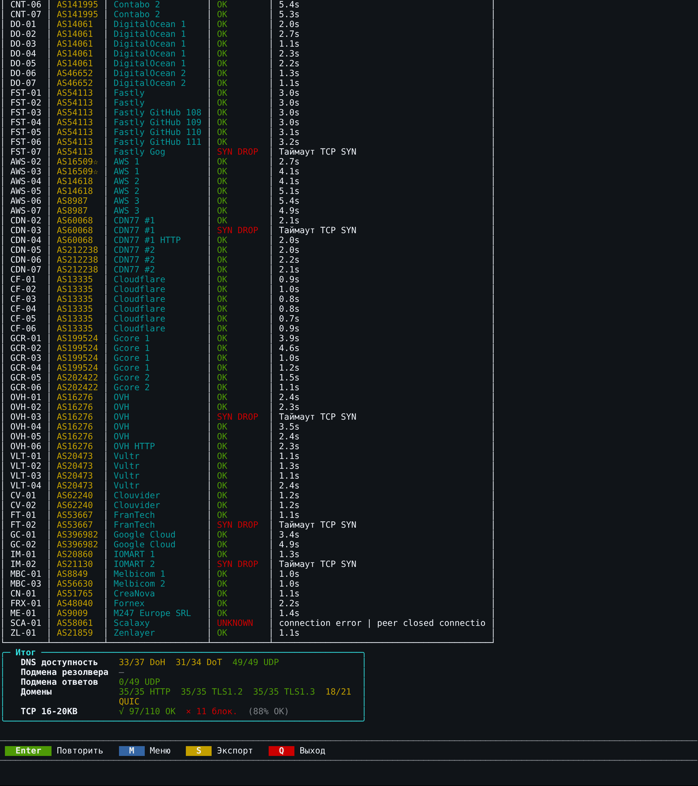

## Что изменилось и как искать причину

В этой паре TCP-проверки улучшились с **67/110 до 97/110**, HTTP — с **16/35 до 35/35**, TLS 1.2 и TLS 1.3 — с **31/35 до 35/35**. На строках DigitalOcean 1 вместо `TLS DROP` виден `OK`; на Vultr вместо обрыва чтения около 16–20 КиБ — `OK`. Поэтому одного успешного подключения или TLS-рукопожатия недостаточно: важна передача данных.

Личная стратегия подбиралась под эту линию; штатная не давала на ней такого же результата. Это объясняет пользу проверки после импорта, но не доказывает точную причину каждого сетевого сбоя. Detector показывает признаки: `SYN DROP` — не завершилось установление TCP, `TLS DROP` — не завершилось рукопожатие TLS, `DETECTED` — обнаружен характерный обрыв чтения. Один тайм-аут сам по себе не доказывает блокировку IP.

Ошибки остались: после настройки есть **11 помеченных Detector блокировок**, а также неопределённый результат. QUIC изменился с **19/21 до 18/21**. DNS: DoH **32/37 → 33/37**, DoT **30/34 → 31/34**, UDP **49/49** в обоих прогонах. Флаг о подмене резолвера в штатном прогоне требует отдельного разбора; отсутствие флага после настройки не доказывает отсутствие всех DNS-утечек.

Это повторная пара измерений. В предыдущей паре на этой же линии TCP было 62/110 и 98/110. Разброс подтверждает, что сравнение стоит повторять: цели, их DNS-адреса и состояние сети меняются. Процент OK относится к выбранным тестам, а не ко всему Интернету или его скорости.

**Результат 97/110 относится к личной конфигурации. Публичный кандидат DOM.RU v4 отличается: диагностические IP-ветви и отдельный блок сайтов торрент-трекеров в него не входят. Эти скриншоты не подтверждают такой же результат публичного профиля.**

## Условия обоих прогонов

DPI Detector **v5.0.0-alpha.21**, zapret2 **1.0.7** с fastpath, тесты **1, 2, 3**, IPv4, параллельность **50**, fingerprint **RUSTLS (default)**. В меню задан тайм-аут **8 секунд**; собственный DNS-тест Detector в выводе указывает **10 секунд**. Дополнительный обход на пути не использовался. Менялась стратегия NFQWS2; профиль DNS оставался прежним. DNS-тест Detector обращается к собственному списку серверов, а не просто проверяет настроенный пользователем резолвер.

## Полные экраны всех трёх тестов

Штатная стратегия: параметры, DNS, сайты и все строки TCP — открыть 6 крупных экранов

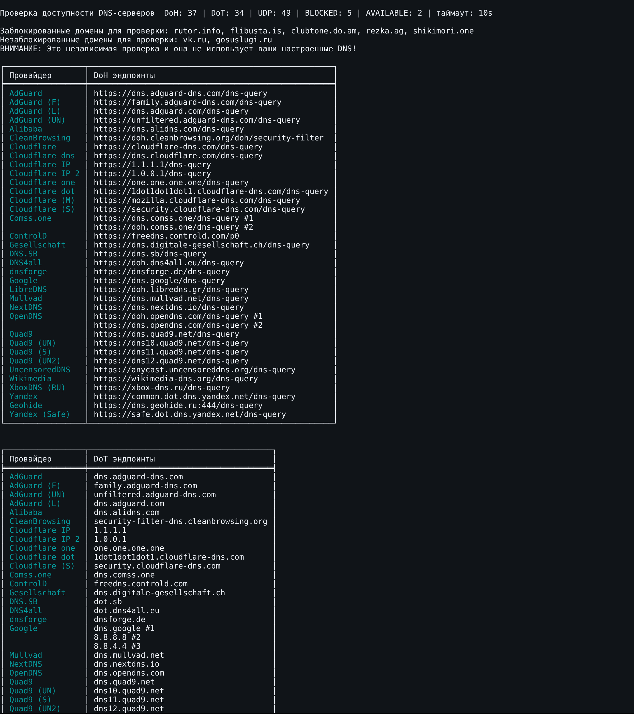

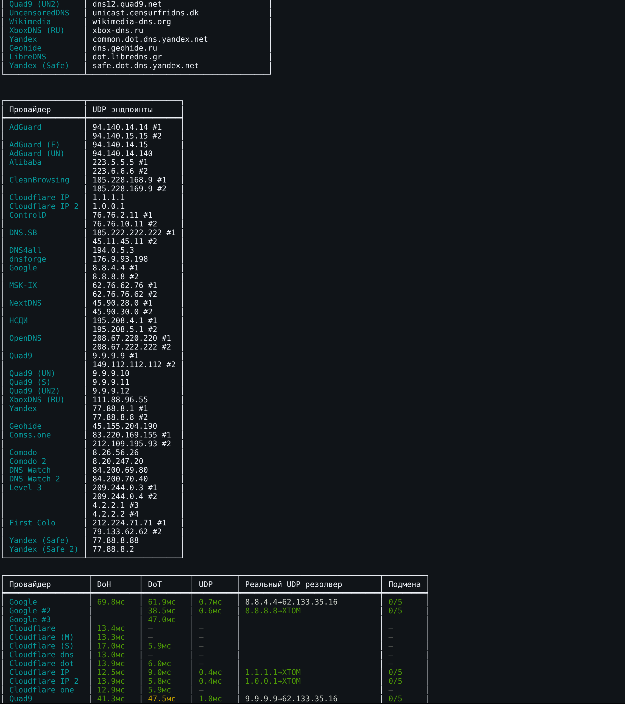

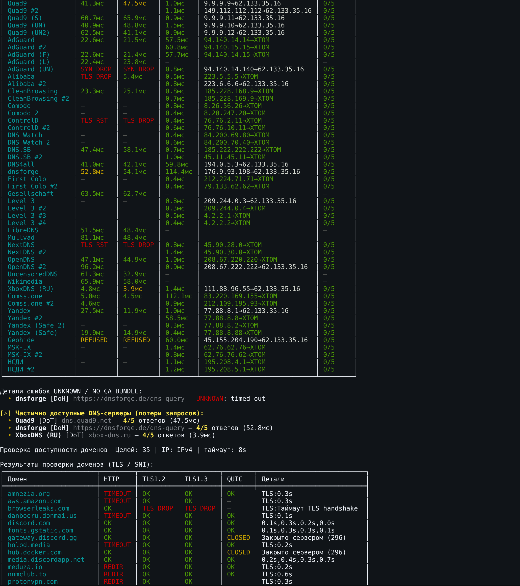

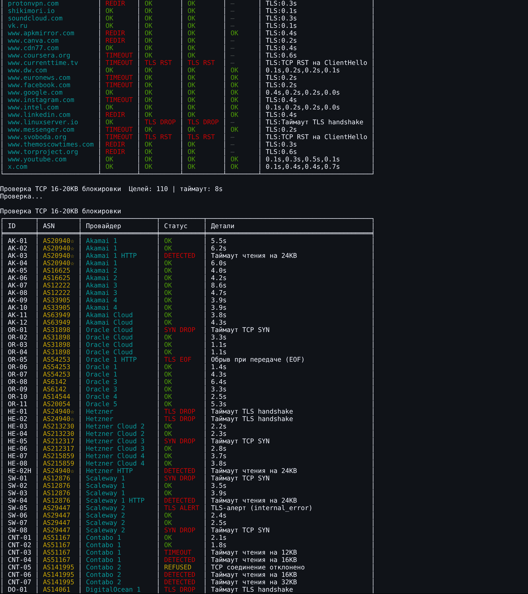

Личная стратегия: параметры, DNS, сайты и все строки TCP — открыть 6 крупных экранов

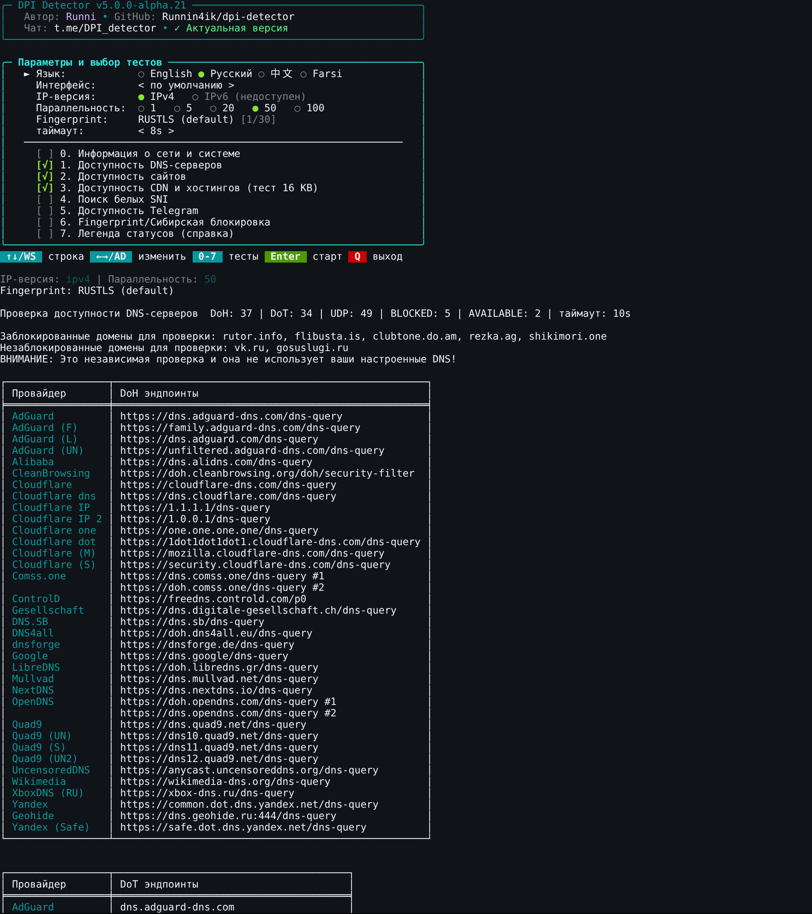

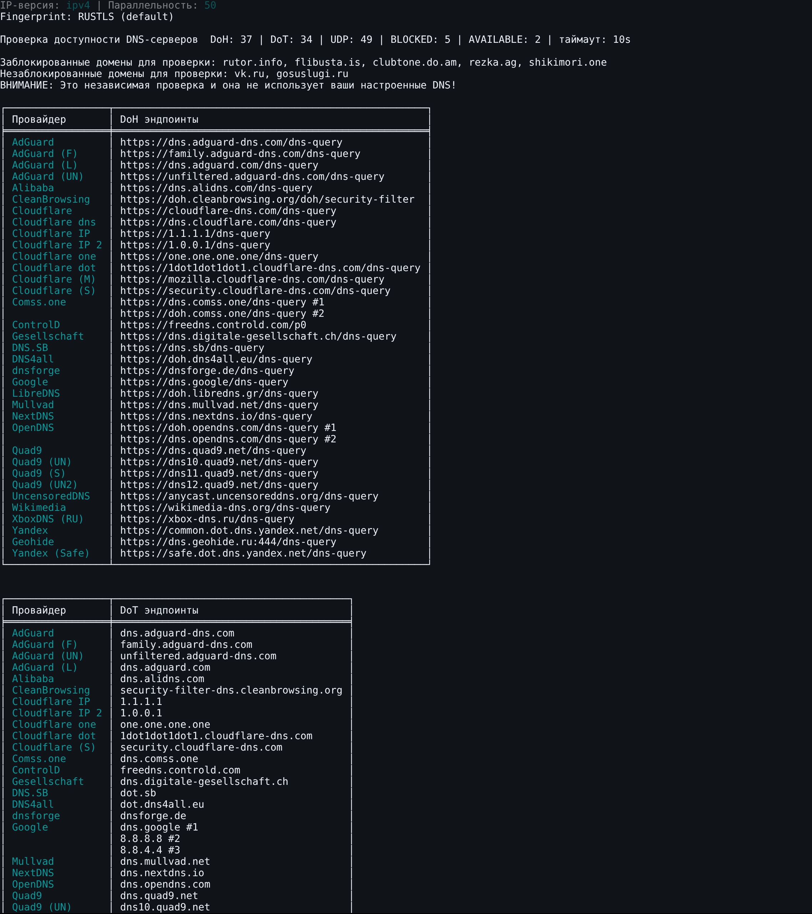

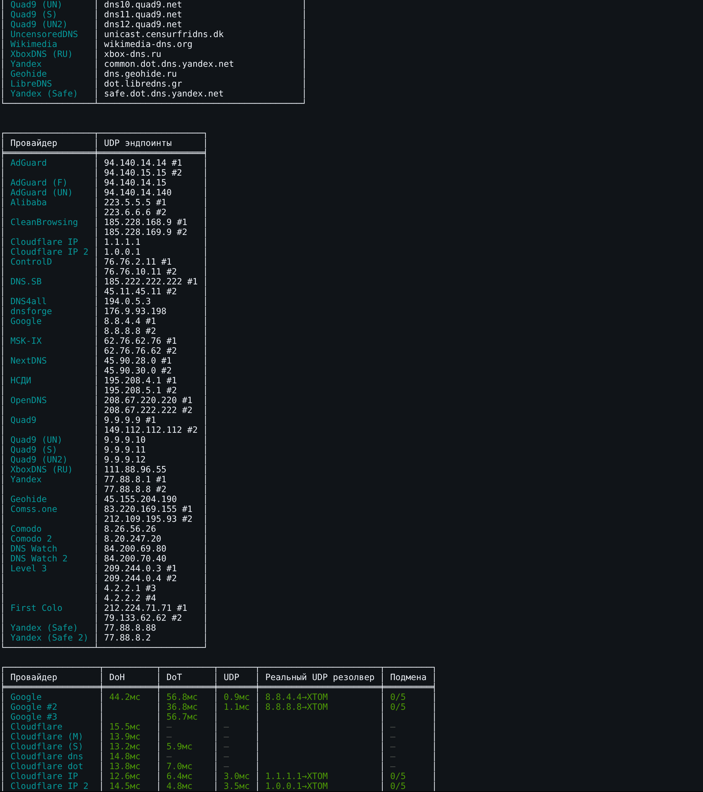

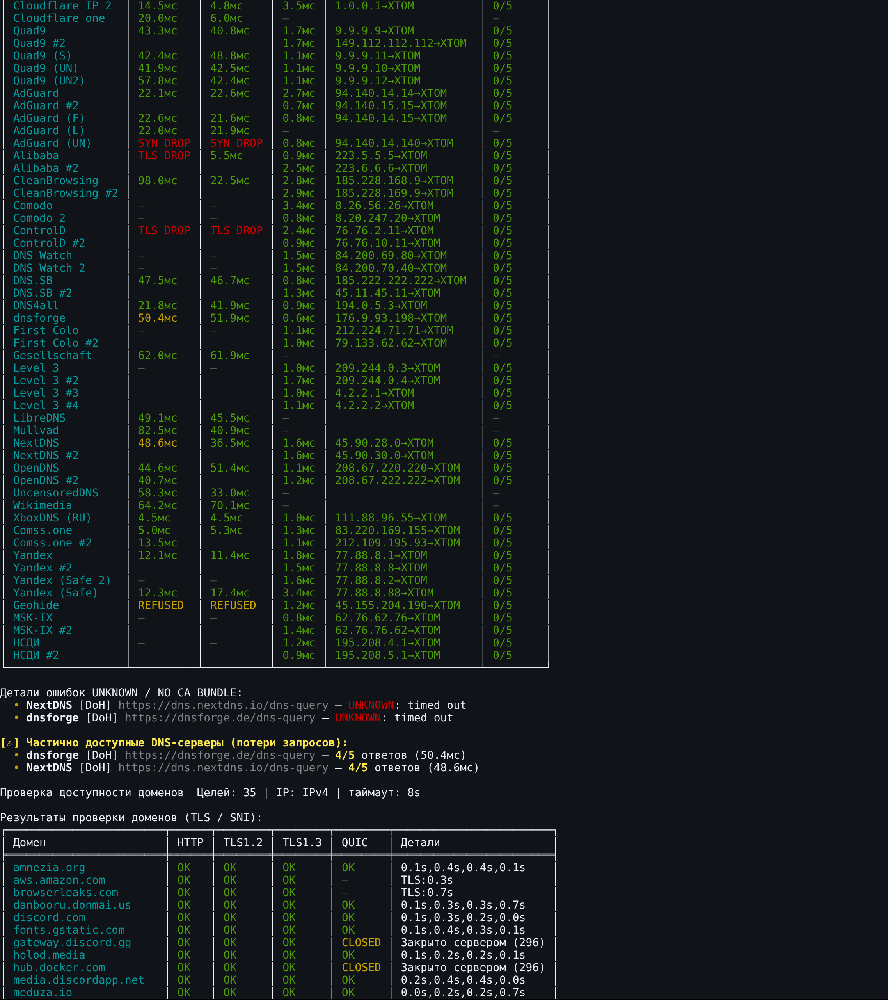

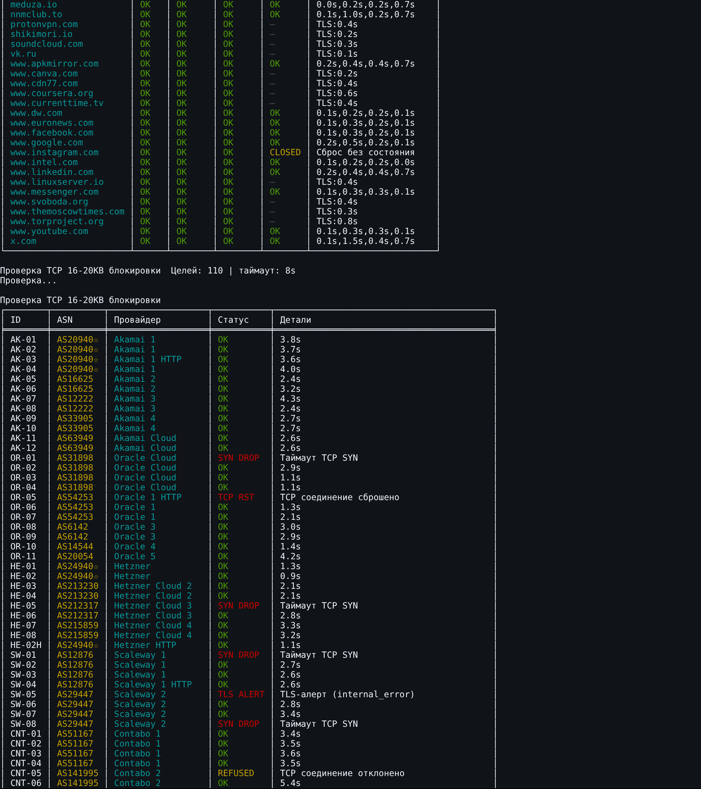

## Как проверить свой импорт

1. Запустите тесты 1–3 и нажмите **S** в меню результатов. Сохраните TXT до изменения стратегии, отметьте профиль и дату.
2. В **«Импорт профиля»** выберите подходящий профиль из подписанного облака, свой JSON или **«Вставить стратегию Keenetic»**. Проверьте блоки, списки, blobs и зависимости в предпросмотре. DNS выбирается отдельно. [Подробнее об импорте](../IMPORT.md).
3. Сохраните изменения и перезапустите NFQWS2. Повторите те же тесты с теми же параметрами. Не меняйте одновременно DNS, VPN и набор тестов — иначе источник разницы будет неясен.
4. Сравните конкретные строки, затем проверьте нужный сервис: страницу, запуск и перемотку видео, сообщения или голос. При переменном результате повторите прежнюю и новую стратегии. Если стало хуже, отмените последний импорт или верните сохранённый профиль.

Закрытие окна Detector останавливает текущие тесты. Сохранённый TXT можно скачать на ПК или телефон в списке **«Отчёты TXT»** окна Detector; обновите список после нажатия **S**. Для отправки через предпросмотр также доступен **«Экспорт / поделиться»**. Detector сам не применяет стратегию и не подбирает её автоматически. [Управление, справка и отчёты](../DPI-DETECTOR.md).
